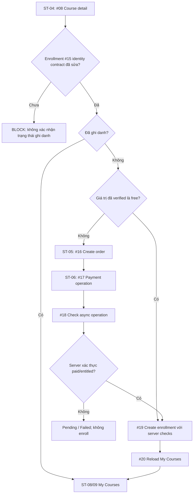

# STUDY2WORK — FULL CONTEXT DỰ ÁN CHO PORTFOLIO

> **Phiên bản lập hồ sơ:** 30/10/2026 | **Đối tượng:** người thiết kế portfolio, Codex/AI coding agent, nhà tuyển dụng (qua bản rút gọn).  
> **Phạm vi:** full context sản phẩm, business, công nghệ, kiến trúc, trải nghiệm người dùng, backend, database, tài liệu, tiến độ, giới hạn và cách diễn đạt trung thực.  
> **Nguồn ưu tiên:** GitHub `daovanhung-dev/Study2Work`, đặc biệt `develop` @ `3760541` ngày 27/10/2026; đối chiếu `main` @ `bb9e2be` ngày 27/09/2026; tài liệu `list_screen.md` đánh giá 25/10/2026; lịch sử trao đổi và `Study2Work_API99_Coding_Plan.md` ngày 26/10/2026.  
> **Quan trọng:** Đây **không** phải kết quả đọc byte-for-byte mọi file của dự án, không có quyền truy cập environment live; đã kiểm kê cây Git đầy đủ và đọc những source/docs/contract quan trọng. Không khẳng định dự án production chỉ vì repo có code, test hoặc tài liệu.

## 0. TÓM TẮT NHANH — THÔNG TIN TRỌNG TÂM

| Thuộc tính | Nội dung |
|---|---|
| Tên | **Study2Work (S2W)** |
| Loại hình | **EdTech + HRTech**, sản phẩm học tập gắn với định hướng nghề nghiệp |
| Bài toán | Kết nối quá trình học, nâng cao năng lực, tạo hồ sơ nghề nghiệp, tìm việc và tuyển dụng |
| Đối tượng | Guest, Student, Mentor, Admin; phía Work có Student/Candidate và Business/Recruiter; vai trò Platform/University trong target architecture |
| Nền tảng | Study Web; Work Web; Work Mobile Student & Business; APIs; AI service; database administration |
| Kiến trúc | Monorepo đa ngôn ngữ, có hai domain Study/Work và nhiều deployable độc lập, shared contracts |
| Repository | https://github.com/daovanhung-dev/Study2Work |
| Người cung cấp hồ sơ | Đào Văn Hùng; Full-stack Developer / System Designer; tham gia API design, backend, database, tài liệu và UI planning — **phạm vi đóng góp riêng cần xác nhận theo commit/task** |
| Giai đoạn | Đang phát triển và hoàn thiện; không có bằng chứng production end-to-end trên các nguồn đã đọc |
| Bản nhánh `main` | 1.844 Git tree entries, **1.333 file**, commit 27/09/2026; phản ánh snapshot cũ hơn |
| Bản nhánh `develop` | 3.497 Git tree entries, **2.797 file**, commit 27/10/2026; tài liệu và backend Study nhiều hơn đáng kể |
| Study AC/UC | **30** use case/activity: Guest 6, Student 10, Mentor 6, Admin 8 |
| Study API thiết kế | **103 API ID**, có mapping tới 83 UI surfaces; hợp đồng thiết kế không đồng nghĩa implementation |
| Study API DD | **103/103** thư mục `docs/dd/*/00_Cover.md` trên `develop` (đã kiểm kê Git tree), trạng thái DD có thể Draft/Need confirmation |
| Study API code trên `develop` | **69 HTTP operations / 58 unique path templates** được đếm từ decorator trong `app/api/v1.py` (gồm 2 tiện ích hello, test/db); **67 annotated business operations** đại diện **66 API IDs**, trong đó API #3 có cả login và refresh |
| Study HTTP/test checkpoint | Tài liệu source-status ghi **1.315 test local đã pass** ở thời điểm API #97; **không** suy rộng sang API #98/#99 hoặc production |
| Work API | **21 runtime operations**, có 21 bộ source-backed DD, Draft Ready for Review |
| Work DB source-of-truth | Prisma PostgreSQL **12 models** của Work API legacy |
| Study DB | ERD 16 bảng / SQL legacy 18 bảng; song song bộ V1-PILOT 60 bảng, chưa xác thực live migration |
| V1-PILOT DDL | **178 bảng thiết kế** phân vào 3 database vật lý: identity 20, study 60, work 98 — **không** phải 178 bảng đang hoạt động trong runtime |
| Study UI inventory | **83 screen/task surfaces**, là tài liệu thiết kế không phải 83 màn hình đã code |
| Work Mobile DD | **45 views / 17 feature packs** (Student 19/7, Business 26/10); thiết kế source-backed, không khẳng định từng màn production |

---

## 1. ĐỊNH VỊ SẢN PHẨM / PRODUCT VISION

### 1.1. Tên và phát biểu giá trị

**Study2Work** là một hệ sinh thái EdTech–HRTech được thiết kế để gắn kết học tập và cơ hội việc làm trong cùng một hành trình phát triển nghề nghiệp, với trọng tâm ban đầu là sinh viên và người học công nghệ thông tin.

**Khái niệm cốt lõi:** `Learn → Practice → Evidence → Career Profile/CV → Jobs → Applications → Hiring Workflow`.

S2W khác một website LMS đơn thuần hoặc job board đơn thuần ở **định hướng liên kết giữa kết quả học và bằng chứng năng lực nghề nghiệp**. Hiện trạng triển khai kết nối Study→Work chưa hoàn thiện; mô tả này là **product vision/architecture target**.

### 1.2. Bài toán cần giải quyết

- Sinh viên/người mới học thiếu lộ trình, đánh giá và bằng chứng rõ ràng về năng lực.
- Nhà tuyển dụng cần dữ liệu có cấu trúc về ứng viên: kỹ năng, CV, dự án, quá trình học và mức phù hợp với vị trí.
- Người học muốn một hành trình thống nhất từ khám phá khóa học, tiến độ đến ứng tuyển.
- Hệ thống cần quản lý nhiều vai trò với ranh giới truy cập, dữ liệu và trách nhiệm khác nhau.
- Đội phát triển cần chuẩn hóa API, schema, documentation, validation, testing và đa nền tảng.

### 1.3. Tầm nhìn tích hợp Study ↔ Work (TARGET, chưa production)

1. Người dùng học và hoàn thành course/lesson/assessment ở Study.
2. Study tạo bằng chứng học tập và xác minh trạng thái với dữ liệu đủ điều kiện.
3. Người dùng đồng ý chia sẻ từng evidence, tránh mặc định mở dữ liệu học tập riêng tư.
4. Work nhận sự kiện qua signed event + idempotency, lưu `StudyEvidenceSnapshot` theo chính sách.
5. CV/career profile sử dụng evidence và skill taxonomy chung.
6. Ứng viên tìm kiếm việc làm, nộp hồ sơ; doanh nghiệp quản lý JD và ứng viên.

**Không được viết trên portfolio:** "Đã triển khai hệ thống đồng bộ xác minh kỹ năng real-time Study–Work" nếu chưa có producer/consumer, test và deploy thực tế.

### 1.4. Domain & actors

| Domain | Actors | Khả năng định hướng |
|---|---|---|
| Study | Guest | Khám phá khóa học, tìm kiếm, đăng ký/đăng nhập, đọc nội dung public |
| Study | Student | Hồ sơ, ghi danh, xem bài, nộp bài, quiz, tiến độ, thảo luận, thông báo |
| Study | Mentor | Nội dung khóa học, bài giảng, chấm bài, phản hồi, hỗ trợ, thống kê, thông báo |
| Study | Admin | Người dùng, khóa học, bài học, quiz, phê duyệt nội dung, moderation, analytics |
| Work | Student/Candidate | Đăng ký, đăng nhập, tìm job, tạo/sửa CV, nộp đơn, theo dõi ứng tuyển |
| Work | Business/Recruiter | Đăng nhập, tạo/sửa/xóa JD, nhận ứng viên, xem CV |
| Enterprise target | University/Partner/Moderator | Vai trò đề xuất cho quy trình liên kết; nhiều route chưa wired |

---

## 2. KIẾN TRÚC THỰC TẾ THEO REPOSITORY

### 2.1. Hệ thống 8 deployable

```text
                           STUDY2WORK MONOREPO
┌───────────────────────────────────────────────────────────────┐
│ STUDY:  Web Vue (design/source tùy branch) → API FastAPI       │
│             ↳ PostgreSQL/Neon + local DB schema candidates    │
│ WORK:   Web React → API Express + Prisma → PostgreSQL/Neon    │
│             Mobile Flutter Student/Business (2 flavors)      │
│             ↳ direct Neon + SQLite + Gemini HTTP [prototype] │
│ AI:     FastAPI → Ollama HTTP (route chat tối thiểu)           │
│ ADMIN:  Angular Web → FastAPI DB Admin → named DB targets      │
│ CONTRACTS: API guidelines, Work OpenAPI, Study→Work events    │
│ INFRA:  DDL, migrations, Docker/Compose design/local tooling  │
└───────────────────────────────────────────────────────────────┘
```

| Deployable | Repo path | Stack | Source-backed status |
|---|---|---|---|
| Study Web | `apps/study-client/` | Vue 3/TS/Vite (main), Ocean light UI target (develop) | `main` có frontend shell; `develop` kiểm kê hiện chỉ có `docs/dd_screens/list_screen.md`, chưa có frontend runtime tương đương |
| Study API | `apps/study-server/` | Python 3.12+, FastAPI, Pydantic, SQLAlchemy/psycopg | Auth, course, mentor, admin và nhiều route source-backed trên `develop` |
| Work Web | `apps/work-client/web/` | React 19, TS, Vite, React Query, Zustand, Zod | Public/student/business page shells, API client relative `/api/v1`, role guards; một số page placeholder |
| Work API | `apps/work-server/` | Express 4, TS, Prisma, JWT Bearer | 21 runtime operations; source-backed domain Student, Business, Jobs, CV, Applications |
| Work Mobile | `apps/work-client/mobile/` | Flutter, Dart, Riverpod, GoRouter, postgres, SQLite, http | Một package Flutter, hai Android flavors; trực tiếp Neon/Gemini là prototype boundary |
| AI API | `apps/ai-server/` | FastAPI, httpx, Ollama | `POST /api/v1/chat_log_ai` tối thiểu; không chứng minh RAG/worker/chat realtime |
| DB Admin Web | `apps/db-admin-web/` | Angular, Material, CodeMirror | Local database administration UI |
| DB Admin API | `apps/db-admin-server/` | FastAPI, SQLAlchemy, psycopg3, JWT/Argon2id | Local-only control plane, catalog/SQL/access/audit có source |

### 2.2. Data boundaries: CURRENT vs TARGET

- **CURRENT:** Study API sử dụng PostgreSQL/Neon qua SQLAlchemy; Work API dùng Prisma/PostgreSQL; Work Web chỉ gọi Work HTTP API; Flutter Work gọi Neon/Gemini trực tiếp và SQLite local; AI server gọi Ollama; DB Admin quản trị DB qua backend riêng.
- **TARGET:** IdP/Platform Identity chung; Study–Work tích hợp qua REST versioned và signed events; consent-aware evidence; local snapshot; tenant isolation, outbox/idempotency; chuyển direct DB/AI từ mobile sang backend least privilege.
- **Không nhầm:** Tài liệu kiến trúc 05/07/2026 đề xuất NestJS/Fastify cho Work và workflow Identity riêng, trong khi mã nguồn Work API đã xác nhận là Express/Prisma. Đây là sự khác biệt thiết kế và implementation, không phải lỗi khi mô tả có trạng thái.
- **Không nhầm:** File bootstrap `infra/postgres` có 3 database `identity_db`, `study_db`, `work_db`; mô tả cũ một DB `s2w` 3 schema là lịch sử/phương án trước. Không viết hai phương án thành một hạ tầng production duy nhất.

### 2.3. Repo ownership & structure

```text
Study2Work/
  AGENTS.md, .agents/                  # AI/context registry, worklogs, conventions
  apps/
    study-client/                       # Study frontend docs; main có Vue shell
    study-server/                       # Study API, modules, DD 103 APIs, tests
    work-client/web/                    # React candidate/recruiter web
    work-client/mobile/                 # Flutter student/business flavors & DD
    work-server/                        # Express/Prisma Work API & 21 API DD
    ai-server/                          # minimal Ollama-backed FastAPI
    db-admin-web/                       # Angular local admin
    db-admin-server/                    # FastAPI DB admin control plane
  contracts/                            # OpenAPI, event JSON schemas, skill taxonomy
  infra/postgres/                       # 178-table pilot DDL + legacy Study/Work DDL
  docs/                                 # lists, diagrams, meeting notes, tutorials
  scripts/                              # context/docs/contract validation
  tests/                                # smoke tests
```

### 2.4. Local addresses — chỉ dev reference, không phải URL production

| Component | Local |
|---|---|
| AI API | `127.0.0.1:3000` |
| DB Admin API | `127.0.0.1:3001` |
| Work API | `127.0.0.1:3002` |
| Study API | `127.0.0.1:3003` |
| DB Admin Web | `127.0.0.2:3000` |
| Work Web | `127.0.0.2:3001` |
| Study Web | `127.0.0.2:3002` (historical/main workflow) |

**Không được đưa những local addresses này thành live demo links.**

---

## 3. STUDY API — FULL CONTEXT CHỨC NĂNG VÀ HIỆN TRẠNG

### 3.1. Kiến trúc backend Study

```text
app/main.py (composition root)
  -> app/api/v1.py (versioned routes / request bindings)
  -> app/modules/{guest,student,mentor,admin}/api_XX_.../
       models.py    : Pydantic request/response contracts
       validate.py  : domain input rules khi cần
       view.py      : use-case / DB transaction / coordination
       query.py     : parameterized SQL
  -> app/core/ (database, security, responses, trace, middleware)
  -> app/service/ (email, object storage, Ollama adapter)
  -> PostgreSQL via SQLAlchemy
```

- Thiết kế theo từng feature/API, chia rõ router/controller, contract, validation, use-case và data access.
- Truy vấn SQL parameterized, transaction do use-case sở hữu, có kiểm soát errors/traceID.
- Password mới dùng Argon2id; bcrypt legacy verification; refresh token opaque/hash và rotation; các quy tắc authorization theo role tại backend.
- Cấu hình source đang ưu tiên constants; không coi `.env.example` là cách runtime tự đọc secret.
- Một số policy/kết quả response là `DERIVED` (được suy ra từ nguồn cho thiếu hụt DD) và cần review trước khi công khai là nghiệp vụ hoàn thiện.

### 3.2. Số liệu source-verified trên `develop` ngày 27/10

- Cây `apps/study-server/app/api/v1.py` khai báo **69 HTTP operations**, **58 đường dẫn độc nhất** tính cả `/hello` và `/test/db`.
- **67 annotated operations** tương ứng **66 design API IDs** (API #03 có hai operation login/refresh). Không cộng 2 tiện ích này vào 103 API design.
- Các design API ID có route: `#01–#09`, `#12–#14`, `#34`, `#46–#98` (tổng 66 design IDs).
- Các ID chưa thấy route trong source vừa kiểm: `#10–#11`, `#15–#33`, `#35–#45`, `#99–#103` (không có quyền tuyên bố deploy).
- API #02 verify-email vẫn dùng **stub provider** theo context; response accepted không chứng minh email được gửi.
- API #98 `GET /api/v1/admin/discussions/{discussion_id}` **có decorator/source trên develop**; worklog còn ghi `PLANNED` và không có bằng chứng test #98 pass. Ghi `SOURCE_BACKED / TEST_STATUS_NOT_CONFIRMED`.
- API #99 `PATCH /api/v1/admin/discussions/{discussion_id}/moderate` có DD và coding plan 26/10 nhưng **không xuất hiện ở route source của `develop` tại commit kiểm tra**. Ghi `PLANNED / NOT_WIRED_IN_VERIFIED_COMMIT`, có thể có bản ZIP hoặc local chưa push.
- Báo cáo 1.315 tests passed là checkpoint khi API #97 đã hoàn thiện, **không** là số test của toàn bộ hệ thống 8 deployable.

### 3.3. API source-backed chia domain

| Nhóm | API IDs | Phạm vi nghiệp vụ source-backed |
|---|---|---|
| Guest/Auth/Discovery | #01–#09, #12 | Đăng ký, đăng nhập, refresh, verify-email stub, profile public, categories, courses, search, detail, curriculum, resource detail |
| Student | #13, #14, #34 | Avatar upload, cập nhật profile, upload asset/metadata; một số tích hợp storage cần xác minh external |
| Mentor | #46–#67 | Course ownership/list, lecture/content, publish/delete, submissions grading/feedback, learner support, roster, notifications, progress, analytics |
| Admin user | #68–#72 | List/detail/update/status/delete user |
| Admin course | #73–#77 | List/detail/update/status/delete course |
| Admin content | #78–#81 | Pending/detail/approve/reject |
| Admin lesson | #82–#86 | List/detail/update/status/delete |
| Admin quiz | #87–#91 | List/create/update/delete/statistics |
| Admin notification | #92–#96 | List/create/update/delete/status |
| Admin discussion | #97–#98 | Reported queue, discussion detail; #99 moderation, #100 delete chưa wired |
| Admin reporting | #101–#103 | Summary, community impact, export ở mức DD/contract, chưa thấy source route |

### 3.4. Các luồng kỹ thuật đáng đưa vào case study

1. **Auth:** `register → password hash → login → JWT access + opaque refresh hash → rotation/revoke → /users/me`.
2. **Catalog:** `categories → published courses → keyword search → course detail → curriculum` kèm sorting, paging, safe error mapping.
3. **Content governance:** Mentor quản lý lecture/content; Admin duyệt content và đổi trạng thái với guard và audit candidates.
4. **Assessment:** Mentor review/submission/feedback và Admin quản lý quiz theo DD + source route.
5. **Async notification:** tạo notification/outbox `QUEUED` và lấy status; **không tuyên bố giao gửi Push/Email thật** nếu chưa có workers/provider.
6. **Community moderation:** queue báo cáo và xem discussion; moderation #99 ở kế hoạch, có yêu cầu atomic state + audit.
7. **Operational quality:** deterministic envelope `success, businessCode, message, data, meta, traceId`, exception mapping, input validation, RBAC, SQL boundaries, HTTP tests.

### 3.5. Những chỗ chưa được chứng minh

- Live Neon DB đã apply đủ schema/migrations; integration DB thật; đường dẫn build/deploy production.
- Nhiều external side effects: email delivery, storage signing, worker notification, payments, export job.
- Feature UI nào đã hoạt động thực tế trên Study Web tại `develop` (không có source `src` ở `develop` checked branch).
- OpenAPI đầy đủ ngoài contract repo; API design vẫn có vài mapping/enum/open questions.
- Tỷ lệ test coverage và uptime; **không bịa KPI người dùng hay doanh thu**.

---

## 4. WORK — HRTECH WEB/API/MOBILE

### 4.1. Web application

- Work Web: React 19 + TypeScript + Vite, React Router 7, React Query, Zustand và Zod.
- Bố cục guest/public, student workspace, business workspace; role guard; app shell; trạng thái loading/empty/error.
- Route public: home, chọn vai trò, đăng nhập Student/Business, đăng ký Student; Business registration UI có thể hiển thị nhưng API nghiệp vụ chưa wired.
- Student pages có dữ liệu thực qua HTTP: danh sách/chi tiết jobs, CV editor, applications, apply flow; các page khác có thể placeholder hoặc local-only.
- Business pages có HTTP: dashboard, JD list/create/update/delete, ứng viên/applications, CV detail; các trang chat/interview/setting/notifications/... không mặc định remote functional.
- Browser API client gửi `Authorization: Bearer <token>` đến **relative `/api/v1`**, kiểm soát envelope/401 và tránh đưa DB credential vào browser.

### 4.2. Work API 21 runtime operations (sơ đồ nguồn)

| STT | Method | Endpoint | Chức năng |
|---:|---|---|---|
| 1 | GET | `/api/v1` | Work root |
| 2 | GET | `/health/live` | Health liveness |
| 3 | GET | `/health/ready` | Probe Prisma dependency |
| 4 | POST | `/api/v1/auth/student/login` | Student login |
| 5 | POST | `/api/v1/auth/business/login` | Business login |
| 6 | POST | `/api/v1/auth/logout` | Client-token logout action (không revoke JWT server-side) |
| 7 | POST | `/api/v1/students` | Register student |
| 8 | GET | `/api/v1/me` | Current user by role |
| 9 | GET | `/api/v1/jobs` | Public job list |
| 10 | GET | `/api/v1/jobs/:id` | Public job detail |
| 11 | GET | `/api/v1/students/me/cv` | Read own CV |
| 12 | POST | `/api/v1/students/me/cv` | Create CV |
| 13 | PUT | `/api/v1/students/me/cv/:cvId` | Update CV |
| 14 | GET | `/api/v1/students/me/applications` | Own applications |
| 15 | POST | `/api/v1/jobs/:jobId/applications` | Apply job |
| 16 | GET | `/api/v1/businesses/me/applications` | Business applicant list |
| 17 | GET | `/api/v1/businesses/me/jobs` | Business JD list |
| 18 | POST | `/api/v1/businesses/me/jobs` | Create JD |
| 19 | PUT | `/api/v1/businesses/me/jobs/:jobId` | Update JD |
| 20 | DELETE | `/api/v1/businesses/me/jobs/:jobId` | Delete JD |
| 21 | GET | `/api/v1/students/:studentId/cv` | View candidate CV (Business) |

**Cơ chế:** Express route composition, middleware auth, role check, `models/validate/view/query`, Prisma database, JWT Bearer, response envelope và trace ID. `POST /auth/logout` không thu hồi token đã phát hành tại server.

### 4.3. Work database — 12 Prisma models hiện hữu

`SinhVien`, `DoanhNghiep`, `Chat`, `Cv`, `DoanChat`, `JD`, `ThongBaoDN`, `ThongBaoSV`, `TopJD`, `TopCV`, `UngVien`, `BanNganh`.

- Các liên kết chính: SinhVien–Cv, DoanhNghiep–JD, UngVien liên kết candidate/company/job; Chat/DoanChat cho hội thoại, notification và toplist legacy.
- PostgreSQL BIGINT identity, `timestamptz`, `Cv.social` JSONB; unique `(jd_id, sinhvien_id)` chống ứng tuyển trùng cùng vị trí.
- Migration Prisma của Work là bằng chứng schema versioned ở backend; không chứng minh tất cả bảng đều được dùng bởi 21 HTTP routes.
- Tên bảng/field tiếng Việt trong schema hiện tại thuộc cấu trúc legacy, nên design architecture tương lai có thể dùng tên chuẩn hóa khác.

### 4.4. Work Mobile

- Flutter/Dart một package `study2work_mobile`, **hai Android flavors**: `student` và `business` với app ID độc lập.
- State/navigation: Flutter Riverpod, GoRouter, shared Material 3/Cobalt theme, app config theo flavor.
- Dữ liệu prototype: trực tiếp PostgreSQL/Neon qua `postgres` package, SQLite cache, HTTP Gemini; một số luồng chat polling **3 giây** chứ không phải websocket realtime.
- Có guard điều hướng theo auth/role; tests normalization/polling ở source; smoke Neon network opt-in.
- **Hạn chế kiến trúc:** kết nối DB và external Gemini từ client mobile cần di chuyển sau Work API/AI API có kiểm soát trước production.

**Student Mobile — 19 views, 7 feature packs:** `WMS_AUTH_SESSION` (4), `WMS_HOME_DASHBOARD` (4), `WMS_JOB_SEARCH_APPLICATION` (3), `WMS_CV_MANAGEMENT` (1), `WMS_CHAT` (2), `WMS_STUDENT_UTILITIES` (4), `WMS_COMPATIBILITY` (1).

**Business Mobile — 26 views, 10 packs:** `WMB_AUTH_SESSION` (4), `WMB_CONNECTIVITY` (1), `WMB_HOME_DASHBOARD` (5), `WMB_JOB_MANAGEMENT` (3), `WMB_CANDIDATE_MANAGEMENT` (4), `WMB_CHAT` (2), `WMB_INTERNSHIP` (2), `WMB_INTERVIEW` (2), `WMB_SCHOOL_LINK` (1), `WMB_REPORTING` (2).

Các feature packs là **documentation inventory/source-backed DD**, không phải xác nhận 45 workflows đã chạy end-to-end qua API.

### 4.5. Scope chưa wired ở Work

- Business registration thực, chat/notifications/interviews, university, TopCV/TopJD, admin, billing/tenant và nhiều integration routes.
- Work OpenAPI `legacy-web.openapi.json` phù hợp hơn với runtime route hiện hành; `openapi.json` chính là target baseline chưa thể dùng để đếm implemented APIs.

---

## 5. AI SERVICE VÀ DATABASE ADMIN

### 5.1. AI server

- `apps/ai-server/`: FastAPI, `POST /api/v1/chat_log_ai`, nhận `prompt`, adapter Ollama `POST /api/generate`.
- Tối thiểu; không có DB runtime, RAG production, AI personalization, Work–Study orchestrator hay test suite đầy đủ được chứng minh.
- AI assistant trong Work Mobile gọi Gemini trực tiếp là integration riêng, **không đồng nhất** với Ollama AI server.
- Nếu portfolio viết "AI integration" nên mô tả đúng **Ollama adapter / experimental AI API**, không viết "AI engine tự vận hành 50 người dùng" nếu chưa benchmark riêng dự án.

### 5.2. Database administration subsystem

- `db-admin-web`: Angular + CodeMirror, workspace quản trị, chọn DB/schema, catalog tree, SQL editor, access management, audit view.
- `db-admin-server`: FastAPI + SQLAlchemy + psycopg3; named `study_server`/`work_server` targets, session/auth, scope-based access, validate SQL, preview/confirmation cho SQL mutations, table row CRUD, audit.
- Local-only control plane; credentials do backend giữ, Angular không kết nối DB trực tiếp.
- Cơ chế đọc system catalog, policy database/schema, transaction-local `search_path`, SQL read rollback, mutation requires confirmation; independent bootstrap `db_admin` schema.
- Không công khai thông tin truy cập, account bootstrap, chính sách nội bộ hoặc endpoint vào production.

---

## 6. DATABASE, DATA MODEL, HỢP ĐỒNG TÍCH HỢP

### 6.1. Ba lớp schema cần tách bạch

| Lớp | Evidence | Trạng thái và số lượng |
|---|---|---|
| Legacy Study | `infra/postgres/study-server/DB.sql`; `DB_UNICA_ERD.drawio` | DDL **18 tables**, ERD **16 tables**; khác biệt gồm `refresh_tokens`, `categories` |
| Legacy Work | `apps/work-server/prisma/schema.prisma` + migrations | **12 Prisma models**, gắn runtime Work hiện tại |
| V1-PILOT architecture DDL | `infra/postgres/{01_identity_db,02_study_db,03_work_db}.sql` + `manifest.json` | **178 tables design**: 20 Identity, 60 Study, 98 Work; không đồng nghĩa live hoặc đã nối toàn bộ ứng dụng |

### 6.2. Study entities (legacy ERD/DDL)

- Tài khoản/credential: `users`, refresh tokens.
- Danh mục/khóa học: `categories`, `courses`, `lessons`, `resources`, `enrollments`, `lesson_progress`.
- Assessment: `quizzes`, `quiz_questions`, `quiz_choices`, `quiz_attempts`, `quiz_answers`, `assignments`, `assignment_submissions`.
- Interaction: `discussions`, `notifications`, `payments`.
- Migrations bổ sung trong `develop`: `002_refresh_tokens`, `003_categories`, `004_uploads`, `005_lesson_uploads`, `006_contents`, `007_content_versions`, `008_support_requests`, `009_notification_delivery_outbox`, `010_course_status_audit_logs`, `011_content_review_audit_logs`, `012_lesson_status_audit_logs`, `013_quiz_question_type_and_choice_order`, `014_discussion_reports`.

### 6.3. Pilot DDL architecture

- `identity_db`: 20 bảng Identity/IAM; `study_db`: 60 bảng EdTech; `work_db`: 98 bảng HRTech/AI/payment/university.
- Không tạo foreign key xuyên database vật lý; UUIDv7 ở tầng ứng dụng theo tài liệu; UTC/timestamptz; tenant RLS cho `TENANT_ENTITY` ở Work; composite FK khi có đủ keys; row version/audit/mutation lifecycle.
- Contract giao tiếp không được thực hiện bằng raw cross-DB SQL; sử dụng authenticated API + signed event + snapshot local.
- Các ràng buộc phức tạp trong SQL dưới dạng `-- SPEC:` là yêu cầu thiết kế, chưa phải enforce bằng code.

### 6.4. Shared contracts, observability

- Standard response envelope: `success`, `businessCode`, `message`, `data`, `meta`, `traceId`.
- Correlation: response header `X-Trace-Id` và nguồn `traceId` cho debug/traceability.
- OpenAPI JSON hiện có ở Work; Study V1 catalog `docs/lists/list_api.md` là approved design (103 IDs), có API status needs review/mapping discrepancies.
- Study-to-Work event: `study.evidence.upserted.v1`, `study.evidence.revoked.v1` với HMAC signature + timestamp + event ID + correlation ID; **consumer Work chưa được chứng minh wired**.
- Skill taxonomy có JSON Schema để dùng code thống nhất giữa Study/Work, nhưng không khẳng định job matching production.

---

## 7. UI/UX / SCREEN DESIGN CONTEXT — STUDY WEB

### 7.1. Định lượng & trạng thái

- 83 **UI surfaces** được kiểm kê và trace tới 103 API IDs; gồm page, modal/dialog, tab, panel, state view và transition, không phải 83 URL riêng.
- 30 UC/AC chia 6 Guest + 10 Student + 6 Mentor + 8 Admin.
- Các thiết kế tháng 10: **SH-01 Landing V1→V5 (41 annotations, 1440×1320)**; **SH-02 Login**; **SH-03 Register (19 elements, 1440×960)**; **SH-07 Async Operations Panel**. Đây là các gói deliverable thiết kế theo hội thoại, **chưa chứng minh đã merge vào develop frontend source**.
- Design guide riêng Study: Ocean/light/calm/minimal; `#F6FAFC` background, `#FFFFFF` surface, `#0B5F8A` primary, `#084968` hover, `#073B57` deep, `#17324D` text, `#536A7A` muted, `#D4E2E9` border, `#43A5C5` accent chỉ trang trí.
- Thiết kế Work Web & Work Mobile khác: Cobalt, `#1D4ED8` primary, `#2563EB` action, `#F8FAFC` background. **Không áp Study Ocean lên Work mặc định.**
- Typography Study: Inter hoặc system sans; contrast WCAG AA, focus-visible, reduced-motion, hit target >=44px; không rasterize chữ UI thành ảnh.

### 7.2. Các nhóm screen

| Nhóm | Số surfaces | Mã |
|---|---:|---|
| Shared / Auth / System | 7 | `SH-01…SH-07` |
| Guest / Discovery | 7 | `GS-01…GS-07` |
| Student | 26 | `ST-01…ST-26` |
| Mentor | 18 | `ME-01…ME-18` |
| Admin | 25 | `AD-01…AD-25` |
| **Tổng** | **83** | Đầy đủ ở Phụ lục A |

### 7.3. UX trạng thái bất đồng bộ

SH-07: theo dõi thanh toán (#17), Mentor notifications (#63), Admin notifications (#93) và reporting/export (#103) thông qua #18 `GET /operations/{operation_id}`; UI chỉ phát polling khi thực sự có `operation_id` từ server. **#18 hiện chưa wired trong develop đã kiểm tra**, vì vậy UI hiện là design/placeholder, không được tuyên bố hoạt động.

### 7.4. Kết luận FE

- `main` có Vue shell/source Study Web tối thiểu, nhưng `develop` snapshot chỉ có Study screen inventory docs tại `apps/study-client/docs/dd_screens/list_screen.md`; các màn trong inventory là **target design**, không phải code.
- Portfolio nên thể hiện ảnh UI thiết kế kèm nhãn `Concept / Design prototype`, tuyệt đối không ghi `Live product` nếu chưa có build thật.

---

## 8. TEAM / OWNERSHIP / QUẢN TRỊ CÔNG VIỆC

- Người cung cấp dự án: **Đào Văn Hùng**; GitHub repository nằm trong namespace `daovanhung-dev` và tài liệu thể hiện hoạt động phát triển/điều phối.
- Hồ sơ công việc lịch sử mô tả vai trò **Full-stack Developer / System Designer** trên S2W, tham gia thiết kế module, tài liệu BD/UC/AC/DD, API/backend, setup cơ sở dữ liệu chung và triển khai UI design.
- Repo có `docs/devs/` với các khu vực cá nhân dành cho Đào Văn Hùng, Hoàng Xuân Long, Trần Văn Đức, Nguyễn Anh Đức, Chu Văn Việt và Nguyễn Việt Hiếu — đây là bằng chứng cấu trúc cộng tác, **không phải bằng chứng chắc chắn về headcount tại mọi thời điểm**.
- Không suy diễn toàn bộ 103 DD, 66 design APIs wired, 1.315 tests hoặc 8 deployables là **một mình bạn code**. Với portfolio, ghi phạm vi cá nhân theo task/PR/commit minh chứng.
- Task/project workflow trong repo: `AGENTS.md` → `.agents/context-map.md` → scopes → source/tests/DD/worklog → coding → verification → worklog, có `scripts/validate-agent-context.mjs`.

### 8.1. Evidence từ thời gian

| Mốc | Diễn biến |
|---|---|
| 07/2026 | Tài liệu kiến trúc tích hợp Study/Work ở trạng thái Draft; xác lập vision Identity, event, evidence, consent |
| 08–09/2026 | Monorepo, DB bootstrap/migration, dịch vụ Study/Work, mobile và docs; API coding, Neon development workflow |
| 18–27/09/2026 | Main branch source baseline; chia scope agent context, Work web/mobile/server và Study register/auth/catalog |
| 23–24/10/2026 | Tài liệu DD Study đủ bộ 103 API, API inventory, coding conventions/worklog |
| 25–26/10/2026 | Nhiều module Mentor/Admin Study được wired ở develop; 1.315 test checkpoint khi API #97; #98 source xuất hiện |
| 26/10/2026 | Kế hoạch coding API #99 riêng, nhưng trong snapshot develop ngày 27/10 chưa có route #99 |
| 25–27/10/2026 | Study screen inventory 83 surfaces, Study Ocean design guide, các gói thiết kế SH-01/02/03/07 được thảo luận |
| 27/10/2026 | Develop SHA `3760541`, commit `feat(agent-context): add design.md` |
| 30/10/2026 | Lập hồ sơ này, không ghi nhận thêm deploy/build/test mới |

### 8.2. Phạm vi có thể dùng khi viết personal contribution

**Có thể viết (nếu bạn xác nhận đúng phạm vi mình trực tiếp phụ trách):**
- Phân tích bài toán EdTech + HRTech, phân rã module và xác định kiến trúc nhiều ứng dụng.
- Thiết kế/chuẩn hóa API contracts, response envelope, validation, error flow, DB mapping và quy trình DD/AC/UC.
- Phát triển và kiểm thử REST APIs với FastAPI, PostgreSQL, JWT/roles; triển khai kiến trúc module-first, database query và transaction.
- Làm việc trên Work web/mobile/backend, tích hợp và đối chiếu ranh giới frontend/backend.
- Lập screen inventory và thiết kế UI Study, xây quy chuẩn spacing, accessibility, annotation và QA.
- Xây workflow AI-assisted development thông qua agent context, worklogs và validation gates.

**Không viết khi chưa có minh chứng:** "Founder duy nhất của S2W", "Senior Software Architect", "đã triển khai 103 API", "ứng dụng có 210 màn hình hoàn thiện", "đã phục vụ X nghìn người dùng", "AI matching production".

---

## 9. ENGINEERING PRACTICES / TESTING / BẢO MẬT

### 9.1. Coding workflow

- Requirements/UC/AC → API DD (Cover, Overview, Request, Response, Data Mapping, Error, table/query) → source implementation → unit/HTTP tests → Ruff/typecheck → docs/worklog update.
- Code conventions: small scoped diff, parameterized SQL, role and ownership guard server-side, safe response/error envelope; không đưa secret vào logs.
- Backend Study: Python/FastAPI/Pydantic/SQLAlchemy, testing fake DB/unit/HTTP; Work API: TypeScript/Express/Prisma/Supertest.
- Client Work Web: React+Zod/React Query; Mobile: Flutter analyze/test + network smoke opt-in; DB Admin có backend/test boundary.
- AI-assisted development: source-of-truth ranking, `EXPECTED_BEHAVIOR` vs `CURRENT_BEHAVIOR`, `DISCREPANCY` tracking, test evidence.

### 9.2. Risk & readiness (dành cho master context, KHÔNG nên đưa toàn bộ lên portfolio)

1. Tài liệu 25/10 phát hiện **credential/signing key nhúng vào source Study** tại snapshot; phải rotate và di chuyển khỏi tracked source trước production. Không ghi key/domain kết nối thật vào portfolio.
2. Work Mobile direct Neon và Gemini HTTP → hạn chế trust boundary, cần backend/API mediation.
3. 1.315 tests local Study không chứng minh kiểm thử live DB, provider thật, performance production hay end-to-end.
4. Một số external effect mới stub/queued (email, notifications, payment, storage, export).
5. Tài liệu `main`/`develop` thay đổi đáng kể, một số agent worklog/context stale; cần xác định SHA mỗi lần public update.
6. `main` README ghi root tooling/manifests có lúc bị xóa, Study frontend source blocker; đừng tuyên bố CI/CD full stack xanh.
7. `Study2Work_Integrated_System_Architecture.md` 05/07 là target Draft; không nhầm NestJS/IdP/outbox hoàn chỉnh với Express hiện tại.
8. Tuy repo public, không đưa schema chứa PII hoặc giả lập thông tin khách hàng/ứng viên thật; hình demo dùng synthetic data.

### 9.3. Test evidence hợp lệ

- **Study:** local checkpoint 1.315 tests passed sau #97; số này được ghi trong source-status, không tự chạy lại trên môi trường hiện tại.
- **Work API:** 21 route source-backed, có Supertest/unit tests; không có số pass tổng mới được kiểm chứng ở thời điểm lập file.
- **DB Admin:** test suite được repo ghi nhận; deployment/audit durable phụ thuộc bootstrap.
- **Mobile:** một số tests của normalization, polling; thiết bị/Neon smoke live chưa thực hiện ở lần kiểm tra này.
- **UI design:** review tài liệu/ảnh thiết kế không đồng nghĩa screenshot source product.

---

## 10. PORTFOLIO: NỘI DUNG CHUẨN CÓ THỂ CÔNG KHAI

### 10.1. Project card tiếng Việt — khuyến nghị dùng trên trang dự án

**Study2Work — Nền tảng kết nối học tập và cơ hội nghề nghiệp**

Study2Work là dự án EdTech–HRTech đa nền tảng, hướng tới kết nối hành trình học tập với xây dựng hồ sơ năng lực và cơ hội tuyển dụng. Dự án gồm hệ thống Study phục vụ khóa học, tiến độ, giảng viên và quản trị nội dung; hệ thống Work phục vụ hồ sơ ứng viên, CV, tin tuyển dụng và quản lý ứng tuyển; đi kèm Flutter mobile, AI service thử nghiệm và công cụ quản trị PostgreSQL. Quá trình phát triển áp dụng kiến trúc modular, API contracts, tài liệu nghiệp vụ/thiết kế, kiểm thử và quy trình cộng tác nhiều thành viên.

**Vai trò:** Full-stack Developer / System Design & API Documentation *(xác nhận phạm vi cá nhân trước public)*.  
**Công nghệ:** Python, FastAPI, TypeScript, Express, React, Vue, Flutter, PostgreSQL, Prisma, SQLAlchemy, Neon, Docker, Git, Ollama.  
**Trạng thái:** In development; đa phần backend của Study đã có source và test; Study frontend đang ở pha thiết kế riêng.

### 10.2. Project card tiếng Anh

**Study2Work — Learning-to-Career Platform**

Study2Work is a multi-platform EdTech and HRTech project designed to bridge online learning, career portfolios, and recruitment workflows. Its Study domain covers course discovery, learning progress, mentor operations, and administration, while its Work domain supports candidate profiles, CVs, job postings, and applications. The repository combines FastAPI and Express backends, React and Vue frontends, a Flutter mobile client with Student and Business flavors, an experimental Ollama-backed AI API, and a separate database administration tool. The project emphasizes API design, modular architecture, traceable documentation, and testing.

*Role:* Full-stack Development, System Design & API Documentation (scope subject to personal commit/task verification).  
*Stage:* Under development; design and source-backed implementation are explicitly distinguished.

### 10.3. Case-study headline / hero

> **Thiết kế một hệ sinh thái EdTech–HRTech từ học tập đến cơ hội việc làm**  
> Phân tách Study và Work thành các hệ thống chuyên biệt, chuẩn hóa API, dữ liệu và quy trình phát triển để hỗ trợ nhiều vai trò trên web và mobile.

### 10.4. 5 điểm nổi bật có bằng chứng, cách gắn nhãn chính xác

1. **8 deployable components in one monorepo** — verified architecture inventory, không phải 8 dịch vụ production.
2. **103 Study API Detail Design packages** — đã có 103 thư mục DD ở develop; mức độ từng DD có thể Draft.
3. **66 Study design API IDs source-backed** — suy ra từ route decorators; còn các ID chưa wired.
4. **21 Work API runtime operations** — có route và DD source-backed.
5. **83 Study UI surfaces + 45 Work Mobile DD views** — quy mô thiết kế/inventory, không phải 128 màn đã chạy.

### 10.5. Năng lực thể hiện qua case study

`System Analysis` · `REST API Development` · `Backend Architecture` · `SQL/PostgreSQL` · `Database Modeling` · `JWT/RBAC` · `Frontend Integration` · `Flutter` · `API Contracts` · `Software Documentation` · `Testing & Debugging` · `AI Integration` · `Team Collaboration` · `UX Design Specification` · `Codebase Context Engineering`.

### 10.6. Cấu trúc gợi ý cho trang portfolio S2W

1. **Hero:** tên sản phẩm, 1 câu nêu value, vai trò, trạng thái `In Development`, GitHub link.
2. **Problem & Audience:** Student/Mentor/Business/Admin, pain points và mục tiêu.
3. **Product Journey:** Study → verified evidence (target) → Work → application.
4. **Architecture:** current stack diagram + target integration diagram tách biệt.
5. **Feature Areas:** Study, Work, Mobile, AI, DB Admin; nhãn status cho từng phần.
6. **My Contributions:** 4–6 bullet bằng task/commit/PR của bản thân; không nhận công toàn team.
7. **Engineering Decisions:** model/validate/view/query, auth/refresh, role guards, schema/Prisma, contracts, observability.
8. **Design:** ảnh SH-01/02/03/07 với nhãn Concept/Design; responsive/accessible decisions.
9. **Evidence & Metrics:** 103 DD / 21 Work APIs / 83 Study UI surfaces / 45 mobile view docs, có ghi rõ *designed vs implemented*.
10. **Challenges & Next Steps:** direct mobile DB, Study→Work event, production hardening, missing live deployment evidence.

### 10.7. Dòng Experience/CV tham khảo (chỉ chọn những phần thực sự do bạn làm)

- Phân tích và chuẩn hóa luồng nghiệp vụ giữa Study (EdTech) và Work (HRTech), xác định actor, use cases, API boundaries, database ownership và khả năng tích hợp liên miền.
- Tham gia phát triển các REST API Python/FastAPI, áp dụng request validation, role-based access, parameterized SQL, transaction handling và HTTP tests.
- Hỗ trợ thiết kế tài liệu 103 API DD và screen/API traceability; phân biệt contract đã duyệt với runtime source nhằm kiểm soát sai lệch khi triển khai.
- Tham gia lập kiến trúc frontend/mobile/backend đa công nghệ, chuẩn hóa response envelope và tài liệu làm việc nhóm trên GitHub.

### 10.8. SEO & tags

- Title: `Study2Work | EdTech & HRTech Platform | Đào Văn Hùng`
- Description: `Study2Work — dự án EdTech–HRTech kết nối học tập và tuyển dụng, phát triển với FastAPI, Express, React, Vue, Flutter và PostgreSQL.`
- Tags: `EdTech`, `HRTech`, `Full-stack`, `FastAPI`, `React`, `Vue`, `Flutter`, `TypeScript`, `PostgreSQL`, `Neon`, `Prisma`, `REST API`, `System Design`.

---

## 11. OPEN QUESTIONS / CẦN BỔ SUNG ĐỂ PORTFOLIO CHÍNH XÁC TUYỆT ĐỐI

| Hạng mục | Trạng thái hiện tại | Bằng chứng để chốt |
|---|---|---|
| Vai trò và phần do Đào Văn Hùng trực tiếp làm | Tự báo cáo Full-stack/System Designer; repo owner không chứng minh 100% code author | Commit/PR/ticket/worklog của từng phạm vi |
| Lịch sử phát triển 10/2026 ngoài develop | Có thiết kế gói SH và API #99 plan; chưa thấy source merge | ZIP bàn giao, branch/commit mới, bản build |
| API #98 test pass / API #99 đã code | API #98 route có; #99 chưa hiện diện ở develop SHA đã kiểm tra | CI/testing logs + commit chứa #99 |
| Triển khai cloud public | Chưa được xác nhận | URL demo hiện hành, screenshot log deployment, health check |
| Số người dùng/đối tác thực tế | Chưa có evidence | Analytics hoặc báo cáo thống kê được phép công khai |
| Tỷ lệ test coverage & benchmark | Không có kết quả hệ thống thống nhất | CI report, test coverage, load test |
| 178 bảng có migrate production không | Chỉ có DDL/manifest target | Migration status thực tế, DB schema introspection |
| Hình ảnh UI thực hiện được | Thiết kế SH ở các cuộc trao đổi trước | PNG clean, screenshots từ deployed app, annotation ZIP |
| Release Work mobile | Có Android flavor/build instructions | APK/AAB verified, QA, Play Console/test track |
| Scope cấm công khai | Phụ thuộc policy team | Review bảo mật, client permission, secrets/PII |

---

## 12. SOURCE INDEX — LIÊN KẾT CHỨNG CỨ

**GitHub:**

- `develop` branch: https://github.com/daovanhung-dev/Study2Work/tree/develop
- `main` branch: https://github.com/daovanhung-dev/Study2Work/tree/main
- Runtime Study: https://github.com/daovanhung-dev/Study2Work/blob/develop/apps/study-server/app/api/v1.py
- Study source status: https://github.com/daovanhung-dev/Study2Work/blob/develop/.agents/project/source-status.md
- Study 103 DD: https://github.com/daovanhung-dev/Study2Work/tree/develop/apps/study-server/docs/dd
- Study 103 API catalog: https://github.com/daovanhung-dev/Study2Work/blob/develop/docs/lists/list_api.md
- Study AC/API index: https://github.com/daovanhung-dev/Study2Work/blob/develop/apps/study-server/docs/diagrams/AC_UNICA/00_AC_API_INDEX.md
- Study screen inventory 83: https://github.com/daovanhung-dev/Study2Work/blob/develop/apps/study-client/docs/dd_screens/list_screen.md
- Study Ocean design: https://github.com/daovanhung-dev/Study2Work/blob/develop/.agents/web-study/design.md
- Work API source: https://github.com/daovanhung-dev/Study2Work/blob/develop/apps/work-server/src/api/v1.ts
- Work API 21 DD: https://github.com/daovanhung-dev/Study2Work/blob/develop/apps/work-server/docs/dd/API_CATALOG.md
- Work Prisma: https://github.com/daovanhung-dev/Study2Work/blob/develop/apps/work-server/prisma/schema.prisma
- Work React router: https://github.com/daovanhung-dev/Study2Work/blob/develop/apps/work-client/web/src/app/router.tsx
- Work Mobile: https://github.com/daovanhung-dev/Study2Work/tree/develop/apps/work-client/mobile
- AI API: https://github.com/daovanhung-dev/Study2Work/blob/develop/apps/ai-server/app/api/v1.py
- DB Admin: https://github.com/daovanhung-dev/Study2Work/tree/develop/apps/db-admin-server
- DB V1 Pilot manifest: https://github.com/daovanhung-dev/Study2Work/blob/develop/infra/postgres/manifest.json
- Shared Study→Work events: https://github.com/daovanhung-dev/Study2Work/tree/develop/contracts/events/study-work
- Agent context map: https://github.com/daovanhung-dev/Study2Work/blob/develop/.agents/context-map.md

**Nguồn ngoài repo đã đối chiếu:** `list_screen.md` bản Library ngày 25/10/2026 (tài liệu thiết kế 83 surfaces); `Study2Work_Integrated_System_Architecture.md` Draft ngày 05/07/2026; `Study2Work_API99_Coding_Plan.md` ngày 26/10/2026; các cuộc trao đổi thiết kế SH-01/SH-02/SH-03/SH-07 trong tháng 10.

## 13. RULES ĐỂ AI/CODEX TẠO PORTFOLIO TỪ TÀI LIỆU NÀY

1. Ưu tiên **vai trò thực tế, source và tác động**, không nhồi toàn bộ tên framework trên Hero.
2. Phân nhãn `IMPLEMENTED_SOURCE`, `TESTED_LOCAL`, `DESIGN_ONLY`, `PLANNED`, `UNWIRED`, `UNVERIFIED_LIVE` rõ ràng.
3. Nếu một số đo là **số lượng DD/UC/UI surfaces**, tuyệt đối không dịch thành **số màn/API đã hoàn thiện**.
4. Source `develop` 27/10/2026 có giá trị hơn `main` 27/09/2026 cho trạng thái API nhưng không chứng minh local changes chưa push.
5. Không viết claims kiểu "microservices production", "unified identity production", "RAG engine", "AI-powered job matching in production" khi chưa có runtime evidence.
6. Không đưa secrets, API keys, DB URLs, private SSH endpoints, PII hoặc nội dung NDA/client lên portfolio.
7. Khi hiển thị screen mockups SH, dùng nhãn `UI Design / Concept / Prototype` trừ khi có verified runtime screenshot.
8. Cá nhân hóa theo ngành việc làm: Full-stack Python nhấn mạnh Study API, JWT/SQL/test; Mobile nhấn Flutter; System Analyst nhấn UC/AC/DD/Data Model; Product nhấn Study→Work vision và decisions.
9. Viết phần thành tựu đo được nhưng bảo toàn qualifier: "103 API DD packages" != "103 implemented endpoints".
10. Có thể dùng §10 để tạo website ngay. Các phần §1–§9, §11–§13 và phụ lục là nguồn master context, không công khai verbatim.

---


# PHỤ LỤC A — CHI TIẾT 83 STUDY SCREENS VÀ API TRACEABILITY (DESIGN ONLY)

> **Chú ý:** phần dưới giữ đầy đủ bảng Study screen/API dependencies gốc, nhằm cho AI thiết kế website/portfolio đọc được toàn bộ 83 màn hình ở mức UX/design. Đây là **tài liệu thiết kế**, không phải giao diện đã được code. Nguồn: bản `list_screen.md` tháng 10/2026 và file `apps/study-client/docs/dd_screens/list_screen.md` trong `develop`. **Các nhãn BE/Gate ở bảng screen là snapshot thiết kế ngày 25/10, có thể đã cũ so với source backend `develop` ngày 27/10; dùng danh sách code-backed ở §3 và bảng API được cập nhật dưới đây khi nói về implementation.**

## 2. Danh sách màn hình chuẩn (83 mã)

**Định nghĩa một dòng:** `STT` global ổn định theo tài liệu, `Mã` stable ID dùng để đặt tên DD Screen, `Surface` Page/Tab/Dialog/Panel/Transition, `Route` là thiết kế, `API #` tham chiếu danh mục §5, `Orchestration` ghi call order và quy tắc nối dữ liệu, `Trạng thái UI` là checklist states, `BE` là nguồn hiện hữu (R/S/D/M/UX), `Gate` là blocker cụ thể. Không đổi Screen ID khi thay URL; một bước UX có thể tạo nhiều component trong DD chi tiết.

### 2.1. Shared / Auth / System — 7 surfaces

| STT | Mã · màn hình · surface | Route đề xuất | AC | API # | Mục đích / logic màn hình | Orchestration API / dữ liệu | Điều hướng | UI states | Ưu tiên | BE / Gate |
|---|---|---|---|---|---|---|---|---|---|---|
| 01 | **SH-01** Trang giới thiệu Study (Page) | `/` | AC-03 | #05, #06 | Giới thiệu giá trị học tập, tìm khóa học và CTA đăng nhập/đăng ký. | Có thể nạp một trang khóa học PUBLISHED; không tạo API hero/KPI mới. | GS-01, SH-02, SH-03 | skeleton/list/empty/network-error | P0 | **R** |
| 02 | **SH-02** Đăng nhập (Page) | `/login` | AC-02 | #03, #04 | Email/password, lỗi tại trường, nhớ route đích, tách thông báo 401 và tài khoản bị chặn. | POST #3 → lưu token ở client an toàn → #4 CHỈ cho Student; Mentor/Admin chưa có /me phù hợp. | ST-01 hoặc role-shell chờ xác nhận; SH-03 | idle/validating/submitting/401/403/network-error | P0 | **R**; **BLOCK:** Role bootstrapping Mentor/Admin chưa hoàn chỉnh |
| 03 | **SH-03** Đăng ký học viên (Page) | `/register` | AC-01 | #01 | Nhập tên/email/password và xác nhận điều khoản nếu có contract; không tự thêm CAPTCHA/OTP. | POST #1 → nhận user_id,email → SH-04; 409 email trùng trở lại form. | SH-04, SH-02 | validating/submitting/409/422/201 | P0 | **R** |
| 04 | **SH-04** Handoff xác thực email (Page) | `/register/verification` | AC-01 | #02 | Hiển thị trạng thái yêu cầu gửi email; chưa có API xác nhận OTP/link. | POST #2 với user_id/email sau đăng ký, chỉ xác nhận accepted (stub), không tuyên bố email đã gửi hoặc đã verify. | SH-02 | accepted/stub/no-delivery/error | P1 | **S**; **BLOCK:** Email provider mới là stub, chưa có confirm endpoint |
| 05 | **SH-05** Không đủ quyền / session hết hạn (State view) | `/forbidden` | AC-02,AC-11 | #04 | Phân biệt 401 (hết hạn/thiếu token), 403 (không đủ quyền), bảo toàn redirect an toàn. | Khi 401 có thể thử refresh runtime R-X01 1 lần; 403 KHÔNG refresh vô hạn. | SH-02 hoặc previous-safe-route | 401/403/token-refresh-failed | P0 | **R** |
| 06 | **SH-06** Trang không tồn tại / tài nguyên không còn (State view) | `/not-found` | AC-05 | #08 | Thông báo 404 không tiết lộ draft/private, cung cấp quay về khóa học. | Router 404 hoặc resource 404 chuyển state; không chuyển 500 thành 404. | GS-01, SH-01 | route-404/resource-404 | P0 | **D** |
| 07 | **SH-07** Theo dõi tác vụ bất đồng bộ (Panel) | `/operations/:operationId` | AC-12,AC-25,AC-36,AC-38 | #18 | Dùng lại trạng thái job thanh toán/gửi thông báo/export theo ownership. | Chỉ GET #18 nếu đã có operation_id do BE xác nhận; không tự sinh ID, stop theo terminal state. | ST-07, ME-15, AD-21, AD-25 | queued/running/succeeded/failed/expired | P2 | **D**; **BLOCK:** Operation status enum/ID mapping còn mâu thuẫn |


### 2.2. Guest / Discovery — 7 surfaces

| STT | Mã · màn hình · surface | Route đề xuất | AC | API # | Mục đích / logic màn hình | Orchestration API / dữ liệu | Điều hướng | UI states | Ưu tiên | BE / Gate |
|---|---|---|---|---|---|---|---|---|---|---|
| 08 | **GS-01** Danh sách khóa học (Page) | `/courses` | AC-03 | #05, #06 | Grid/list khóa học public; sort, paging, số kết quả, thao tác xem chi tiết. | GET #5 cache-first locale → GET #6 page=1,size=20; reset page sau sort/filter; không gửi category đến khi BE hỗ trợ. | GS-02,GS-03 | loading/empty/ready/query-error | P0 | **R**; **BLOCK:** Category chỉ hiển thị metadata; filter category chưa hoạt động |
| 09 | **GS-02** Tìm kiếm khóa học (Page) | `/courses/search?q=` | AC-04 | #05, #07 | Tìm theo q, đồng bộ URL, debounce và reset page khi query đổi. | GET #5 cache-first song song #7 nếu độc lập; q được trim phía UI; #7 cố định 20/page; không gửi category. | GS-01,GS-03 | typing/loading/no-result/error | P0 | **R**; **BLOCK:** Không khẳng định bộ lọc category đã chạy |
| 10 | **GS-03** Chi tiết khóa học (Page) | `/courses/:courseId` | AC-05 | #08, #09, #10 | Thông tin khóa học, mentor, giá, tab đề cương/đánh giá, CTA ghi danh. | GET #8 để xác định published → lazy GET #9 và #10 theo tab; course ID thống nhất. | GS-04,GS-05,GS-06,ST-04 | loading/course-404/partial-tab-error | P1 | **D**; **BLOCK:** API #8–#10 chưa wired; #8 trả Page<Course> |
| 11 | **GS-04** Đề cương khóa học (Tab) | `/courses/:courseId?tab=curriculum` | AC-05 | #09 | Hiển thị danh sách lesson public theo sort_order; item private không mở bằng guest. | Tái dùng #8 từ cache → GET #9; phân biệt empty curriculum và lỗi. | GS-03,ST-10 | loading/empty/ready/error | P1 | **D**; **BLOCK:** Các quy tắc visibility lesson ở mức DD assumption |
| 12 | **GS-05** Đánh giá và thảo luận công khai (Tab) | `/courses/:courseId?tab=reviews` | AC-05 | #08, #10 | Danh sách review/reply; không hiển thị sao trung bình khi không có rating contract. | Tái dùng #8 → GET #10 phân trang; 404 course riêng với empty reviews. | GS-03 | loading/empty/ready/error | P2 | **D**; **BLOCK:** Thiếu rating/title schema; reviews đang map discussions |
| 13 | **GS-06** Tài nguyên khóa học (Tab) | `/courses/:courseId?tab=resources` | AC-06 | #11, #12 | Tài nguyên public theo khóa học; thể hiện quyền mở/tải theo metadata từ BE. | GET #11 → người dùng chọn id → GET #12 trước khi mở URL; không suy diễn visibility. | GS-07,GS-03 | empty/list/forbidden/expired-link | P2 | **D**; **BLOCK:** API #11 dạng Resource đơn thay vì list; visibility chưa có |
| 14 | **GS-07** Xem/tải tài nguyên (Page) | `/resources/:resourceId` | AC-06 | #12 | Preview metadata/media hỗ trợ; fallback download khi URL hợp lệ và được phép. | GET #12 tại thời điểm mở; không cache signed URL vô hạn hoặc lộ internal storage key. | GS-06 | loading/ready/403-unclear/404/link-expired | P2 | **D**; **BLOCK:** Access public vs private và signer chưa chốt |


### 2.3. Student / Learning & Interaction — 26 surfaces

| STT | Mã · màn hình · surface | Route đề xuất | AC | API # | Mục đích / logic màn hình | Orchestration API / dữ liệu | Điều hướng | UI states | Ưu tiên | BE / Gate |
|---|---|---|---|---|---|---|---|---|---|---|
| 15 | **ST-01** Tổng quan học viên (Page) | `/student` | AC-13,AC-18,AC-20 | #20, #21, #38, #43 | Tổng quan khóa đang học, tiến độ, thành tích và thông báo; widget độc lập. | Chỉ sau role STUDENT hợp lệ; load #20/#21; thành tích #38, thông báo #43 lazy/parallel. | ST-08,ST-20,ST-26,ST-02 | partial-widget/empty/loading/403 | P1 | **D**; **BLOCK:** Các API dashboard chưa wired |
| 16 | **ST-02** Hồ sơ cá nhân (Page) | `/student/profile` | AC-11 | #04 | Xem thông tin profile không lộ trường bảo mật; avatar/email/role/status. | GET #4 với Bearer; cache profile; profile có thể thiếu bio. | ST-03 | loading/ready/401/403 | P0 | **R** |
| 17 | **ST-03** Chỉnh sửa hồ sơ/avatar (Page) | `/student/profile/edit` | AC-11 | #04, #13, #14 | Form chỉnh sửa fullname/phone/bio/avatar, theo dõi upload/save riêng. | GET #4 → nếu đổi avatar thì POST #13 → nhận tham chiếu chưa xác định → PUT #14 → GET #4 để đồng bộ; chặn khi mapping chưa chốt. | ST-02 | dirty/uploading/saving/422/error | P1 | **M**; **BLOCK:** API #13/#14 chưa wired; avatar, bio, phone contract xung đột |
| 18 | **ST-04** Kiểm tra ghi danh trước đăng ký (Page) | `/student/enroll/:courseId` | AC-12 | #08, #15 | Xem giá, quyền học hiện có, nhánh khóa miễn phí/trả phí; không tự xác nhận đã ghi danh. | GET #8 trước; #15 chỉ gọi khi BE chốt identity/selection; nếu miễn phí → #19, nếu trả phí → #16. | ST-05,ST-07,ST-08 | loading/not-eligible/already-enrolled/free/paid | P1 | **D**; **BLOCK:** BLOCKER: API #15 Public nhưng không xác định user |
| 19 | **ST-05** Kiểm tra đơn hàng / checkout (Page) | `/student/checkout/:courseId` | AC-12 | #08, #16 | Hiển thị khoản tiền, nhà cung cấp, xác nhận mua trước khi tạo Order. | Revalidate #8; POST #16 một lần theo action người dùng; lưu order_id từ response. | ST-06,ST-04 | confirming/order-creating/422/order-error | P2 | **D**; **BLOCK:** Order table và payment policy chưa source-backed |
| 20 | **ST-06** Thực hiện thanh toán (Page) | `/student/pay/:orderId` | AC-12 | #17, #18 | Theo dõi trạng thái thanh toán và điều hướng ngoài nếu gateway xác nhận, có retry an toàn. | POST #17 → nhận operation_id → GET #18 theo điều kiện chốt; client callback không phải bằng chứng đã paid. | ST-07,SH-07 | pending/running/failed/cancelled/succeeded | P2 | **D**; **BLOCK:** Payment gateway/operation contract chưa triển khai |
| 21 | **ST-07** Kết quả đăng ký khóa học (Page) | `/student/enroll/result/:courseId` | AC-12 | #18, #19, #20 | Thể hiện enrolled hoặc thanh toán chưa hoàn tất; tránh ghi danh trùng. | Chỉ sau BE chứng minh free/paid entitlement, POST #19; GET #20 cập nhật khóa của tôi. | ST-08,ST-09 | awaiting-confirmation/enrolled/conflict/failure | P2 | **D**; **BLOCK:** BE phải sở hữu kiểm tra payment, atomic/idempotent enrollment |
| 22 | **ST-08** Khóa học của tôi (Page) | `/student/courses` | AC-13 | #20, #21 | Danh sách khóa đã ghi danh, filter trạng thái và thanh tiến độ. | GET #20 page/status → GET #21 nếu cần dữ liệu progress không kèm sẵn; merge theo course_id. | ST-09,ST-20 | loading/empty/partial-progress/error | P1 | **D**; **BLOCK:** Response #20/#21 catalog lệch dạng |
| 23 | **ST-09** Tổng quan khóa đang học (Page) | `/student/courses/:courseId` | AC-13,AC-18 | #09, #20, #37 | Đề cương, tiến độ từng bài và CTA tiếp tục học. | Xác nhận course thuộc #20 → GET #37; GET #9 chỉ chứa phần public; lesson access #22 trước khi học. | ST-10,ST-21 | enrolled/not-enrolled/loading/no-lessons | P1 | **D**; **BLOCK:** Chưa có contract course-learning tree đầy đủ |
| 24 | **ST-10** Kiểm tra quyền và bắt đầu học (Transition) | `/student/lessons/:lessonId/start` | AC-14 | #22, #23, #24 | Không phát video hay lộ nội dung khi chưa có entitlement. | GET #22 → nếu allow, POST #23 (chống submit lặp) → GET #24 → ST-11. | ST-11,ST-09 | checking/denied/started/failure | P1 | **D**; **BLOCK:** Chưa có API runtime access/start |
| 25 | **ST-11** Trình học bài/lesson player (Page) | `/student/lessons/:lessonId` | AC-14,AC-15 | #24, #25, #26, #27 | Video/nội dung, mục lục, nút complete, vị trí học, bài tiếp theo. | GET #24; GET #26 lazy; PATCH #25 khi có biến cố progress hợp lệ; GET #27 sau completed. | ST-12,ST-09,ST-13,ST-17 | loading/playing/paused/progress-saving/finished | P1 | **D**; **BLOCK:** Throttle progress và autosave policy cần chốt |
| 26 | **ST-12** Tài liệu kèm bài học (Panel) | `/student/lessons/:lessonId/resources` | AC-15 | #26, #12 | Tài nguyên theo lesson, xem/tải an toàn và quay lại vị trí học. | GET #26; nếu có resource_id hợp lệ GET #12; không tự mở URL ngoài chính sách. | ST-11,GS-07 | empty/loading/available/forbidden | P2 | **D**; **BLOCK:** Response #26 hiện được catalog là Lesson, cần làm rõ |
| 27 | **ST-13** Giới thiệu bài kiểm tra (Page) | `/student/quizzes/:quizId` | AC-16 | #28 | Tiêu đề, thời hạn và quy định chấm; xác nhận bắt đầu. | GET #28 để xem metadata/câu hỏi được phép; POST #29 chỉ khi người dùng bắt đầu. | ST-14 | loading/closed/available/denied | P1 | **D**; **BLOCK:** Rule time limit và exposure answers TBD |
| 28 | **ST-14** Làm bài kiểm tra (Page) | `/student/quizzes/:quizId/attempts/:attemptId` | AC-16 | #28, #29, #30 | Điều hướng câu hỏi, đồng hồ nếu server cung cấp, lưu đáp án, đánh dấu câu chưa trả lời. | POST #29 tạo attempt → GET #28 theo quyền → PUT #30 khi đáp án đổi; quản lý xung đột mạng. | ST-15 | unsaved/saving/saved/retrying/expired | P1 | **D**; **BLOCK:** Autosave idempotency/time-source và answer schema thiếu |
| 29 | **ST-15** Xác nhận nộp bài kiểm tra (Dialog) | `/student/attempts/:attemptId/submit` | AC-16 | #30, #31 | Xem số câu chưa làm, xác nhận nộp và khóa chỉnh sửa khi server chấp nhận. | Flush PUT #30 còn pending → POST #31 một lần → ST-16; xử lý double submit/409. | ST-16,ST-14 | confirm/submitting/submitted/ambiguous-network | P1 | **D**; **BLOCK:** Submit state machine chưa chốt |
| 30 | **ST-16** Kết quả bài kiểm tra (Page) | `/student/attempts/:attemptId/result` | AC-16 | #32 | Điểm/trạng thái chấm và feedback nếu được trả; không lộ đáp án ngoài policy. | GET #32 khi attempt đã submit; pending grading hiển thị trạng thái, không suy ra score=0. | ST-09,ST-20 | pending/graded/unavailable/error | P1 | **D** |
| 31 | **ST-17** Chi tiết bài tập (Page) | `/student/assignments/:assignmentId` | AC-17 | #33 | Đề bài, hạn nộp, điểm tối đa, file liên quan và nút nộp. | GET #33 → kiểm tra điều kiện deadline/permission từ server, không dùng clock UI làm nguồn duy nhất. | ST-18,ST-09 | loading/open/closed/not-found | P1 | **D** |
| 32 | **ST-18** Soạn và nộp bài tập (Page) | `/student/assignments/:assignmentId/submit` | AC-17 | #33, #34, #35 | Soạn nội dung, file đính kèm, kiểm tra tiến độ upload/nộp một lần. | GET #33 → POST #34 cho từng file khi cần → thu asset reference → POST #35 → nhận submission_id. | ST-19,ST-17 | editing/uploading/submitting/failed/submitted | P1 | **D**; **BLOCK:** Upload constraints, retry/orphan cleanup chưa khóa |
| 33 | **ST-19** Bài đã nộp và phản hồi (Page) | `/student/submissions/:submissionId` | AC-17 | #36 | Hiển thị timestamp, file, trạng thái chấm, score/feedback khi có. | GET #36 theo owner; không tự hiển thị GRADED nếu chỉ SUBMITTED. | ST-17,ST-20 | submitted/pending-review/graded/denied | P1 | **D** |
| 34 | **ST-20** Tổng quan tiến độ (Page) | `/student/progress` | AC-18 | #21, #38 | Tổng số bài học, tiến độ theo course và achievements thực tế. | GET #21 và #38 độc lập; render từng widget theo trạng thái API riêng. | ST-21,ST-22 | loading/partial/empty/error | P2 | **D**; **BLOCK:** Response progress chưa có schema domain chuẩn |
| 35 | **ST-21** Tiến độ theo khóa học (Page) | `/student/progress/:courseId` | AC-18 | #37 | Các bài đã/đang/chưa học, tỷ lệ hoàn thành, mốc thời gian có chứng cứ. | GET #37 theo course_id; liên kết lesson_id → ST-10/11 sau gate. | ST-11,ST-20 | loading/empty/in-progress/completed | P2 | **D** |
| 36 | **ST-22** Thành tích và chứng nhận (Page) | `/student/achievements` | AC-18 | #38 | Danh sách achievement theo course; tuyệt đối không tự cấp chứng chỉ. | GET #38 (filter course_id optional); thành tích chỉ hiển thị khi backend xác nhận. | ST-20,ST-09 | loading/empty/earned/error | P2 | **D**; **BLOCK:** Achievement persistence đang design-derived |
| 37 | **ST-23** Danh sách thảo luận (Page) | `/student/discussions` | AC-19 | #39 | Topic theo khóa học, filter/sort, nút tạo thảo luận. | GET #39 theo course_id/page; không tự gộp với public reviews #10 nếu chưa được chốt. | ST-24,ST-25 | loading/empty/ready/error | P2 | **D** |
| 38 | **ST-24** Tạo câu hỏi / chủ đề (Page) | `/student/discussions/new` | AC-19 | #40, #39 | Soạn title/body, chọn course đã ghi danh, lưu và quay về danh sách. | POST #40 sau hợp đồng title/content hợp lệ → refresh #39; không tự tạo content numeric. | ST-23,ST-25 | draft/invalid/submitting/created | P2 | **D**; **BLOCK:** Contract content:int64 mâu thuẫn ngữ nghĩa rich text |
| 39 | **ST-25** Chi tiết thread và phản hồi (Page) | `/student/discussions/:discussionId` | AC-19 | #42, #41 | Danh sách nội dung phản hồi theo thứ tự; composer bình luận và trạng thái gửi. | GET #42 → POST #41 → reload #42; xử lý double-send/ownership. | ST-23 | loading/replying/moderated/closed | P2 | **D**; **BLOCK:** Response thảo luận Page<Discussion> không đồng nhất |
| 40 | **ST-26** Thông báo học viên (Page) | `/student/notifications` | AC-20 | #43, #44, #45 | Lọc chưa đọc, mở deep link an toàn, mark-one/mark-all. | GET #43 → khi user mở POST? Không, PATCH #44; PATCH #45 khi user bấm tất cả → refresh #43. | ST-09,ST-17,ST-25 | unread/read/empty/marking/error | P2 | **D**; **BLOCK:** Payload deep-link thông báo chưa định nghĩa |


### 2.4. Mentor / Teaching & Support — 18 surfaces

| STT | Mã · màn hình · surface | Route đề xuất | AC | API # | Mục đích / logic màn hình | Orchestration API / dữ liệu | Điều hướng | UI states | Ưu tiên | BE / Gate |
|---|---|---|---|---|---|---|---|---|---|---|
| 41 | **ME-01** Dashboard mentor (Page) | `/mentor` | AC-21,AC-23,AC-24 | #46, #54, #58 | Card khóa đang phụ trách, submission chưa chấm, yêu cầu hỗ trợ. | GET #46/#54/#58 theo quyền; mỗi widget có trạng thái lỗi độc lập. | ME-02,ME-09,ME-11 | loading/partial/empty/error | P1 | **D**; **BLOCK:** Role introspection Mentor chưa có |
| 42 | **ME-02** Các khóa học phụ trách (Page) | `/mentor/courses` | AC-21 | #46 | Course list theo ownership/assignment, status/page/size, action manage. | GET #46; mentor chỉ thao tác course hợp quyền từ server, không tự suy ownership ở client. | ME-03,ME-04,ME-16 | loading/empty/ready/denied | P1 | **D** |
| 43 | **ME-03** Workspace khóa học của mentor (Page) | `/mentor/courses/:courseId` | AC-22,AC-26 | #49, #65 | Tổng quan cây nội dung, tiến độ lớp, hành động tạo bài giảng. | GET #49 và #65 sau khi course thuộc #46; render module theo permissions. | ME-04,ME-06,ME-16 | loading/no-content/partial/error | P1 | **D** |
| 44 | **ME-04** Tải lên và tạo bài giảng (Page) | `/mentor/courses/:courseId/lectures/new` | AC-21 | #46, #34, #47 | Form lecture metadata, sắp xếp thứ tự, đính kèm media. | GET #46 xác minh course context → POST #34 cho asset → POST #47; không nhận content:int64 như rich-text nếu chưa chốt. | ME-05,ME-03 | draft/uploading/creating/422/error | P1 | **D**; **BLOCK:** Schema lecture.content và asset refs còn ambiguity |
| 45 | **ME-05** Xem bài giảng mentor (Page) | `/mentor/lectures/:lectureId` | AC-21 | #48 | Thông tin bài giảng vừa tạo, file, trạng thái và link về course. | GET #48; không tự bổ sung edit lecture endpoint nếu không có contract. | ME-03,ME-06 | loading/ready/not-found | P1 | **D** |
| 46 | **ME-06** Cây nội dung khóa học (Page) | `/mentor/courses/:courseId/content` | AC-22 | #49 | Tree sections/contents và thứ tự; mở editor/publish/delete khi được phép. | GET #49; preserve ids/version, tránh render draft như published. | ME-07,ME-08 | loading/empty/ready/error | P1 | **D**; **BLOCK:** Content không nằm trong 18 bảng DB.sql |
| 47 | **ME-07** Tạo/chỉnh sửa nội dung (Page) | `/mentor/courses/:courseId/content/:contentId?` | AC-22 | #49, #50, #51 | Editor theo content_type/payload, xác thực dirty state. | GET #49 tìm content hiện hữu → POST #50 hoặc PUT #51 → refresh #49. | ME-06,ME-08 | draft/dirty/validating/saving/conflict | P1 | **D**; **BLOCK:** PUT #51 chưa mô tả body rõ trong catalog |
| 48 | **ME-08** Xuất bản/xóa nội dung (Dialog) | `/mentor/content/:contentId/actions` | AC-22 | #52, #53, #49 | Review cảnh báo dependency, xác nhận publish/unpublish hoặc xóa. | PATCH #52 hay DELETE #53 theo action → GET #49 refresh; không tự đặt soft-delete policy. | ME-06 | confirm/processing/success/blocked | P2 | **D**; **BLOCK:** Publish state machine và delete dependency cần chốt |
| 49 | **ME-09** Danh sách bài cần chấm (Page) | `/mentor/submissions` | AC-23 | #54 | Lọc course/status, danh sách bài nộp có deadline/owner. | GET #54; click submission_id → ME-10; không khẳng định response Page khi contract chỉ Submission. | ME-10 | loading/empty/ready/error | P1 | **D**; **BLOCK:** Response cardinality #54 sai kiểu |
| 50 | **ME-10** Chấm điểm và phản hồi (Page) | `/mentor/submissions/:submissionId` | AC-23 | #55, #56, #57 | Đọc bài làm + file, form điểm, rubric, nhận xét; tách 2 thao tác nếu API tách. | GET #55 → POST #56 điểm → POST #57 feedback khi người dùng yêu cầu → revalidate #55. | ME-09 | loading/dirty/grading/feedback-sent/conflict | P1 | **D**; **BLOCK:** Rubric fields, score type, atomicity chưa khóa |
| 51 | **ME-11** Hộp thư hỗ trợ học viên (Page) | `/mentor/support` | AC-24 | #58 | Danh sách request thuộc course phụ trách, filter status. | GET #58; không tự hiển thị liên hệ ngoài SupportRequest cho phép. | ME-12 | loading/empty/ready/error | P2 | **D**; **BLOCK:** SupportRequest không có bảng trong DB.sql |
| 52 | **ME-12** Trao đổi và đóng yêu cầu (Page) | `/mentor/support/:requestId` | AC-24 | #59, #60, #61 | Timeline message, attachment, reply composer, resolve confirmation. | GET #59 → POST #60 reply → reload #59; PATCH #61 resolve sau xác nhận. | ME-11 | loading/replying/resolving/resolved/error | P2 | **D**; **BLOCK:** Không có create support request cho Student |
| 53 | **ME-13** Chọn người nhận thông báo (Step) | `/mentor/notifications/new/recipients` | AC-25 | #46, #62 | Chọn course và học viên được phép nhận, không tự lấy toàn bộ users. | GET #46 → GET #62 theo course_id → preserve recipient IDs để ME-14. | ME-14 | loading/empty/selected/denied | P2 | **D**; **BLOCK:** Recipient payload định dạng string chưa khóa |
| 54 | **ME-14** Soạn thông báo mentor (Page) | `/mentor/notifications/new` | AC-25 | #62, #63 | Soạn title/content/channels và preview phạm vi gửi. | Từ ME-13 có recipients → POST #63 → operation #18 nếu server trả operation_id. | ME-15 | draft/validating/sending/accepted/error | P2 | **D**; **BLOCK:** Delivery job chưa wired |
| 55 | **ME-15** Theo dõi gửi thông báo (Page) | `/mentor/notifications/:notificationId/status` | AC-25 | #18, #64 | Thể hiện accepted, queued, delivered/failed theo dữ liệu thực. | GET #64 cho notification_id; GET #18 nếu có operation_id (hai ID khác nhau). | ME-14,SH-07 | queued/sending/complete/failed | P2 | **D**; **BLOCK:** Mapping operation_id vs notification_id chưa chốt |
| 56 | **ME-16** Tiến độ toàn khóa học (Page) | `/mentor/courses/:courseId/progress` | AC-26 | #65 | Bảng theo học viên, lesson completion, phân nhóm cần hỗ trợ. | GET #65 → student_id action ME-17; không tự tính từ client khi thiếu dữ liệu. | ME-17,ME-18 | loading/empty/ready/denied | P2 | **D**; **BLOCK:** Response #65 Page<Course> chưa đúng analytics shape |
| 57 | **ME-17** Tiến độ từng học viên (Page) | `/mentor/courses/:courseId/students/:studentId/progress` | AC-26 | #67 | Timeline học tập và các bài còn thiếu của một học viên. | GET #67 với cả course_id/student_id, server kiểm ownership; không dùng API profile Student. | ME-16 | loading/ready/denied/not-found | P2 | **D** |
| 58 | **ME-18** Analytics khóa học (Page) | `/mentor/courses/:courseId/analytics` | AC-26 | #66 | Biểu đồ hiệu suất/hoàn thành dựa trên KPI được BE trả. | GET #66 theo course_id; ghi chú metric definitions, period, aggregation TBD. | ME-16 | loading/no-data/ready/error | P2 | **D**; **BLOCK:** Metric schema chưa được xác lập |


### 2.5. Admin / Management — 25 surfaces

| STT | Mã · màn hình · surface | Route đề xuất | AC | API # | Mục đích / logic màn hình | Orchestration API / dữ liệu | Điều hướng | UI states | Ưu tiên | BE / Gate |
|---|---|---|---|---|---|---|---|---|---|---|
| 59 | **AD-01** Dashboard quản trị (Page) | `/admin` | AC-38 | #101 | Tổng quan hệ thống theo khoảng ngày: học viên, khóa, tác động và các KPI. | GET #101 với from/to; không tự bịa KPI từ bảng nếu BE chưa trả. | AD-02,AD-06,AD-24 | loading/partial/no-data/error | P1 | **D**; **BLOCK:** Thiếu admin role-profile endpoint |
| 60 | **AD-02** Danh sách người dùng (Page) | `/admin/users` | AC-31 | #68 | Bảng users, keyword, status, role, pagination, hành động quản trị. | GET #68 với filter; giữ query URL; chỉ role Admin. | AD-03,AD-04 | loading/empty/ready/filter-error | P1 | **D** |
| 61 | **AD-03** Chi tiết người dùng (Page) | `/admin/users/:userId` | AC-31 | #69 | Thông tin account/status/role/audit khi backend thực sự trả. | GET #69; không hiển thị hash/email private ngoài quyền và contract. | AD-04,AD-05 | loading/ready/404/403 | P1 | **D** |
| 62 | **AD-04** Chỉnh sửa người dùng (Page) | `/admin/users/:userId/edit` | AC-31 | #69, #70 | Chỉnh field và role được hợp đồng cho phép; dirty-state + cancel. | GET #69 → PUT #70 → GET #69; không đổi ownership tự ý. | AD-03 | loading/dirty/saving/validation-error | P1 | **D**; **BLOCK:** PUT body API #70 chưa đặc tả |
| 63 | **AD-05** Khóa/mở khóa/xóa tài khoản (Dialog) | `/admin/users/:userId/actions` | AC-31 | #69, #71, #72 | Cảnh báo tác động session và ràng buộc trước khi khóa/xóa. | GET #69 → PATCH #71 hoặc DELETE #72 → refresh #68, không tự giả định revoke token. | AD-02,AD-03 | confirm/in-progress/success/dependency-conflict | P2 | **D**; **BLOCK:** Delete/role status policy chưa khóa |
| 64 | **AD-06** Danh sách khóa học quản trị (Page) | `/admin/courses` | AC-32 | #73 | Tìm kiếm/filter mentor/status, mở chi tiết, sửa trạng thái. | GET #73; category filter cần relation DB, không auto-enable. | AD-07 | loading/empty/ready/error | P1 | **D**; **BLOCK:** Course-category relation chưa có |
| 65 | **AD-07** Chi tiết khóa học quản trị (Page) | `/admin/courses/:courseId` | AC-32 | #74 | Xem metadata, owner, trạng thái, counters nếu API trả. | GET #74; không nhầm với GET #8 chỉ public published. | AD-08,AD-09,AD-12 | loading/ready/404/error | P1 | **D** |
| 66 | **AD-08** Chỉnh sửa khóa học (Page) | `/admin/courses/:courseId/edit` | AC-32 | #74, #75 | Sửa metadata khóa, ảnh/giá nếu contract xác nhận. | GET #74 → PUT #75 → revalidate #74; không có API create admin course ở V1. | AD-07 | dirty/saving/422/conflict | P1 | **D**; **BLOCK:** PUT body #75 và upload thumbnail chưa xác nhận |
| 67 | **AD-09** Thay đổi trạng thái/xóa khóa (Dialog) | `/admin/courses/:courseId/actions` | AC-32 | #74, #76, #77 | Confirmation đổi trạng thái và cảnh báo enrollment/content phụ thuộc. | PATCH #76 hoặc DELETE #77 sau xác nhận → GET #73/#74; không tự soft-delete. | AD-06,AD-07 | confirm/working/conflict/done | P2 | **D**; **BLOCK:** Delete policy chưa xác nhận |
| 68 | **AD-10** Hàng đợi kiểm duyệt nội dung (Page) | `/admin/content/pending` | AC-33 | #78 | List pending content theo type/course/page; có trạng thái trống. | GET #78 → chọn content_id mở AD-11. | AD-11 | loading/empty/ready/error | P1 | **D**; **BLOCK:** Content persistence chưa có trong DDL |
| 69 | **AD-11** Duyệt/từ chối nội dung (Page) | `/admin/content/:contentId/review` | AC-33 | #79, #80, #81 | Preview nội dung, author/version, form lý do từ chối. | GET #79 → PATCH #80 hoặc PATCH #81 với reason → refresh hàng đợi #78. | AD-10 | loading/pending/approving/rejecting/conflict | P1 | **D**; **BLOCK:** Rules approval vs publish chưa khóa |
| 70 | **AD-12** Danh sách bài học quản trị (Page) | `/admin/lessons` | AC-34 | #82 | List lesson theo course/status/type và thao tác sửa. | GET #82; metadata filter chỉ bật khi catalog xác nhận. | AD-13 | loading/empty/ready/error | P1 | **D** |
| 71 | **AD-13** Chi tiết bài học quản trị (Page) | `/admin/lessons/:lessonId` | AC-34 | #83 | Xem lesson content/status/linked progress theo contract. | GET #83; không gọi Student #24 vì bị RBAC Student. | AD-14 | loading/ready/404/error | P1 | **D** |
| 72 | **AD-14** Sửa, đổi trạng thái, xóa bài học (Page) | `/admin/lessons/:lessonId/edit` | AC-34 | #83, #84, #85, #86 | Editor, confirm publish/status, confirm delete có dependency. | GET #83 → PUT #84; PATCH #85 hoặc DELETE #86 bằng action riêng → refresh #82/#83. | AD-12,AD-13 | dirty/saving/status-changing/deleting/error | P1 | **D**; **BLOCK:** DELETE/lesson-progress dependency phải chốt |
| 73 | **AD-15** Danh sách bài kiểm tra (Page) | `/admin/quizzes` | AC-35 | #87 | Bảng quiz theo course/status, CTA tạo, thống kê. | GET #87; open builder / stats; page/filter theo contract. | AD-16,AD-17,AD-18 | loading/empty/ready/error | P1 | **D** |
| 74 | **AD-16** Tạo/chỉnh sửa quiz (Page) | `/admin/quizzes/new hoặc /admin/quizzes/:quizId/edit` | AC-35 | #88, #89 | Quiz builder gồm câu hỏi/lựa chọn/đáp án, chống mất dữ liệu chưa lưu. | POST #88 khi tạo; PUT #89 khi sửa; không giả định GET admin quiz detail vì V1 không có. | AD-15,AD-17 | draft/invalid/saving/created/conflict | P1 | **D**; **BLOCK:** Thiếu GET quiz admin detail và config/questions schema |
| 75 | **AD-17** Thống kê bài kiểm tra (Page) | `/admin/quizzes/:quizId/statistics` | AC-35 | #91 | KPI quiz: lượt làm, phân phối điểm nếu contract trả. | GET #91 → render analytics thực có; không tự tính analytics từ Quiz raw. | AD-15 | loading/no-data/ready/error | P2 | **D**; **BLOCK:** Response #91 Quiz không đủ thống kê |
| 76 | **AD-18** Xác nhận xóa bài kiểm tra (Dialog) | `/admin/quizzes/:quizId/delete` | AC-35 | #90 | Xem tác động đối với attempts và nhận xác nhận xóa. | DELETE #90 → invalidate #87; nếu conflict giữ nguyên màn. | AD-15 | confirm/deleting/conflict/deleted | P2 | **D**; **BLOCK:** Delete policy với attempts TBD |
| 77 | **AD-19** Danh sách thông báo quản trị (Page) | `/admin/notifications` | AC-36 | #92 | List status/channel, tìm draft/scheduled/sent. | GET #92; open composer hoặc status. | AD-20,AD-21 | loading/empty/ready/error | P1 | **D** |
| 78 | **AD-20** Soạn/gửi thông báo hệ thống (Page) | `/admin/notifications/new` | AC-36 | #93 | Chọn recipients/segment, channels, preview và xác nhận. | POST #93; nếu 202 và có operation_id thì sang SH-07, không coi accepted là sent. | AD-21,SH-07 | draft/submitting/accepted/failed | P1 | **D**; **BLOCK:** Recipient/segment delivery schema và operation ID chưa rõ |
| 79 | **AD-21** Sửa/kiểm soát/đo trạng thái thông báo (Page) | `/admin/notifications/:notificationId` | AC-36 | #18, #94, #95, #96 | Sửa nháp, cancel/delete khi policy cho phép; xem delivery. | GET #96 khi xem; PUT #94 sửa hoặc DELETE #95, poll #18 nếu có operation_id. | AD-19,SH-07 | draft/scheduled/sending/delivered/failed | P1 | **D**; **BLOCK:** Không có GET notification detail riêng |
| 80 | **AD-22** Danh sách thảo luận bị báo cáo (Page) | `/admin/discussions/reported` | AC-37 | #97 | Queue theo severity/reason, pagination, ưu tiên pending. | GET #97 → detail AD-23; không tự giả lập endpoint report discussion. | AD-23 | loading/empty/ready/error | P1 | **D**; **BLOCK:** Chưa có POST report từ Student |
| 81 | **AD-23** Điều tra/kiểm duyệt thảo luận (Page) | `/admin/discussions/:discussionId/moderate` | AC-37 | #98, #99, #100 | Đọc full thread/report, action hide/lock/warn/delete có lý do. | GET #98 → PATCH #99 với action/reason hoặc DELETE #100 → refresh #97. | AD-22 | loading/reviewing/processing/resolved/conflict | P1 | **D**; **BLOCK:** Report persistence/audit chưa source-backed |
| 82 | **AD-24** Báo cáo tác động cộng đồng (Page) | `/admin/reports/community-impact` | AC-38 | #101, #102 | Date range, phân khúc, KPI và biểu đồ tác động. | GET #101 tổng quan, GET #102 theo from/to/segment; giữ filter URL cho export. | AD-25 | loading/no-data/partial/ready | P2 | **D**; **BLOCK:** Report metric definitions chưa xác nhận |
| 83 | **AD-25** Xuất báo cáo và theo dõi tiến trình (Page) | `/admin/reports/export` | AC-38 | #103, #18 | Chọn format và filter, tiến độ xuất, tải file khi operation có kết quả. | GET #103 (theo contract, status 202) → GET #18 nếu có operation_id → download chỉ khi server cung cấp URL. | AD-24,SH-07 | queued/processing/ready/failed/expired | P2 | **D**; **BLOCK:** Export URL/result schema/format allowlist chưa chốt |


## 3. Các luồng nghiệp vụ liên kết API (screen → request → response → điều hướng)

> Các chuỗi dưới đây là **target journey**. Những API đánh dấu `D` là sequence cần implement; không được chạy trên môi trường thật cho đến khi BE có route và contract đã khóa. Trừ khi đặc tả đã chốt, việc retry mutation phải đợi xử lý idempotency ở backend.

### F01 — Đăng ký → email handoff → đăng nhập (AC-01, AC-02)

1. `SH-03` validate form → **#01 POST /auth/register**. Success `201` lấy `data.id`, `data.email`; `409` email trùng dừng flow và giữ form.
2. `SH-04` **#02 POST /auth/verify-email/send** với `user_id`, `email`. Runtime mới là **stub**; HTTP `202` chỉ bảo đảm request được chấp nhận bởi stub, **không** chứng minh đã gửi hoặc đã xác thực.
3. `SH-02` **#03 POST /auth/login** → nhận token/profile runtime → với `STUDENT` mới gọi **#04 GET /users/me**. 401/403 tách trạng thái. `#04` **không** dùng để nạp Mentor/Admin profile.
4. Khi access hết hạn, runtime phụ trợ **R-X01 POST /auth/refresh**; refresh rotation làm token cũ không thể sử dụng lần nữa. No server logout/revoke endpoint được bảo đảm trong contract.

### F02 — Khám phá → tìm kiếm → course detail → tài nguyên (AC-03..AC-06)

1. `GS-01` **#05 categories** (cache-first theo locale) + **#06 courses** (page/size/sort). Category chips hiện chỉ trình bày dữ liệu; #06 gửi `category` sẽ 422.
2. `GS-02` dùng **#07 courses/search**, `q` trimmed/lowercase; `page=1` khi q/sort đổi, size=20 cố định; `category` vẫn không supported.
3. Click course `course_id` → `GS-03` **#08 detail**; chỉ khi course `PUBLISHED` mới hiện CTA/đề cương. **#09 curriculum** và **#10 reviews** nạp lazy theo tab. #08 design response singleton `Page<Course>` dù là detail, cần xác nhận.
4. `GS-06` **#11 course resources** (cardinality bất nhất `Resource` vs list) → click resource `GS-07` **#12 resource detail**; URL signed/private **không** được tự mở nếu quyền/expiry chưa giải quyết. Không dựng rating tổng hợp khi DB không có rating.

### F03 — Student ghi danh: miễn phí / có thanh toán (AC-12)



**Critical:** Chỉ #08 course price không đủ xác minh payment. #15 **Public** nhưng response một `Enrollment` có `user_id`, request chỉ có `course_id` → **BLOCK** trước khi triển khai; phải sửa/duyệt identity + selection semantics, bảo đảm backend tạo enrollment chỉ khi user sở hữu entitlement. Payment callback ở client không phải trusted source. Cần chốt bảo vệ chống double order/double enrollment, thời hạn job, 404 của #15 và handling 409.

### F04 — Khóa học của tôi → lesson/access/progress (AC-13..AC-15)

- `ST-08` **#20 my courses** + **#21 aggregate progress** → merge theo `course_id` xác nhận.
- `ST-09` **#37 course progress** + **#09 curriculum** (lưu ý #09 chỉ public published). Không dùng public curriculum thay cho permission-based learning tree.
- `ST-10` **#22 lesson access** → allowed → **#23 lesson start** → **#24 lesson content** → `ST-11`. Nếu denied, không call #24/không phát media.
- `ST-11` **#25 progress** chỉ khi có thay đổi hợp lệ, có pending/save-failed state; lazy **#26 resources**; hoàn thành mới **#27 next**. Không suy ra `completed=true` chỉ từ vị trí video khi chưa có server policy.

### F05 — Quiz (AC-16)

`ST-13 #28 quiz` → nút Start → `ST-14 #29 create attempt` → `#30 save answer` có queue/retry → `ST-15 #31 submit` sau khi flush pending → `ST-16 #32 result`. State máy: `READY → IN_PROGRESS → SAVING → SUBMITTING → SUBMITTED → GRADING / GRADED`; xử lý 409 duplicate, tab close, network ambiguity, time sourced từ backend. Không expose đáp án đúng trước thời điểm cho phép.

### F06 — Assignment (AC-17)

`ST-17 #33 brief/deadline` → `ST-18 #34 upload nếu có` → lấy asset refs → `#35 submit` → nhận submission_id → `ST-19 #36 receipt/grade`. Tách `upload succeeded` khỏi `submission succeeded`. Chưa có policy cleanup orphan files, size, mime, retry; form phải giữ draft nếu lỗi.

### F07 — Tiến độ, thành tích, thảo luận và thông báo (AC-18..AC-20)

- `ST-20 #21 + #38` tổng quan; `ST-21 #37` course; `ST-22 #38` achievements (không tự cấp).
- `ST-23 #39 list` → `ST-24 #40 create topic` hoặc `ST-25 #42 thread` → `#41 add comment` → reload #42. Content type/mapping chưa chốt, không dựng autosave mutation.
- `ST-26 #43 notifications` → `#44 mark one` hoặc `#45 mark all` → invalidate #43; deep link an toàn cần schema payload/route mapping.

### F08 — Mentor tạo và quản lý nội dung (AC-21, AC-22)

`ME-02 #46 owned courses` → `ME-04 #34 upload` → `#47 lecture create` → `ME-05 #48 detail`. Song song `ME-06 #49 content tree` → `ME-07 #50 create / #51 update` → `ME-08 #52 publish / #53 delete` → invalidate #49. Chỉ enable action khi server trả ownership/allowed transition. Entity Content và Lecture thiếu mapping đủ trong DDL.

### F09 — Mentor chấm điểm và hỗ trợ (AC-23, AC-24)

`ME-09 #54 submissions` → `ME-10 #55 detail` → `#56 grade`, `#57 feedback` (hai mutation có thể thành công độc lập, trạng thái cần hiển thị riêng) → refetch #55. Hỗ trợ: `ME-11 #58 inbox` → `ME-12 #59 detail` → `#60 reply` → `#61 resolve` chỉ khi được phép. Thiếu API Student tạo support request; không tạo CTA gửi yêu cầu tương ứng trong Student V1.

### F10 — Mentor notifications / cohort analytics (AC-25, AC-26)

`ME-13 #46 → #62 recipients` → `ME-14 #63 send` → nếu nhận operation_id `SH-07 #18`, sau đó `ME-15 #64 delivery status`. Tách `notification_id` và `operation_id`. Tiến độ: `ME-16 #65 class progress` → `ME-17 #67 student progress`; `ME-18 #66 analytics`. Các response `Page<Course>` cho analytics cần chuẩn hóa trước khi mock chart chi tiết.

### F11 — Admin quản lý user/course/lesson/quiz (AC-31, AC-32, AC-34, AC-35)

- User: `AD-02 #68 list → AD-03 #69 detail → AD-04 #70 update` hoặc `AD-05 #71 status / #72 delete`; refetch #68/#69, xử lý 403/409.
- Course: `AD-06 #73 → AD-07 #74 → AD-08 #75` hoặc `AD-09 #76 status/#77 delete`; không dùng public detail #08 thay admin detail #74.
- Lesson: `AD-12 #82 → AD-13 #83 → AD-14 #84 update / #85 status / #86 delete`.
- Quiz: `AD-15 #87 → AD-16 #88 create/#89 edit → AD-17 #91 statistics`, `AD-18 #90 delete`. Thiếu `GET /admin/quizzes/{quiz_id}` nên edit deep-link không thể tự populate từ ID; yêu cầu thêm contract hoặc dùng list payload đã được backend xác minh đầy đủ.

### F12 — Admin duyệt và moderation (AC-33, AC-37)

`AD-10 #78 pending` → `AD-11 #79 detail` → `#80 approve` hoặc `#81 reject(reason)` → invalidate #78. `AD-22 #97 reported` → `AD-23 #98 thread` → `#99 moderate(action,reason)` hoặc `#100 delete` → invalidate #97. Audit log, report creation và rollback review còn ngoài contract; không tạo UI giả cho action không có API.

### F13 — Admin thông báo / báo cáo / export (AC-36, AC-38)

`AD-19 #92 list` → `AD-20 #93 create/send` (202 chưa đủ chứng minh delivered) → `AD-21 #94 edit / #95 delete / #96 delivery status`; nếu backend trả operation_id dùng thêm #18. `AD-01 #101 overview` → `AD-24 #102 impact(range,segment)` → `AD-25 #103 GET export` trả 202 → `#18 operation` → tải file khi backend trả URL. Không gắn download button hoạt động thật trước khi chốt export result/URL.

## 4. Mô hình dữ liệu và API-to-data dependencies

### 4.1. 18 bảng thực sự có trong `infra/postgres/study-server/DB.sql` (không phải live DB check)

| Entity/nhóm | Truy vết màn hình | Quan hệ/ghi chú |
|---|---|---|
| `users`, `refresh_tokens` | SH-02..04, ST-02/03, AD-02..05 | User identity/role/profile; refresh HMAC token hash; JWT/refresh lifecycle |
| `categories`, `courses` | GS-01..05, ST-04..09, ME-02..04, AD-06..09 | Course mentor_id → users; **thiếu** course-category FK ở DDL |
| `lessons`, `resources` | GS-04/06/07, ST-09..12, ME-04..08, AD-12..14 | lesson.course_id; resource.lesson_id; thiếu resource.visibility |
| `enrollments`, `lesson_progress` | ST-04..12/20/21, ME-16/17 | User/course enrollment; per-lesson progress, identity/duplicate selection của #15 chưa chốt |
| `quizzes`, `quiz_questions`, `quiz_choices`, `quiz_attempts`, `quiz_answers` | ST-13..16, AD-15..18 | Question/attempt/answer lifecycle; rubric, save/submit consistency TBD |
| `assignments`, `assignment_submissions` | ST-17..19, ME-09/10 | Due date/submission/score/feedback |
| `discussions`, `notifications` | GS-05, ST-23..26, ME-13..15, AD-19..23 | Public review currently mapped discussions; no rating field, notification payload differs catalog |
| `payments` | ST-05..07 | DDL has payments but **không có** orders; payment gateway/operation chưa có physical schema chuẩn |

**Không có physical schema được chứng minh cho:** `orders`, generic `content`, `support_requests`, storage `uploads/assets`, `achievements`, `operations`, `reviews/ratings`, moderation reports/audits. Có thể có suy diễn/tính toán trong API design, nhưng không thiết kế stateful UI dựa vào bảng tự tưởng tượng. `DB_UNICA_ERD.drawio` liệt kê 16 bảng; `DB.sql` là nguồn tĩnh đã bổ sung `categories` và `refresh_tokens` (18 bảng). Hai file migration `002_refresh_tokens.sql`, `003_categories.sql` tồn tại, nhưng live apply không xác minh.

### 4.2. Quy tắc join ID qua UI

- `{courseId}` = `courses.id`; `mentor_id` chỉ từ course/ownership response; không dùng mentor full name làm khóa.
- `{lessonId}` = `lessons.id`; lesson phải thuộc course/enrollment đã xác minh.
- `{quizId}`/`{attemptId}`: quiz id khác attempt id, lưu cả hai khi đi từ intro → làm bài → kết quả; không suy ra từ position/ordinal.
- `{assignmentId}`/`{submissionId}`: bài tập khác bài nộp, lấy `submission_id` từ POST #35.
- `{orderId}`/`{operationId}`: order id, payment operation id và notification id là các namespace riêng; **operation_id phải chốt uuid vs int64 trước khi cast**.
- `{userId}` trong admin page không được dùng thay JWT `sub` của Student; server phải kiểm ownership/role.
- `PageMeta` theo contract `{page,size,total,total_pages}`; `decimal-string` cho price/amount không ép IEEE float trong UI trước khi có decimal-safe formatting.

## 5. API dependency index ngược: 103/103 API có screen tham chiếu

Cột **Source đã đối chiếu lại với route decorators nhánh `develop` ngày 27/10/2026**: `R` = route có trong source, `S` = route stub cho email, `D` = chỉ có thiết kế/chưa wired. Các screen consumer là dữ liệu từ inventory ngày 25/10. **Không** phải xác nhận endpoint chạy trên live DB. `R-X01` là runtime ngoài bộ catalog V1.

| API # | Method | Endpoint (canonical `/api/v1`) | Source | Screen consumers |
|---|---|---|---|---|
| 001 | POST | `/api/v1/auth/register` | R | SH-03 |
| 002 | POST | `/api/v1/auth/verify-email/send` | S | SH-04 |
| 003 | POST | `/api/v1/auth/login` | R | SH-02 |
| 004 | GET | `/api/v1/users/me` | R | SH-02, SH-05, ST-02, ST-03 |
| 005 | GET | `/api/v1/categories` | R | SH-01, GS-01, GS-02 |
| 006 | GET | `/api/v1/courses` | R | SH-01, GS-01 |
| 007 | GET | `/api/v1/courses/search` | R | GS-02 |
| 008 | GET | `/api/v1/courses/{course_id}` | R | SH-06, GS-03, GS-05, ST-04, ST-05 |
| 009 | GET | `/api/v1/courses/{course_id}/curriculum` | R | GS-03, GS-04, ST-09 |
| 010 | GET | `/api/v1/courses/{course_id}/reviews` | D | GS-03, GS-05 |
| 011 | GET | `/api/v1/courses/{course_id}/resources` | D | GS-06 |
| 012 | GET | `/api/v1/resources/{resource_id}` | R | GS-06, GS-07, ST-12 |
| 013 | POST | `/api/v1/users/me/avatar` | R | ST-03 |
| 014 | PUT | `/api/v1/users/me/profile` | R | ST-03 |
| 015 | GET | `/api/v1/courses/{course_id}/enrollment-status` | D | ST-04 |
| 016 | POST | `/api/v1/orders` | D | ST-05 |
| 017 | POST | `/api/v1/payments` | D | ST-06 |
| 018 | GET | `/api/v1/operations/{operation_id}` | D | SH-07, ST-06, ST-07, ME-15, AD-21, AD-25 |
| 019 | POST | `/api/v1/courses/{course_id}/enrollments` | D | ST-07 |
| 020 | GET | `/api/v1/users/me/courses` | D | ST-01, ST-07, ST-08, ST-09 |
| 021 | GET | `/api/v1/users/me/progress` | D | ST-01, ST-08, ST-20 |
| 022 | GET | `/api/v1/lessons/{lesson_id}/access` | D | ST-10 |
| 023 | POST | `/api/v1/lessons/{lesson_id}/start` | D | ST-10 |
| 024 | GET | `/api/v1/lessons/{lesson_id}` | D | ST-10, ST-11 |
| 025 | PATCH | `/api/v1/lessons/{lesson_id}/progress` | D | ST-11 |
| 026 | GET | `/api/v1/lessons/{lesson_id}/resources` | D | ST-11, ST-12 |
| 027 | GET | `/api/v1/lessons/{lesson_id}/next` | D | ST-11 |
| 028 | GET | `/api/v1/quizzes/{quiz_id}` | D | ST-13, ST-14 |
| 029 | POST | `/api/v1/quizzes/{quiz_id}/attempts` | D | ST-14 |
| 030 | PUT | `/api/v1/attempts/{attempt_id}/answers` | D | ST-14, ST-15 |
| 031 | POST | `/api/v1/attempts/{attempt_id}/submit` | D | ST-15 |
| 032 | GET | `/api/v1/attempts/{attempt_id}/result` | D | ST-16 |
| 033 | GET | `/api/v1/assignments/{assignment_id}` | D | ST-17, ST-18 |
| 034 | POST | `/api/v1/uploads` | R | ST-18, ME-04 |
| 035 | POST | `/api/v1/assignments/{assignment_id}/submissions` | D | ST-18 |
| 036 | GET | `/api/v1/submissions/{submission_id}` | D | ST-19 |
| 037 | GET | `/api/v1/users/me/progress/{course_id}` | D | ST-09, ST-21 |
| 038 | GET | `/api/v1/users/me/achievements` | D | ST-01, ST-20, ST-22 |
| 039 | GET | `/api/v1/discussions` | D | ST-23, ST-24 |
| 040 | POST | `/api/v1/discussions` | D | ST-24 |
| 041 | POST | `/api/v1/discussions/{discussion_id}/comments` | D | ST-25 |
| 042 | GET | `/api/v1/discussions/{discussion_id}` | D | ST-25 |
| 043 | GET | `/api/v1/users/me/notifications` | D | ST-01, ST-26 |
| 044 | PATCH | `/api/v1/notifications/{notification_id}/read` | D | ST-26 |
| 045 | PATCH | `/api/v1/notifications/read-all` | D | ST-26 |
| 046 | GET | `/api/v1/mentor/courses` | R | ME-01, ME-02, ME-04, ME-13 |
| 047 | POST | `/api/v1/mentor/courses/{course_id}/lectures` | R | ME-04 |
| 048 | GET | `/api/v1/mentor/lectures/{lecture_id}` | R | ME-05 |
| 049 | GET | `/api/v1/mentor/courses/{course_id}/content` | R | ME-03, ME-06, ME-07, ME-08 |
| 050 | POST | `/api/v1/mentor/content` | R | ME-07 |
| 051 | PUT | `/api/v1/mentor/content/{content_id}` | R | ME-07 |
| 052 | PATCH | `/api/v1/mentor/content/{content_id}/publish` | R | ME-08 |
| 053 | DELETE | `/api/v1/mentor/content/{content_id}` | R | ME-08 |
| 054 | GET | `/api/v1/mentor/submissions` | R | ME-01, ME-09 |
| 055 | GET | `/api/v1/mentor/submissions/{submission_id}` | R | ME-10 |
| 056 | POST | `/api/v1/mentor/submissions/{submission_id}/grade` | R | ME-10 |
| 057 | POST | `/api/v1/mentor/submissions/{submission_id}/feedback` | R | ME-10 |
| 058 | GET | `/api/v1/mentor/support/requests` | R | ME-01, ME-11 |
| 059 | GET | `/api/v1/mentor/support/{request_id}` | R | ME-12 |
| 060 | POST | `/api/v1/mentor/support/{request_id}/reply` | R | ME-12 |
| 061 | PATCH | `/api/v1/mentor/support/{request_id}/resolve` | R | ME-12 |
| 062 | GET | `/api/v1/mentor/courses/{course_id}/students` | R | ME-13, ME-14 |
| 063 | POST | `/api/v1/mentor/notifications` | R | ME-14 |
| 064 | GET | `/api/v1/mentor/notifications/{notification_id}/status` | R | ME-15 |
| 065 | GET | `/api/v1/mentor/courses/{course_id}/progress` | R | ME-03, ME-16 |
| 066 | GET | `/api/v1/mentor/courses/{course_id}/analytics` | R | ME-18 |
| 067 | GET | `/api/v1/mentor/courses/{course_id}/students/{student_id}/progress` | R | ME-17 |
| 068 | GET | `/api/v1/admin/users` | R | AD-02 |
| 069 | GET | `/api/v1/admin/users/{user_id}` | R | AD-03, AD-04, AD-05 |
| 070 | PUT | `/api/v1/admin/users/{user_id}` | R | AD-04 |
| 071 | PATCH | `/api/v1/admin/users/{user_id}/status` | R | AD-05 |
| 072 | DELETE | `/api/v1/admin/users/{user_id}` | R | AD-05 |
| 073 | GET | `/api/v1/admin/courses` | R | AD-06 |
| 074 | GET | `/api/v1/admin/courses/{course_id}` | R | AD-07, AD-08, AD-09 |
| 075 | PUT | `/api/v1/admin/courses/{course_id}` | R | AD-08 |
| 076 | PATCH | `/api/v1/admin/courses/{course_id}/status` | R | AD-09 |
| 077 | DELETE | `/api/v1/admin/courses/{course_id}` | R | AD-09 |
| 078 | GET | `/api/v1/admin/content/pending` | R | AD-10 |
| 079 | GET | `/api/v1/admin/content/{content_id}` | R | AD-11 |
| 080 | PATCH | `/api/v1/admin/content/{content_id}/approve` | R | AD-11 |
| 081 | PATCH | `/api/v1/admin/content/{content_id}/reject` | R | AD-11 |
| 082 | GET | `/api/v1/admin/lessons` | R | AD-12 |
| 083 | GET | `/api/v1/admin/lessons/{lesson_id}` | R | AD-13, AD-14 |
| 084 | PUT | `/api/v1/admin/lessons/{lesson_id}` | R | AD-14 |
| 085 | PATCH | `/api/v1/admin/lessons/{lesson_id}/status` | R | AD-14 |
| 086 | DELETE | `/api/v1/admin/lessons/{lesson_id}` | R | AD-14 |
| 087 | GET | `/api/v1/admin/quizzes` | R | AD-15 |
| 088 | POST | `/api/v1/admin/quizzes` | R | AD-16 |
| 089 | PUT | `/api/v1/admin/quizzes/{quiz_id}` | R | AD-16 |
| 090 | DELETE | `/api/v1/admin/quizzes/{quiz_id}` | R | AD-18 |
| 091 | GET | `/api/v1/admin/quizzes/{quiz_id}/statistics` | R | AD-17 |
| 092 | GET | `/api/v1/admin/notifications` | R | AD-19 |
| 093 | POST | `/api/v1/admin/notifications` | R | AD-20 |
| 094 | PUT | `/api/v1/admin/notifications/{notification_id}` | R | AD-21 |
| 095 | DELETE | `/api/v1/admin/notifications/{notification_id}` | R | AD-21 |
| 096 | GET | `/api/v1/admin/notifications/{notification_id}/status` | R | AD-21 |
| 097 | GET | `/api/v1/admin/discussions/reported` | R | AD-22 |
| 098 | GET | `/api/v1/admin/discussions/{discussion_id}` | R | AD-23 |
| 099 | PATCH | `/api/v1/admin/discussions/{discussion_id}/moderate` | D | AD-23 |
| 100 | DELETE | `/api/v1/admin/discussions/{discussion_id}` | D | AD-23 |
| 101 | GET | `/api/v1/admin/reports/summary` | D | AD-01, AD-24 |
| 102 | GET | `/api/v1/admin/reports/community-impact` | D | AD-24 |
| 103 | GET | `/api/v1/admin/reports/community-impact/export` | D | AD-25 |

**Runtime support ngoài catalog V1:** `R-X01 POST /api/v1/auth/refresh` (opaque token rotation, được SH-02/SH-05 gọi qua auth interceptor); `GET /`, `GET /health/live`, `GET /health/ready`, `GET /api/v1/hello`, `GET /api/v1/test/db` là system/dev endpoints; không phải màn hình nghiệp vụ. `/health/ready` chỉ báo dependency *configured*, **không** probe DB. Tránh đưa `/api/v1/test/db` ra frontend production.


---

# PHỤ LỤC B — PHƯƠNG PHÁP KIỂM CHỨNG VÀ PHẠM VI CHƯA ĐỌC HẾT

- Đã kiểm kê full recursive Git tree của 2 nhánh `main` và `develop`, so sánh với repo README, source-status, route decorators, Prisma schema, DD/API catalogs, UI inventories và một số worklogs có nguồn.
- Đã đọc nhiều file source quan trọng ở 8 deployable và tài liệu kiến trúc; **chưa tải và kiểm tra byte-for-byte toàn bộ 2.797 source blobs** trên nhánh `develop`, chưa chạy code/tests/migrations và chưa truy cập live DB/deployment.
- Những số đếm endpoint dựa trên source decorator và tài liệu API, không dựa trên API server đang online.
- Mọi số liệu có tính lịch sử phải gắn SHA/ngày; trước khi công khai kết quả mới, xem `develop` commit gần nhất và CI logs.
- Master context này có giá trị làm nguồn đầy đủ/khả dụng cho portfolio, không phải lời chứng nhận QA hoặc security audit production.
