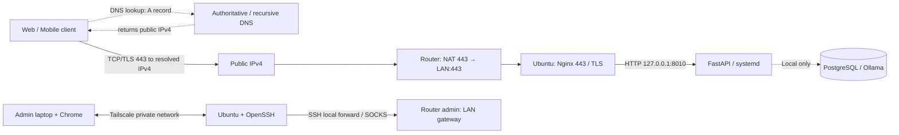

# Ubuntu Server — Từ máy vật lý đến Production

> **Infrastructure Engineering · Hướng dẫn thực hành · Phiên bản 3.0 — 21/11/2026**  
> **Mục tiêu:** Dựng một Ubuntu Server có thể quản trị từ xa bằng Tailscale, điều khiển router qua Chrome trên laptop, đưa FastAPI lên Internet qua Nginx/HTTPS, sau đó cập nhật và vận hành an toàn.  
> **Nguồn bối cảnh:** Hướng dẫn tổng hợp cho lab Ubuntu Server, Nginx/FastAPI và Linux. **Căn cứ kỹ thuật:** Tài liệu gốc Ubuntu, Tailscale, OpenSSH, Nginx, systemd, Python, Git, Certbot, Let’s Encrypt, PostgreSQL và IETF/RFC. IP, tên miền và thông số phần cứng trong phần hướng dẫn là **ví dụ**, không phải cấu hình hiện tại của máy thật. Mỗi bước quan trọng đều có bằng chứng PASS/FAIL. Tài liệu được rà soát logic và đối chiếu nguồn, **không khẳng định đã chạy nghiệm thu trên một máy thực tế trong lần biên tập này**.

## Nội dung

- [01. Kết quả đầu ra và sơ đồ hệ thống](#01-kết-quả-đầu-ra-và-sơ-đồ-hệ-thống)
- [02. Chuẩn bị và cách dùng tài liệu](#02-chuẩn-bị-và-cách-dùng-tài-liệu)
- [03. Khởi tạo Ubuntu Server và kiểm tra mạng](#03-khởi-tạo-ubuntu-server-và-kiểm-tra-mạng)
- [04. Cấu hình OpenSSH và Tailscale](#04-cấu-hình-openssh-và-tailscale)
- [05. Mở trang quản trị router bằng Chrome ở nơi khác](#05-mở-trang-quản-trị-router-bằng-chrome-ở-nơi-khác)
- [06. DHCP Reservation, WAN, CGNAT và Port Forwarding](#06-dhcp-reservation-wan-cgnat-và-port-forwarding)
- [07. DNS và cách một request tìm đến backend](#07-dns-và-cách-một-request-tìm-đến-backend)
- [08. Chuẩn bị môi trường, source code và biến môi trường](#08-chuẩn-bị-môi-trường-source-code-và-biến-môi-trường)
- [09. Chạy backend như một dịch vụ systemd](#09-chạy-backend-như-một-dịch-vụ-systemd)
- [10. Cấu hình Nginx reverse proxy](#10-cấu-hình-nginx-reverse-proxy)
- [11. HTTPS/TLS với Certbot](#11-httpstls-với-certbot)
- [12. Triển khai source thật và quản lý nhiều ứng dụng](#12-triển-khai-source-thật-và-quản-lý-nhiều-ứng-dụng)
- [13. Bảo mật server và quản lý firewall](#13-bảo-mật-server-và-quản-lý-firewall)
- [14. Quy trình cập nhật, backup và bảo trì](#14-quy-trình-cập-nhật-backup-và-bảo-trì)
- [15. Playbook chẩn đoán và xử lý lỗi](#15-playbook-chẩn-đoán-và-xử-lý-lỗi)
- [16. Checklist nghiệm thu từ số 0 đến production](#16-checklist-nghiệm-thu-từ-số-0-đến-production)
- [17. Case study lịch sử: những bài học thực tế](#17-case-study-lịch-sử-những-bài-học-thực-tế)
- [18. Tài liệu chính thức](#18-tài-liệu-chính-thức)
- [19. Từ điển lệnh và phân tích đầy đủ tham số](#19-từ-điển-lệnh-và-phân-tích-đầy-đủ-tham-số)
- [20. Hợp đồng nội dung cho Codex dựng portfolio](#20-hợp-đồng-nội-dung-cho-codex-dựng-portfolio)
- [21. Kiểm tra chất lượng, nguồn tham khảo và an toàn công bố](#21-kiểm-tra-chất-lượng-nguồn-tham-khảo-và-an-toàn-công-bố)

---

## Cách đọc tài liệu và độ tin cậy

| Nhãn | Cách sử dụng |
|---|---|
| **[SERVER] / [LAPTOP] / [ROUTER] / [DNS]** | Xác định chính xác nơi thực hiện, không chạy nhầm lệnh trên máy khác |
| **[READ-ONLY]** | Đọc thông tin, thông thường không đổi trạng thái |
| **[CHANGE]** | Thay đổi cấu hình; lưu backup, xác định rollback và quyền truy cập dự phòng |
| **[TEST]** | Lệnh chứng minh đầu ra, kèm giá trị kỳ vọng và cách xử lý khi FAIL |
| **[CASE STUDY]** | Kinh nghiệm lịch sử, không khẳng định là trạng thái hiện tại |
| **[SOURCE]** | Link trực tiếp tới tài liệu tác giả/nhà phát hành hoặc chuẩn IETF; Codex phải giữ nguyên link |

**Phân biệt mức độ:** (1) *Hành vi được nguồn chính thức mô tả* (ví dụ `ssh -L`); (2) *Cấu hình mẫu có điều kiện* (địa chỉ router, vhost, service); (3) *Kinh nghiệm lab được ghi nhận từ các phiên trước*. Không trộn ba loại trên thành một tuyên bố đã chạy production.

**Lệnh nhiều dòng:** dấu `\` ở cuối dòng bash là ký tự tiếp tục cùng một câu lệnh; không phải tham số. `#` ở đầu dòng là chú thích, không chạy. Ký hiệu `$VAR` là biến shell phải khai báo trong **đúng terminal**; `.service` của systemd không dùng cú pháp shell giống terminal. Phần 19 giải thích từng option quan trọng; khi gặp lệnh mới, không suy luận option theo tên mà tra `man COMMAND`/`COMMAND --help`.

---

## 01. Kết quả đầu ra và sơ đồ hệ thống

### 1.1. Chuẩn đầu ra

Hoàn thành hướng dẫn này, bạn cần **chứng minh được bằng lệnh và phép thử** rằng:

1. Laptop ở mạng Wi-Fi/4G khác SSH được vào Ubuntu thông qua Tailscale **mà không public cổng SSH**.
2. Chrome **chạy trên laptop từ xa**, nhưng truy cập được giao diện quản trị router trong LAN của server thông qua SSH tunnel/SOCKS5.
3. Router dành sẵn một địa chỉ IPv4 LAN cho server bằng **DHCP Reservation** (nếu hỗ trợ), đối chiếu WAN IP và phân biệt được CGNAT.
4. Router forward **TCP 80/443** về đúng máy Ubuntu; DNS domain trỏ đến WAN public IPv4 đúng.
5. Backend FastAPI chạy bằng **systemd**, bind `127.0.0.1:8010`, có healthcheck, tự khởi động lại và sau reboot.
6. Nginx nhận request HTTP/HTTPS, xác định domain bằng `server_name`, rồi chuyển về backend nội bộ.
7. Certbot cấp chứng chỉ hợp lệ, HTTPS chạy được từ mạng ngoài và quy trình gia hạn được thử nghiệm.
8. Source có quy trình `git pull`, cập nhật dependency, restart, kiểm tra, rollback; server có backup, log và lịch bảo trì.

### 1.2. Sơ đồ kiến trúc



> **Hai luồng hoàn toàn khác nhau:** **Quản trị riêng** qua Tailscale + SSH; **phục vụ khách truy cập công khai** qua DNS + WAN + Router NAT + Nginx + TLS. Tailscale không tự public website cho người dùng ngoài tailnet.

### 1.3. Bảng vai trò IP và cổng

| Thành phần | Ví dụ trong hướng dẫn | Ý nghĩa |
|---|---|---|
| LAN IP Ubuntu | `192.168.1.50` | IP nội bộ cần cố định để NAT không trỏ sai |
| Gateway / router | `192.168.1.1` | Trang cấu hình router và default gateway |
| Tailscale IP Ubuntu | `100.x.y.z` | IP overlay riêng; đọc bằng `tailscale ip -4` |
| Public IPv4 | `<PUBLIC_IPV4>` | IPv4 ở WAN router (nếu có public IPv4 trực tiếp) |
| Domain | `api.example.com` | **Tên minh họa, phải thay bằng tên miền bạn sở hữu** |
| OpenSSH | `22/TCP` | Chỉ cho phép quản trị qua tailnet ở cấu hình mẫu |
| Nginx | `80/TCP`, `443/TCP` | Nhận HTTP/HTTPS từ ngoài Internet |
| FastAPI demo | `127.0.0.1:8010` | Dịch vụ riêng trong server, không NAT trực tiếp |
| PostgreSQL / Ollama | `5432`, `11434` | Chỉ nội bộ hoặc mạng được cấp quyền |

> **Đọc cho đúng:** `127.0.0.1` luôn là **máy thực hiện kết nối**. Khi Nginx trên Ubuntu gọi `127.0.0.1:8010`, nó gọi FastAPI trên chính Ubuntu. Khi Chrome laptop gọi `127.0.0.1:19090`, nó gọi **đầu tunnel trên laptop**, không gọi router trực tiếp.

---

## 02. Chuẩn bị và cách dùng tài liệu

### 2.1. Điều kiện tiên quyết

- Một máy vật lý/VM Ubuntu Server mới cài hoặc có quyền `sudo`, có **mạng LAN và Internet outbound**.
- Một laptop điều khiển (ví dụ Ubuntu/Debian Desktop) có SSH client, Chrome và tài khoản Tailscale.
- Quyền quản trị router của **chính mạng nơi đặt server**; biết hoặc có thể xác định gateway.
- Tên miền kiểm soát DNS (ví dụ mua qua TenTen). DNS tại TenTen chỉ có tác dụng khi nameserver của tên miền thực sự trỏ tới hệ thống DNS đó.
- Với phương án public qua NAT: WAN router phải có IPv4 công khai và ISP cho phép inbound 80/443. Nếu CGNAT, xem mục 6.6.
- **Có cách truy cập console vật lý/IPMI** trước khi thay đổi mạng, SSH hay UFW; làm qua SSH mà không có đường cứu hộ có thể tự khóa mình.

### 2.2. Thay các biến trước khi triển khai

**Thông số được chọn cho bài thực hành nhất quán từ đầu đến cuối:**

```text
OS:            Ubuntu Server (cài mới, cập nhật gói)
LINUX_USER:    tài khoản thường có sudo trên Ubuntu
APP_NAME:      portfolio-api
APP_DIR:       /opt/apps/portfolio-api
APP_PORT:      8010
ENV_PATH:      /etc/portfolio-api/backend.env
SERVICE_NAME:  portfolio-api.service
NGINX_SITE:    /etc/nginx/sites-available/portfolio-api.conf
DOMAIN:        api.example.com       <-- BẮT BUỘC THAY
SERVER_LAN_IP: 192.168.1.50          <-- BẮT BUỘC KIỂM TRA
ROUTER_LAN_IP: 192.168.1.1           <-- BẮT BUỘC KIỂM TRA
TAILSCALE_IP:  lấy từ tailscale ip -4
```

**Quy tắc thực hành:** Mọi lệnh dưới nhãn **[SERVER]** thực hiện trên Ubuntu Server; **[LAPTOP]** trên laptop điều khiển; **[ROUTER]** là trường cấu hình trong web admin router. Các giá trị mẫu/đường dẫn cần được thay tương ứng. **Không chạy các lệnh thay đổi cấu hình trên server đang phục vụ người dùng nếu chưa kiểm tra service và port đang tồn tại.**

### 2.3. Cổng kiểm soát theo thứ tự

| Gate | Điều kiện PASS | Nếu FAIL |
|---|---|---|
| G1 — Linux | Có LAN IP, default route, DNS, outbound HTTPS |  |
| G2 — Remote | SSH được từ laptop qua Tailscale | Dừng: sửa SSH/tailnet; **chưa bật UFW** |
| G3 — Router | Truy cập được admin web qua Chrome từ xa | Dừng: sửa tunnel/gateway |
| G4 — WAN | WAN public trực tiếp, NAT 80/443 đúng, kiểm thử ngoài LAN | Nếu CGNAT, chuyển phương án public |
| G5 — App | `curl 127.0.0.1:8010/health/live` trả `200` | Dừng: sửa Python/env/systemd |
| G6 — Nginx | `nginx -t` PASS, HTTP qua domain tới app | Dừng: sửa upstream/vhost/NAT/DNS |
| G7 — TLS | HTTPS có chứng chỉ tin cậy, thử renewal PASS | Dừng: sửa ACME, không công bố production |
| G8 — Operations | Backup, kiểm tra sau reboot, rollback | Dừng trước bàn giao |

---

## 03. Khởi tạo Ubuntu Server và kiểm tra mạng

**Nguồn đối chiếu:** [Ubuntu Server installation](https://ubuntu.com/server/docs/installation/), [Netplan](https://ubuntu.com/server/docs/about-netplan/) và [Netplan `try`](https://netplan.readthedocs.io/en/latest/netplan-try/). Các flags của nhóm lệnh này được bóc tách tại [19.2](#192-nhóm-lệnh-xem-tình-trạng-linux--chỉ-đọc), [19.3](#193-nhóm-lệnh-mạng-và-ý-nghĩa-các-option), [19.8](#198-netplan-dhcpstatic-ý-nghĩa-của-từng-key-yaml).


### 3.1. Cài hệ điều hành trên máy mới

1. Tải ISO Ubuntu Server chính thức; dùng Ventoy/Rufus hoặc công cụ tạo USB phù hợp.
2. Boot theo UEFI, **xác nhận đúng SSD/NVMe** trước khi chọn cài mới/xóa đĩa.
3. Chọn Ethernet DHCP trước, tạo người dùng thường, hostname có ý nghĩa; tích chọn **Install OpenSSH Server**.
4. Hoàn tất cài đặt, tháo USB và đăng nhập trực tiếp từ console.
5. Nếu server **đang chạy production**, bỏ qua cài OS, chỉ làm phần đọc trạng thái trước.

**[SERVER] Kiểm tra tài nguyên:**

```bash
hostnamectl
uname -r
lscpu | head -n 18
free -h
lsblk -f
df -hT /
uptime
```

Không dùng `lvextend`, `parted`, `mkfs`, `fdisk` hay cài lại OS trên server có dữ liệu nếu chưa có kế hoạch sao lưu và xác định đúng block device.

### 3.2. Kiểm tra đường mạng trước khi cài gì thêm

**[SERVER]**

```bash
ip -br link                 # NIC nào UP, NIC nào NO-CARRIER?
ip -4 -br addr              # NIC có IPv4 LAN chưa?
ip -4 route                 # Có default via <gateway> không?
resolvectl status           # DNS nào đang được sử dụng?
ping -c 3 1.1.1.1           # Thử kết nối IP (ICMP có thể bị chặn)
getent ahostsv4 github.com  # Thử DNS
curl -I --max-time 10 https://github.com
```

**Cách đọc:**

- NIC `UP` nhưng **không có IPv4**: DHCP/Netplan/cắm dây sai NIC.
- Có IPv4 nhưng **không có `default via`**: thiếu gateway để ra Internet.
- Có Internet bằng IP nhưng tên miền không phân giải: chẩn đoán DNS.
- `ping` thất bại nhưng `curl` HTTPS thành công: có thể ICMP bị chặn; không suy luận Internet hỏng chỉ từ ping.

### 3.3. Cấu hình DHCP bằng Netplan (chỉ khi cần)

**[SERVER] Đọc trước khi sửa [READ-ONLY]:**

```bash
ls -la /etc/netplan/
sudo netplan get
ip -br link
```

Ví dụ card cắm dây có tên `enp5s0`. **Chỉ tạo file dưới đây nếu chắc chắn không xung đột file Netplan khác do cloud-init/installer quản lý.**

```yaml
# /etc/netplan/99-local-lan.yaml — VÍ DỤ, KHÔNG DÙNG MÙ TÊN NIC
network:
  version: 2
  renderer: networkd
  ethernets:
    enp5s0:
      dhcp4: true
```

```bash
sudo netplan generate
sudo netplan try       # Xác nhận trong thời gian được hỏi; có đường console dự phòng
ip -4 -br addr
ip -4 route
```

> Nếu đang quản trị qua SSH, đổi Netplan là thao tác có thể cắt kết nối. **Không dùng `netplan apply` vô điều kiện**; cần console và lưu bản sao file cấu hình trước.

### 3.4. Cập nhật gói nền tảng

**[SERVER]**

```bash
sudo apt update
sudo apt install -y ca-certificates curl git openssh-server \
  python3 python3-venv python3-pip nginx ufw dnsutils \
  iproute2 net-tools
sudo systemctl enable --now ssh
sudo systemctl enable --now nginx
sudo systemctl status ssh nginx --no-pager
```

Sau khi cài gói, kiểm tra Nginx hiện tại; trên máy production có thể đã có site chạy. Không xóa cấu hình mặc định hoặc thay đổi listener của site khác nếu chưa hiểu `sudo nginx -T`.

---

## 04. Cấu hình OpenSSH và Tailscale

**Nguồn đối chiếu:** [Tailscale Linux](https://tailscale.com/docs/install/linux), [Ubuntu SSH](https://ubuntu.com/server/docs/how-to/security/openssh-server/), [OpenSSH manual](https://man.openbsd.org/ssh.1). Xem từ điển [19.4–19.6](#194-cài-đặt-gói-tailscale-và-quản-lý-dịch-vụ-nền).


### 4.1. Tại sao cần Tailscale?

Ubuntu ở sau router thường chỉ có địa chỉ **LAN**. Nếu muốn SSH từ một laptop ở địa điểm khác, phương án cổ điển phải public/NAT cổng SSH. **Tailscale tạo một mạng riêng giữa các máy được cấp quyền**, nên có thể SSH tới IP tailnet mà không cần forward cổng 22 trên WAN; ngay cả khi router ở CGNAT vẫn có thể quản trị qua tailnet.

**Mô hình:**

```text
Laptop ở nơi khác (Tailscale) ── kết nối tailnet ── Ubuntu (Tailscale + sshd)
                                        |
                            Ubuntu ở LAN của router
```

### 4.2. Cài Tailscale trên server

**[SERVER]**

```bash
# Kiểm tra script nhà cung cấp trước khi chạy trong môi trường kiểm soát chặt.
curl -fsSL https://tailscale.com/install.sh | sh
sudo systemctl enable --now tailscaled
sudo tailscale up

tailscale status
tailscale ip -4
sudo systemctl is-active tailscaled
```

`sudo tailscale up` lần đầu cung cấp URL đăng nhập/tác vụ xác thực. Hoàn thành xác thực theo tài khoản của bạn. Không đưa auth key, URL xác thực riêng, hoặc thông tin của tailnet vào GitHub công khai.

**[LAPTOP]** Cài Tailscale theo OS của laptop và đăng nhập vào **cùng tailnet**; phải được ACL/grants cho phép kết nối tới server. Đọc IP của server từ `tailscale ip -4` ngay trên server (IP có thể khác các phiên trước).

### 4.3. Kiểm tra SSH qua tailnet

**[SERVER]**

```bash
sudo systemctl status ssh --no-pager
sudo ss -lntp | grep ':22'
tailscale status
```

**[LAPTOP]** — thay IP vừa lấy:

```bash
# Sao chép IP từ `tailscale ip -4` trên SERVER; không dùng IP mẫu.
TS_IP='100.101.102.103'       # VÍ DỤ: thay bằng Tailscale IP thực
LINUX_USER='ubuntu'           # VÍ DỤ: thay bằng tài khoản Linux thực
tailscale status
ping -c 2 "$TS_IP"            # ICMP có thể bị lọc
tailscale ping "$TS_IP"
ssh "$LINUX_USER@$TS_IP"
```

`<LINUX_USER>` là user Linux thật đã tạo trong Ubuntu. Đây là **OpenSSH đi qua Tailscale**, không bắt buộc bật tính năng **Tailscale SSH** (`tailscale set --ssh`), vốn có cơ chế xác thực/ACL riêng.

### 4.4. Dùng SSH key thay password

**[LAPTOP]**

```bash
ssh-keygen -t ed25519 -C "my-laptop-admin"
ssh-copy-id "$LINUX_USER@$TS_IP"
ssh "$LINUX_USER@$TS_IP"
```

- Nếu máy đã có key trong `~/.ssh`, không ghi đè private key cũ.
- Thử SSH key trong **một terminal mới** trước khi thay đổi quyền đăng nhập.
- Sau khi xác nhận key hoạt động và có đường phục hồi, có thể cân nhắc tắt login bằng password qua SSH. Kiểm tra cấu hình hiệu lực bằng `sudo sshd -T`; không chỉ đọc một dòng trong `sshd_config` vì còn drop-in.

**[SERVER] Kiểm tra SSH an toàn:**

```bash
sudo sshd -t
sudo sshd -T | grep -E '^(passwordauthentication|pubkeyauthentication|permitrootlogin|allowtcpforwarding) '
sudo journalctl -u ssh -n 50 --no-pager
```

Nếu muốn harden, thực hiện ở phiên riêng, kiểm thử từ terminal mới trước khi kết thúc phiên cũ. Ví dụ các giá trị mục tiêu: `PermitRootLogin no`, `PasswordAuthentication no`, `PubkeyAuthentication yes`. Không áp dụng khi chưa copy SSH key thành công.

### 4.5. Kết nối ổn định và tiện dụng

**[LAPTOP]** thêm vào `~/.ssh/config`:

```sshconfig
Host my-ubuntu
    HostName 100.101.102.103
    User ubuntu
    Port 22
    ServerAliveInterval 30
    ServerAliveCountMax 3
```

Sau đó dùng:

```bash
ssh my-ubuntu
scp ./README.md my-ubuntu:~/
```

> Cần thay `HostName` và `User` trước khi dùng. Tailscale MagicDNS cũng có thể thay IP bằng hostname đã phân giải được trong tailnet, nếu được bật.

---

## 05. Mở trang quản trị router bằng Chrome ở nơi khác

**Nguồn đối chiếu:** [OpenSSH forwarding](https://man.openbsd.org/ssh.1), [OpenSSH config](https://man.openbsd.org/ssh_config.5), [Chromium proxy support](https://chromium.googlesource.com/chromium/src/+/master/net/docs/proxy.md). Tham số từng lệnh tại [19.5](#195-openssh-thường-so-với-tailscale-ssh) và [19.7](#197-chrome-từ-xa-socks5-và-cổng-quản-trị-router).


### 5.1. Vấn đề thực tế cần giải quyết

Bạn đang ở quán cà phê/trường học, còn server ở nhà/công ty. Router chỉ cho mở `http://192.168.1.1` từ **mạng LAN của chính router**. Laptop ở xa không thể mở IP đó trực tiếp; và **không nên bật WAN Remote Management của router** chỉ vì muốn vào trang admin.

Giải pháp: laptop đã SSH qua Tailscale vào Ubuntu; **Ubuntu có kết nối LAN tới router**, nên ta dùng Ubuntu làm điểm trung chuyển TCP. Chrome vẫn chạy trên **laptop**, không cần cài GUI hoặc Chrome vào Ubuntu Server.

### 5.2. Xác định địa chỉ và giao thức router trước

**[SERVER]**

```bash
ip -4 route show default       # Ví dụ: default via 192.168.1.1 dev enp5s0
ip -4 -br addr
curl -I --connect-timeout 5 http://192.168.1.1/
curl -kI --connect-timeout 5 https://192.168.1.1/
```

- Gateway lấy từ `default via ...`, **không đoán** `192.168.1.1` hoặc `192.168.100.1`.
- Nếu giao diện chỉ trả về HTTP ở 80: dùng đường hầm 80; nếu HTTPS ở 443: dùng đường hầm 443.
- `curl -k` chỉ là phép thử kỹ thuật với self-signed certificate của router; khi vào trình duyệt phải kiểm tra mình đang truy cập router tin cậy, không bỏ qua cảnh báo một cách vô điều kiện.

### 5.3. Cách A — SSH Local Port Forward (đơn giản nhất)

**[LAPTOP, terminal 1]** — ví dụ router HTTP tại `192.168.1.1:80`. Ở cùng terminal này phải có sẵn `TS_IP`, `LINUX_USER` từ mục 4.3, hoặc khai báo lại sau khi mở terminal mới:

```bash
TS_IP='100.101.102.103'     # Thay bằng IP Tailscale SERVER thực
LINUX_USER='ubuntu'          # Thay bằng Linux user thực
ssh -N -o ExitOnForwardFailure=yes \
  -L 127.0.0.1:19090:192.168.1.1:80 \
  "$LINUX_USER@$TS_IP"
```

**[LAPTOP, Chrome]** mở:

```text
http://127.0.0.1:19090
```

Luồng TCP:

```text
Chrome laptop :19090
  -> SSH local listener 127.0.0.1:19090
  -> SSH được mã hóa trong Tailscale
  -> sshd trên Ubuntu
  -> Router LAN 192.168.1.1:80
  -> HTML trả về Chrome laptop
```

`-L` nghĩa là **local forwarding**, `-N` không tạo shell nên terminal trông như “đứng yên” là bình thường; giữ terminal mở trong lúc thao tác web. Dừng bằng **Ctrl+C**. `127.0.0.1:` trước cổng 19090 bảo đảm chỉ laptop nội bộ truy cập đầu tunnel.

**Nếu router dùng HTTPS**, chuyển tiếp cổng 443 tương ứng:

```bash
ssh -N -o ExitOnForwardFailure=yes \
  -L 127.0.0.1:19443:192.168.1.1:443 \
  "$LINUX_USER@$TS_IP"
```

Laptop mở `https://127.0.0.1:19443`. Router có thể trả chứng chỉ không khớp `127.0.0.1`; cần đối chiếu chứng chỉ/hostname hợp lệ của router, không coi cảnh báo TLS là lỗi backend.

**Khi cách A không hiển thị đúng**: Nhiều router redirect tới `192.168.1.1`, absolute URL, kiểm tra `Host`, cookie hoặc WebSocket; trình duyệt có thể rời khỏi đường hầm. Lúc đó dùng **cách B (SOCKS5)** để browser giữ nguyên địa chỉ LAN. **Cần biết giới hạn:** `ExitOnForwardFailure=yes` chỉ yêu cầu SSH thoát nếu *không tạo được listener/tunnel*, **không bảo đảm** router phía cuối (`192.168.1.1:80`) có thể kết nối. Phải thử `curl`/Chrome riêng. [SOURCE: OpenSSH ssh_config](https://man.openbsd.org/ssh_config.5)

### 5.4. Cách B — SSH Dynamic SOCKS5 + Google Chrome (linh hoạt nhất)

**[LAPTOP, terminal 1]**:

```bash
ssh -N -o ExitOnForwardFailure=yes \
  -D 127.0.0.1:1080 \
  "$LINUX_USER@$TS_IP"
```

**[LAPTOP, terminal 2]** — chạy **Chrome cục bộ trên laptop** với một profile riêng:

```bash
google-chrome \
  --user-data-dir=/tmp/chrome-router-admin \
  --proxy-server='socks5://127.0.0.1:1080' \
  --new-window 'http://192.168.1.1'
```

Ở cách này, Chrome truy cập `http://192.168.1.1` nhưng kết nối được tạo **từ phía Ubuntu** qua SSH SOCKS tunnel. Để kiểm soát DNS leak khi dùng hostname nội bộ, Chromium có tài liệu về `--host-resolver-rules`; do bài lab dùng IP router trực tiếp nên không cần thêm tùy chọn này. [SOURCE: Chromium SOCKS proxy](https://www.chromium.org/developers/design-documents/network-stack/socks-proxy/) · [SOURCE: Chromium proxy support](https://chromium.googlesource.com/chromium/src/+/master/net/docs/proxy.md). Chrome không cần cùng LAN với router. Đừng dùng profile thường cho công việc duyệt web khác khi đang proxy qua server.

Thử kết nối không cần Chrome:

```bash
# [LAPTOP, terminal 2]
curl --proxy socks5h://127.0.0.1:1080 \
  --connect-timeout 5 -I http://192.168.1.1/
```

Nếu router quản trị qua hostname riêng thay vì IP, `socks5h://` giúp curl phân giải hostname phía proxy. Trên Chrome, cách xử lý DNS/proxy và chính sách truy cập mạng nội bộ có thể khác theo phiên bản; ưu tiên IP LAN của router để đơn giản.

### 5.5. Những lỗi từng gặp và cách xử lý

| Triệu chứng | Nguyên nhân thường gặp | Cách kiểm tra / xử lý |
|---|---|---|
| `bind [127.0.0.1]:9090: Address already in use` | Cổng local bị ứng dụng/tunnel khác chiếm | `ss -lntp | grep ':9090'`; chuyển sang `19090` |
| `ssh -N` không hiển thị dấu nhắc | **Không phải lỗi**; đang giữ đường hầm | Mở URL trong Chrome tại terminal khác |
| `channel ... open failed: connect failed` | Server không nối được router LAN/port hoặc forwarding bị chặn | Kiểm tra `ip route`, `curl` từ server, `sudo sshd -T | grep allowtcpforwarding` |
| Chrome redirect tới địa chỉ router nhưng timeout | Local forward không giữ được host/URL | Chuyển sang SOCKS5 dynamic forwarding |
| Chrome mở router khác ở `192.168.1.1` | Laptop và router server trùng subnet, browser không proxy đúng | Dùng profile SOCKS5 riêng; xác nhận request thực sự đi qua proxy |
| `Permission denied (publickey)` | SSH user/key/tailnet ACL sai | Thử `ssh -v`, kiểm tra khóa và dịch vụ SSH |

**Bảo mật:** Tunnel SSH được mã hóa từ laptop tới Ubuntu; nếu router chỉ dùng HTTP, đoạn **Ubuntu → Router qua LAN vẫn là HTTP**. Chỉ thao tác trên LAN tin cậy, tránh bật remote administration từ WAN và luôn đổi mật khẩu router mặc định.

---

## 06. DHCP Reservation, WAN, CGNAT và Port Forwarding

**Nguồn đối chiếu:** [IETF RFC 6598](https://www.rfc-editor.org/rfc/rfc6598.html), [Ubuntu networking](https://ubuntu.com/server/docs/about-netplan/); **menu router là ví dụ có điều kiện, không phải API thống nhất của mọi hãng**. Xem tham số [19.9](#199-router-giải-thích-từng-trường-dhcp-reservation-và-port-forwarding).


### 6.1. “Reverse IP” thường là *Reserved IP* / DHCP Reservation

Trong giao diện nhiều router, mục **Reserved IP / DHCP Reservation** nghĩa là **cố định IP LAN cấp qua DHCP theo địa chỉ MAC**. Nó **không phải** Reverse Proxy (Nginx), Reverse DNS (PTR) hay SSH reverse tunnel (`ssh -R`).

Tại sao cần? Nếu server nhận IP `192.168.1.50` hôm nay nhưng ngày mai đổi thành `.51`, rule NAT vẫn trỏ `.50` thì truy cập public hỏng.

### 6.2. Đặt DHCP Reservation trên router

**[SERVER] Lấy thông tin NIC thật:**

```bash
ip -br link                      # Tìm NIC Ethernet có dây đang dùng
ip -4 route show default         # Gateway và tên NIC
ip -4 -br addr                   # IP LAN hiện tại
NIC=enp5s0                       # VÍ DỤ: thay bằng tên NIC lấy ở dòng đầu
cat "/sys/class/net/$NIC/address"
```

**[ROUTER]** — menu thường là `LAN` / `DHCP Server` / `Address Reservation` / `Reserved IP`:

| Trường | Giá trị phải nhập |
|---|---|
| Host/Device | Server Ubuntu hoặc tên dễ nhận diện |
| MAC | MAC card Ethernet **đang nối router** |
| Reserved IPv4 | `192.168.1.50` (nằm đúng subnet, còn trống) |
| Status | Enable / Save / Apply |

**[SERVER] Sau khi lưu:**

```bash
# Thực hiện vào lúc có console/đường dự phòng; release DHCP tùy NIC/renderer.
ip -4 -br addr
ip -4 route
ping -c 2 192.168.1.1
```

Nếu reservation chưa có hiệu lực, khởi động lại đúng interface hoặc renew DHCP **khi có console**; không bừa bãi down NIC trên phiên SSH. Khi dùng DHCP Reservation, thường **giữ Netplan `dhcp4: true`**; không cần đồng thời khai static IP giống hệt trong Ubuntu.

### 6.3. Phân biệt IP private, public, WAN và CGNAT

**[SERVER]**:

```bash
curl -4 -sS https://api.ipify.org; echo  # Egress public IP Internet nhìn thấy
ip -4 route show default
```

**[ROUTER]** xem `Internet Status` / `WAN IPv4`. So sánh **WAN IPv4 router** với **IP curl**:

| Trường hợp | Ý nghĩa | Hướng xử lý |
|---|---|---|
| WAN IPv4 = egress public IPv4, ISP cho phép inbound | Có thể thử NAT 80/443 | Tiếp tục |
| WAN thuộc `100.64.0.0/10` | Thường là CGNAT | Xin public IPv4 hoặc tunnel phục vụ public |
| WAN thuộc `10/8`, `172.16/12`, `192.168/16` | NAT lớp trước / router hai tầng | Cấu hình đủ hai tầng hoặc thay kiến trúc |
| WAN khác egress public IP | Có thể NAT ISP/router tầng trên | Kiểm tra topology; chưa thể kết luận NAT sẽ chạy |
| Chỉ có IPv6 global | Cần kiến trúc IPv6 + DNS AAAA + firewall tương ứng | Không giả định IPv4 forwarding hoạt động |

**Nguyên lý quan trọng:** `curl api.ipify.org` chỉ cho biết IP lúc **đi ra Internet**. Nó **không chứng minh** router được Internet gọi trực tiếp. DNS A record cũng **không** vượt qua CGNAT.

### 6.4. Cấu hình port forwarding khi WAN có public IPv4

**[ROUTER]** — menu có thể là `NAT`, `Virtual Server`, `Port Forwarding`, `Port Mapping`, tùy firmware. Ví dụ:

| Tên rule | WAN Protocol | External Port | Internal IP | Internal Port |
|---|---|---:|---|---:|
| `ubuntu-http` | TCP | 80 | `192.168.1.50` | 80 |
| `ubuntu-https` | TCP | 443 | `192.168.1.50` | 443 |

**Không forward:** `8010` (FastAPI), `5432` (PostgreSQL), `6379` (Redis), `11434` (Ollama) hoặc `9090` (Cockpit) lên Internet. Với SSH, ưu tiên Tailscale; không thêm WAN 2222→22 nếu không có yêu cầu và biện pháp bảo mật riêng.

**[SERVER]** khi ứng dụng/nginx đã chạy:

```bash
sudo ss -lntp | grep -E ':(80|443|8010)\b'
sudo ufw status verbose
```

**[LAPTOP tại mạng ngoài: 4G hoặc Wi-Fi khác]**:

```bash
# Chỉ có ý nghĩa sau khi Nginx lên và firewall đúng.
# Thay IPv4 ví dụ bằng WAN public IPv4 vừa đối chiếu từ router.
PUBLIC_IPV4='203.0.113.10'     # VÍ DỤ RFC 5737: phải thay bằng địa chỉ thật
curl -I --connect-timeout 8 "http://$PUBLIC_IPV4"
nc -vz -w 5 "$PUBLIC_IPV4" 80
nc -vz -w 5 "$PUBLIC_IPV4" 443
```

> Kiểm tra WAN IP từ **cùng LAN** có thể sai lệch do router không hỗ trợ NAT loopback/hairpin. Kết quả đáng tin phải thử từ mạng khác. Không đoán rằng site hoạt động chỉ vì `curl localhost` trả `200`.

### 6.5. Public IP động, DNS và double NAT

Nếu public IPv4 thay đổi khi router reconnect, domain có thể trỏ tới IP cũ. Cần cơ chế DDNS/cập nhật A record được DNS provider cho phép, hoặc public IP tĩnh từ ISP. Không đặt token DNS automation trong script công khai. Nếu có **router + modem ONT hai tầng**, cần kiểm tra WAN của từng lớp; NAT một tầng có thể chưa đủ.

### 6.6. Nếu bị CGNAT: không cố làm port forwarding giả

Đường quản trị vẫn dùng được **Tailscale + SSH**. Nhưng để website/API truy cập công khai có thể cần một trong các phương án:

1. Đề nghị ISP cấp public IPv4 và cho phép inbound.
2. Dùng VPS có public IP làm reverse proxy/đầu tunnel về server.
3. Dùng dịch vụ tunnel hỗ trợ public ingress như Cloudflare Tunnel hoặc Tailscale Funnel, sau khi kiểm tra giới hạn kỹ thuật, điều khoản và cơ chế bảo vệ.
4. Dùng IPv6 public đúng cách nếu hạ tầng/client hỗ trợ.

**Phạm vi bài thực hành tiếp theo:** giả định đã có **WAN public IPv4 hoạt động**. Nếu chưa, hoàn thành nhánh giải pháp public khác trước khi chạy Certbot HTTP-01; không bỏ qua gate này.

---

## 07. DNS và cách một request tìm đến backend

**Nguồn đối chiếu:** [IETF DNS RFC 1035](https://www.rfc-editor.org/rfc/rfc1035), [NGINX request processing](https://nginx.org/en/docs/http/request_processing.html). Xem [19.10](#1910-dns-bóc-tách-lệnh-và-bản-ghi).


### 7.1. DNS TenTen không phải là reverse proxy

Tên miền, DNS, NAT và Nginx có trách nhiệm khác nhau:

```text
Gõ https://api.example.com/health/live
   │
   ├─ DNS resolver hỏi A record → <PUBLIC_IPV4>
   │
   ├─ Client kết nối TCP <PUBLIC_IPV4>:443
   │
   ├─ Router DNAT: WAN:443 → 192.168.1.50:443
   │
   ├─ Ubuntu firewall cho phép 443
   │
   ├─ Nginx TLS handshake bằng chứng chỉ api.example.com
   │
   ├─ Nginx chọn `server_name api.example.com`
   │
   ├─ Nginx proxy HTTP → 127.0.0.1:8010
   │
   └─ FastAPI trả JSON → Nginx → Router → Client
```

**Vì sao không phải gõ port?** HTTP mặc định dùng 80, HTTPS mặc định dùng 443. URL `https://...` ngầm yêu cầu 443. DNS chỉ phân giải **tên → IP**, không tự chỉ định backend port; Nginx phân tuyến theo Host/URI.

### 7.2. Tạo bản ghi DNS

**[DNS provider đang có thẩm quyền]**:

| Type | Name/Host | Value | TTL |
|---|---|---|---|
| `A` | `api` | `<PUBLIC_IPV4>` | Mặc định hoặc ngắn nếu IP động |

Nếu tên miền chính là `example.com`, `api` sẽ tạo `api.example.com`. Không tự tạo AAAA nếu server không có IPv6 public hoạt động (một AAAA sai khiến client ưu tiên IPv6 và không kết nối được).

**[LAPTOP hoặc SERVER]**:

```bash
dig NS example.com +short
dig @1.1.1.1 api.example.com A +short
dig @8.8.8.8 api.example.com A +short
```

- Nếu nameserver của domain không thuộc TenTen, cần sửa bản ghi tại nơi DNS **đang authoritative**, không phải cứ đăng nhập TenTen là đủ.
- Chưa cần HTTPS ngay; phải làm Nginx HTTP và NAT 80 hoạt động trước để cấp chứng chỉ HTTP-01.

---

## 08. Chuẩn bị môi trường, source code và biến môi trường

**Nguồn đối chiếu:** [Python venv](https://docs.python.org/3/library/venv.html), [Git clone](https://git-scm.com/docs/git-clone), [systemd.exec](https://www.freedesktop.org/software/systemd/man/latest/systemd.exec.html). Xem [19.11–19.13](#1911-filesystem-quyền-và-file-config-bên-ngoài-git).


### 8.1. Cấu trúc deployment có chủ đích

```text
/opt/apps/portfolio-api/              # Mã nguồn (Git/Source)
├── main.py                            # FastAPI demo trong tài liệu
├── requirements.txt                   # Dependencies
├── .venv/                             # Virtual environment, KHÔNG commit
├── .env.example                       # Danh sách key mẫu, KHÔNG có secret
└── .gitignore                         # Loại .env, .venv, cache

/etc/portfolio-api/backend.env         # Secrets/config production (ngoài repo)
/etc/systemd/system/portfolio-api.service
/etc/nginx/sites-available/portfolio-api.conf
/etc/nginx/sites-enabled/portfolio-api.conf -> ../sites-available/portfolio-api.conf
/var/log/nginx/                         # Access/error logs
/var/backups/portfolio-api/             # Backup cục bộ có kiểm soát
```

**Lý do giữ `backend.env` ngoài repo:** giảm nguy cơ commit nhầm, tách cấu hình từng môi trường, không ghi đè khi `git pull`, hạn chế quyền đọc file. `EnvironmentFile=` của systemd đưa biến vào **môi trường process**; code Python đọc qua `os.environ`/`pydantic-settings`. **Lưu ý bảo mật:** theo tài liệu systemd, environment variables **không phải kênh phù hợp cho bí mật độ nhạy cao** vì có khả năng bị lộ qua process/IPC/cây tiến trình. Đây là phương án học tập/vận hành đơn giản; production nhạy cảm nên cân nhắc secrets manager hoặc `LoadCredential=`/`LoadCredentialEncrypted=` và chỉnh app đọc credential file. [SOURCE: systemd.exec](https://www.freedesktop.org/software/systemd/man/latest/systemd.exec.html)

### 8.2. Tạo một demo API có thể chạy được hoàn toàn từ đầu

> Mục đích: xây một backend **tự chứa** để kiểm tra toàn bộ hạ tầng trước khi đưa source thật lên. Nếu ứng dụng hiện có đang dùng cổng mẫu 8000, chọn cổng demo khác như **8010** để tránh xung đột.

**[SERVER]** — thực hiện trên một tài khoản Linux thường có `sudo`:

```bash
export APP_NAME='portfolio-api'
export APP_DIR='/opt/apps/portfolio-api'
export APP_USER="$(id -un)"
export APP_GROUP="$(id -gn)"

# CHỈ thực hiện nếu APP_DIR CHƯA tồn tại; đây là cổng kiểm soát thủ công.
test ! -e "$APP_DIR"
# Nếu dòng trên trả mã lỗi (echo $? khác 0), DỪNG và dùng nhánh repo có sẵn.
sudo ss -lntp | grep ':8010' || true
# Nếu cổng 8010 đã có listener, DỪNG và chọn cổng demo khác.

sudo install -d -o "$APP_USER" -g "$APP_GROUP" -m 750 "$APP_DIR"
cd "$APP_DIR"
```

**Chỉ tạo demo trong thư mục chưa tồn tại.** `test ! -e` là phép kiểm tra chứ không tự chặn các dòng chạy sau nếu bạn dán cả khối vào shell tương tác: **phải đọc kết quả rồi mới chạy lệnh `install`**. Nếu thư mục/cổng đã tồn tại, không ghi đè mà chuyển sang mục 12 hoặc chọn app/port khác.

**[SERVER] `requirements.txt`:**

```bash
cat > requirements.txt <<'EOF'
fastapi>=0.115,<1
uvicorn[standard]>=0.30,<1
EOF
```

**[SERVER] `main.py`:**

```bash
cat > main.py <<'PY'
import os
from fastapi import FastAPI

app = FastAPI(title=os.environ.get("APP_NAME", "Portfolio API"))

@app.get("/health/live")
def live():
    return {"status": "ok", "service": "portfolio-api"}

@app.get("/health/ready")
def ready():
    # Demo chỉ kiểm tra process; app thật cần check DB/dependencies.
    return {"status": "ready"}
PY
```

**[SERVER] Khởi tạo Python venv và cài thư viện:**

```bash
python3 -m venv "$APP_DIR/.venv"
"$APP_DIR/.venv/bin/python" -m pip install --upgrade pip
"$APP_DIR/.venv/bin/python" -m pip install -r "$APP_DIR/requirements.txt"
"$APP_DIR/.venv/bin/python" -c 'import fastapi, uvicorn; print("dependencies: OK")'
```

Ở source production, **ưu tiên `requirements.txt`/`pyproject.toml`/lockfile thực tế** thay vì `pip install` các gói ngẫu nhiên. Code FastAPI cần đúng `module:app` theo cấu trúc repo (ví dụ `app.main:app` hoặc `my_backend.main:app`).

### 8.3. Tạo file env ở ngoài repo

**[SERVER]** — vẫn dùng biến `APP_GROUP` từ bước 8.2 (nếu triển khai source thật theo nhánh 8.4, tạo quyền nhóm/service phù hợp **riêng**, không áp dụng máy móc đường dẫn demo):

```bash
sudo install -d -o root -g "$APP_GROUP" -m 750 /etc/portfolio-api
# Không TRUNCATE file env nếu đã tồn tại từ phiên deploy trước.
if ! sudo test -e /etc/portfolio-api/backend.env; then
  sudo install -o root -g "$APP_GROUP" -m 640 \
    /dev/null /etc/portfolio-api/backend.env
fi
sudoedit /etc/portfolio-api/backend.env
```

Nội dung ví dụ:

```dotenv
APP_NAME="Portfolio API"
APP_ENV=production
LOG_LEVEL=info
# DATABASE_URL=postgresql://...  # Chỉ đặt giá trị thật vào file riêng tư
# GEMINI_API_KEY=...             # Không copy bí mật vào tài liệu
```

Lưu ý: nếu sử dụng `sudoedit`, file được sửa với trình biên tập cục bộ an toàn; **không đưa token vào ảnh portfolio, log hoặc câu lệnh chứa secret có thể xuất hiện trong shell history**. Các file `.env.example` trong Git chỉ nên nêu **tên biến và giá trị giả**.

**Kiểm tra phân quyền mà không in secret:**

```bash
sudo stat -c '%a %U:%G %n' /etc/portfolio-api/backend.env
# Mong đợi: 640 root:NHOM_USER ... (tên nhóm thực tế khác nhau)
```

### 8.4. Nếu source lấy từ Git thay vì demo

Đây là **nhánh thay thế** cho 8.2, không chạy clone đè thư mục demo vừa tạo:

```bash
# [SERVER] Chỉ chọn nhánh này nếu chưa tạo demo cùng APP_DIR.
# URL Git phải được thay bằng URL repo của bạn, không dán secret vào URL.
REPO_URL='git@github.com:YOUR_ORG/YOUR_REPO.git'  # THAY GIÁ TRỊ
REPO_PARENT="$HOME/apps"
REPO_PATH="$REPO_PARENT/portfolio-api"
mkdir -p "$REPO_PARENT"
test ! -e "$REPO_PATH"       # Nếu fail, DỪNG, không clone đè
# Chạy sau khi đã xác nhận test ở trên PASS.
git clone "$REPO_URL" "$REPO_PATH"
cd "$REPO_PATH"

git status -sb
git remote -v
ls -la
```

Nếu repo **đã tồn tại** (chỉ pull sau khi xác định đúng ứng dụng/branch và bản sao lưu); sửa đúng path repo thực tế. Theo nhánh clone ngay trên, path là `$HOME/apps/portfolio-api`:

```bash
cd "$HOME/apps/portfolio-api"
git status -sb
git remote -v
# Chỉ khi đã xác minh working tree sạch và branch đúng:
git pull --ff-only
```

**Private repo:** cần SSH deploy key hoặc token quản lý an toàn theo Git provider; không nhúng token trong URL rồi commit, không `sudo git clone` thiếu kiểm soát quyền. **Không xóa cả thư mục production vì `destination already exists`**.

---

## 09. Chạy backend như một dịch vụ systemd

**Nguồn đối chiếu:** [systemd.service](https://www.freedesktop.org/software/systemd/man/latest/systemd.service.html), [systemd.exec](https://www.freedesktop.org/software/systemd/man/latest/systemd.exec.html), [Uvicorn settings](https://www.uvicorn.org/settings/). Tham khảo [19.14–19.16](#1914-uvicorn-và-các-option-networktrusted-proxy).


### 9.1. Vì sao không dùng `uvicorn` chạy thủ công trong terminal?

Khi SSH session kết thúc hoặc server reboot, process thủ công có thể dừng. `systemd` giúp quản lý start/stop/restart, auto-start và ghi log qua `journalctl`. Nginx không tự “chạy backend” giúp bạn; nếu upstream ngừng hoạt động, Nginx thường trả `502`.

### 9.2. Tạo unit cho demo

**[SERVER]** — sử dụng các biến shell đã `export` trong mục 8.2; nếu mở phiên terminal mới, khai báo lại `APP_DIR`, `APP_USER`, `APP_GROUP`. `User=` dùng user người cài trong **demo** để ngắn gọn; với production nhiều ứng dụng nên dùng **service account riêng, không sudo và không login shell**, đặt quyền đọc source/env tối thiểu. [SOURCE: systemd.exec](https://www.freedesktop.org/software/systemd/man/latest/systemd.exec.html)

```bash
sudo tee /etc/systemd/system/portfolio-api.service >/dev/null <<EOF
[Unit]
Description=Portfolio FastAPI backend
After=network-online.target
Wants=network-online.target

[Service]
Type=simple
User=${APP_USER}
Group=${APP_GROUP}
WorkingDirectory=/opt/apps/portfolio-api
EnvironmentFile=/etc/portfolio-api/backend.env
ExecStart=/opt/apps/portfolio-api/.venv/bin/uvicorn main:app --host 127.0.0.1 --port 8010 --proxy-headers --forwarded-allow-ips 127.0.0.1
Restart=on-failure
RestartSec=3
NoNewPrivileges=true
PrivateTmp=true
ProtectSystem=full

[Install]
WantedBy=multi-user.target
EOF

sudo systemctl daemon-reload
sudo systemctl enable --now portfolio-api
sudo systemctl status portfolio-api --no-pager
```

**[SERVER] Thử endpoint và listener:**

```bash
sudo ss -lntp | grep ':8010'
curl -i http://127.0.0.1:8010/health/live
curl -i http://127.0.0.1:8010/health/ready
systemctl is-enabled portfolio-api
systemctl is-active portfolio-api
sudo journalctl -u portfolio-api -n 50 --no-pager
```

Kỳ vọng: `/health/live` và `/health/ready` trả HTTP `200`, body JSON có `status` phù hợp; `ss` cho thấy app **chỉ nghe tại `127.0.0.1:8010`**.

> `active (running)` chỉ chứng minh process còn sống. `/health/live` cho biết HTTP đang trả lời. `/health/ready` **chỉ thực sự kiểm tra DB/cache/AI nếu code được lập trình để làm điều đó**; endpoint demo ở đây chưa kiểm tra phụ thuộc.

### 9.3. App thật cần kết nối database / AI

Nếu ứng dụng cần PostgreSQL và Ollama, FastAPI đọc `DATABASE_URL`/`OLLAMA_BASE_URL` từ **environment**, không hardcode vào `main.py`. Hãy cài DB/migration theo tài liệu repo thực tế, thực hiện **backup trước migration**, rồi tạo `/health/ready` trả trạng thái phụ thuộc. **Không public 5432/11434** và không nhét password vào file `.service`.

### 9.4. Những lệnh systemd phải nắm

```bash
sudo systemctl start portfolio-api
sudo systemctl stop portfolio-api
sudo systemctl restart portfolio-api
sudo systemctl status portfolio-api --no-pager
sudo systemctl cat portfolio-api
sudo journalctl -u portfolio-api -f
sudo systemctl daemon-reload          # Sau khi SỬA unit; không cần cho mỗi lần git pull
```

---

## 10. Cấu hình Nginx reverse proxy

**Nguồn đối chiếu:** [NGINX `proxy_pass`](https://nginx.org/en/docs/http/ngx_http_proxy_module.html#proxy_pass), [NGINX request processing](https://nginx.org/en/docs/http/request_processing.html), [NGINX WebSocket](https://nginx.org/en/docs/http/websocket.html). Xem [19.17](#1917-nginx-vhost-giải-thích-từng-directive--bẫy-path).


### 10.1. Logic request và proxy_pass

Nginx đứng trước FastAPI:

```text
Internet / Router ─TCP:80/443─> Nginx ─HTTP:8010─> FastAPI
```

Nginx chọn `server` theo port + `Host`/SNI và chọn `location` theo đường dẫn. **Cùng một IP public:443 có thể phục vụ nhiều domain**, vì Nginx biết request gửi tới `server_name` nào. DNS không chọn ứng dụng; **Nginx vhost mới làm việc đó**.

### 10.2. Tạo HTTP vhost đơn giản để Certbot có thể xác thực

**[SERVER]** — **thay `api.example.com` bằng domain thật** trước khi chạy:

```bash
sudo tee /etc/nginx/sites-available/portfolio-api.conf >/dev/null <<'NGINX'
server {
    listen 80;
    server_name api.example.com;

    access_log /var/log/nginx/portfolio-api.access.log;
    error_log  /var/log/nginx/portfolio-api.error.log warn;

    location / {
        proxy_pass http://127.0.0.1:8010;
        proxy_http_version 1.1;
        proxy_set_header Host $host;
        proxy_set_header X-Real-IP $remote_addr;
        proxy_set_header X-Forwarded-For $proxy_add_x_forwarded_for;
        proxy_set_header X-Forwarded-Proto $scheme;
        proxy_connect_timeout 10s;
        proxy_read_timeout 60s;
    }
}
NGINX

# Chỉ tạo symlink nếu chưa tồn tại.
sudo ln -s /etc/nginx/sites-available/portfolio-api.conf \
  /etc/nginx/sites-enabled/portfolio-api.conf
sudo nginx -t
sudo systemctl reload nginx
```

**Quan trọng:** Nếu `/etc/nginx/sites-enabled/portfolio-api.conf` đã tồn tại, **không chạy `ln -s` thêm**. Trên server đã có site production, đọc `sudo nginx -T` rồi quyết định; không xóa `default` hoặc vhost khác một cách vô điều kiện.

**[SERVER] kiểm tra vhost ngay cả trước khi DNS hoạt động:**

```bash
curl -i -H 'Host: api.example.com' \
  http://127.0.0.1/health/live
sudo nginx -t
sudo ss -lntp | grep -E ':(80|443)\b'
```

**[LAPTOP ở mạng ngoài] sau khi NAT và DNS đúng:**

```bash
curl -i http://api.example.com/health/live
```

### 10.3. Bẫy dấu `/` ở `proxy_pass`

```nginx
# Trường hợp A: GIỮ nguyên /api/health khi chuyển upstream
location /api/ {
    proxy_pass http://127.0.0.1:8010;
}

# Trường hợp B: BỎ tiền tố /api/ (thay bằng /)
location /api/ {
    proxy_pass http://127.0.0.1:8010/;
}
```

Nếu backend khai route `/api/v1/users`, cấu hình B sẽ vô tình gửi `/v1/users` và gây `404`. Phải đối chiếu cách FastAPI thực sự khai route trước khi chọn. Với demo bài này, dùng `location /` và `proxy_pass` **không có URI** để giữ nguyên request.

### 10.4. Khi có WebSocket

Chỉ thêm nếu app thật có endpoint WebSocket. Ví dụ đơn giản, riêng trong server block:

```nginx
location /ws/ {
    proxy_pass http://127.0.0.1:8011;
    proxy_http_version 1.1;
    proxy_set_header Upgrade $http_upgrade;
    proxy_set_header Connection "upgrade";
    proxy_set_header Host $host;
    proxy_read_timeout 300s;
}
```

`8011` là cổng **minh họa**; phải trỏ về process thật. Với nhiều trạng thái keep-alive/upgrade có thể dùng `map` tại `http {}`. **Đừng public cổng Ollama 11434 chỉ để phục vụ WebSocket.**

---

## 11. HTTPS/TLS với Certbot

**Nguồn đối chiếu:** [Certbot for Nginx](https://certbot.eff.org/instructions?os=snap&ws=nginx), [Let’s Encrypt HTTP-01 / DNS-01](https://letsencrypt.org/docs/challenge-types/). Xem [19.19](#1919-https-certbot-và-tls--từng-tham-số).


### 11.1. TLS giải quyết vấn đề gì?

DNS chỉ nói tên miền trỏ về đâu; nó **không xác thực server** và **không mã hóa lưu lượng**. Trong HTTPS, client và server thực hiện TLS handshake: server đưa chứng chỉ, client kiểm tra domain và chuỗi tin cậy, hai bên thiết lập khóa phiên rồi mã hóa lưu lượng ứng dụng.

- Router NAT chỉ đưa kết nối tới Ubuntu; nó không mặc nhiên giải mã TLS.
- Khi **Nginx chấm dứt TLS**, Nginx có private key tương ứng với chứng chỉ và xử lý HTTPS; giữa Nginx và FastAPI trên `127.0.0.1` có thể là HTTP nội bộ.
- **Certbot** là ACME client tự yêu cầu, cài đặt và gia hạn chứng chỉ (thường từ Let's Encrypt); **không phải** DNS provider và không thay Nginx.
- Client gửi request sai domain/chứng chỉ hết hạn/sai CA → trình duyệt thường cảnh báo hoặc ngắt kết nối **trước khi HTTP request ứng dụng chạy bình thường**.

### 11.2. Điều kiện bắt buộc trước khi xin chứng chỉ qua HTTP-01

- Domain thật `api.yourdomain.tld` có A record trỏ public IPv4 đúng.
- Router NAT **WAN 80 → Ubuntu LAN 80** hoạt động từ Internet; UFW cho phép TCP 80.
- Nginx đã phục vụ HTTP domain đúng; `curl http://domain/...` từ mạng ngoài hoạt động.
- Không bị CGNAT/ISP chặn ingress 80. Let's Encrypt **HTTP-01 dùng cổng 80**, không thay bằng WAN `8080` để xác thực theo cách này.

### 11.3. Cài Certbot theo hướng dẫn chính thức cho Nginx

**[SERVER]**

```bash
sudo apt update
sudo apt install -y snapd
sudo snap install --classic certbot
/snap/bin/certbot --version

# Thay domain thật, KHÔNG dùng api.example.com để xin chứng chỉ.
sudo /snap/bin/certbot --nginx -d api.example.com --redirect

sudo nginx -t
sudo systemctl reload nginx
sudo /snap/bin/certbot certificates
sudo /snap/bin/certbot renew --dry-run
```

Nếu máy đã cài Certbot qua `apt` hoặc phương pháp khác, **kiểm tra phiên bản/đường dẫn hiện có** trước khi cài thêm, tránh hai bản Certbot cùng quản lý renewal. Certbot plugin có thể tự cập nhật cấu hình Nginx; **đọc lại file vhost sau khi chạy**, không giả định nội dung không đổi.

### 11.4. Kiểm tra HTTPS thật sự từ ngoài mạng

**[LAPTOP, kết nối Internet khác LAN server]**:

```bash
curl -Iv --connect-timeout 8 https://api.example.com/health/live
curl -fsS https://api.example.com/health/live
```

**[SERVER] Kiểm tra chứng chỉ đang được Nginx cung cấp:**

```bash
openssl s_client \
  -connect api.example.com:443 \
  -servername api.example.com </dev/null 2>/dev/null \
  | openssl x509 -noout -issuer -subject -dates

sudo /snap/bin/certbot certificates
systemctl list-timers --all | grep -i certbot || true
```

Chứng chỉ còn hạn chưa đủ: phải **thử renewal `--dry-run`**, kiểm tra job tự động của phương pháp cài Certbot và chắc chắn Nginx reload/sử dụng chứng chỉ mới khi cần. Không copy private key trong `/etc/letsencrypt/` vào Git.

### 11.5. Khi port 80 không thể mở

HTTP-01 không hoàn thành được; nên xử lý ISP/NAT hoặc dùng **DNS-01** với DNS provider/ACME client phù hợp, hay phương án public ingress khác. Không bỏ `--nginx`/đổi port ngẫu nhiên rồi kết luận server đã có TLS. Các chứng chỉ public-IP ngắn hạn là luồng khác, cần xác minh hỗ trợ ACME client và renewal trước khi dùng; **hướng dẫn này ưu tiên chứng chỉ theo domain**.

---

## 12. Triển khai source thật và quản lý nhiều ứng dụng

**Nguồn đối chiếu:** [Git clone](https://git-scm.com/docs/git-clone), [Git pull](https://git-scm.com/docs/git-pull), [Python venv](https://docs.python.org/3/library/venv.html), [PostgreSQL backup](https://www.postgresql.org/docs/current/backup.html). Xem [19.12](#1912-git-source-code-và-giải-thích-toàn-bộ-options-deploy).


### 12.1. Giữ nguyên kiến trúc, thay ứng dụng ở phía sau

Đối với backend thật, thay demo `main.py` bằng repository đã kiểm tra. Ba điểm bắt buộc phải khớp:

| Điểm | Demo | Source thật |
|---|---|---|
| `WorkingDirectory` | `/opt/apps/portfolio-api` | Thư mục chứa package/startpoint thật |
| `ExecStart` | `uvicorn main:app` | Ví dụ `uvicorn app.main:app` hoặc `uvicorn my_backend.main:app` |
| Env | `/etc/portfolio-api/backend.env` | `DATABASE_URL`, auth secret, AI keys, CORS origins... |
| Health | `/health/live`, `/health/ready` | Endpoint đã được implement đúng theo DD/BD |
| Port backend | `8010` | Chọn cổng loopback không trùng service đang chạy |

**Quy trình đưa repository vào máy mới:**

```bash
# [SERVER] Chỉ thao tác cho ứng dụng MỚI; không đụng đến demo/production cũ.
# Repo ví dụ phải thay bằng SSH URL thật; key deploy phải được cấu hình trước.
REPO_URL='git@github.com:YOUR_ORG/YOUR_REPO.git'
APP_PARENT="$HOME/apps"            # Path rõ quyền owner để clone không cần sudo
APP_PATH="$APP_PARENT/my-real-api"
mkdir -p "$APP_PARENT"
test ! -e "$APP_PATH"           # Nếu FAIL: DỪNG, không chạy clone

# git clone tự tạo thư mục đích; KHÔNG mkdir APP_PATH trước.
git clone "$REPO_URL" "$APP_PATH"
cd "$APP_PATH"

git status -sb
git log -1 --oneline
python3 -m venv .venv
.venv/bin/python -m pip install -r requirements.txt
```

Sau đó tạo **unit và vhost riêng** cho `my-real-api`, với `WorkingDirectory=$APP_PATH`, `ExecStart`, hostname và cổng đúng; không gán đè các ứng dụng khác. Đây là ví dụ clone vào `$HOME/apps` để quyền nhất quán; với quy trình production đặt dưới `/opt/apps`, quản trị viên phải cấp quyền thư mục cha **trước** rồi clone bằng user deploy, tuyệt đối không clone với `sudo` vào thư mục root rồi chạy app bằng user thiếu quyền. **Dừng ngay nếu `test ! -e` thất bại**; dòng đó không tự ngăn các dòng khác khi dán tất cả vào shell tương tác. Repo private cần setup xác thực Git hợp lệ trước khi clone. Với mono-repo, dependency và entrypoint thường nằm ở subfolder, phải sửa path theo thực tế.

### 12.2. Nếu backend Node.js thay vì Python

Kiến trúc **không thay đổi**: Node.js chạy process nội bộ, `systemd` quản lý, Nginx làm reverse proxy, Certbot quản lý TLS. Chỉ khác bước cài runtime, dependencies (`npm ci`) và `ExecStart` (ví dụ `/usr/bin/node dist/main.js`), cùng `WorkingDirectory` theo cấu trúc thực tế của repo. Chọn **Node LTS tương thích dự án**; với TypeScript cần chạy build/migration theo hướng dẫn dự án.

### 12.3. Nhiều domain trên cùng 1 IP public

```text
api.example.com  ─┐
                      ├─ Router :443 ─> Nginx (SNI / server_name)
study.example        ─┘                     ├─ api.example.com -> 127.0.0.1:8000
                                            └─ study.example       -> 127.0.0.1:8010
```

Mỗi ứng dụng cần: **unit**, env, vhost, domain/cert, health và backup logic riêng. Không dùng cùng `127.0.0.1:8000` cho hai process độc lập. Trên một máy có thể có nhiều listener; phải kiểm tra `ss -lntp` và `systemctl cat` để biết cổng thực sự thuộc dịch vụ nào, **không đoán**.

### 12.4. Cài PostgreSQL cho backend cần database (nhánh tùy chọn)

Nếu API thực tế sử dụng PostgreSQL, bổ sung sau khi đã có mã nguồn và **trước** khi chạy migration/readiness. Nếu bài demo health đơn giản, **bỏ qua mục này**.

**[SERVER] Cài và kiểm tra dịch vụ:**

```bash
sudo apt update
sudo apt install -y postgresql
sudo systemctl enable --now postgresql
sudo pg_isready
sudo ss -lntp | grep ':5432'
```

**[SERVER] Chỉ trên database mới, vào psql bằng tài khoản quản trị cục bộ:**

```bash
sudo -u postgres psql
```

Trong cửa sổ `psql` (không phải bash):

```sql
CREATE ROLE portfolio_user LOGIN;
CREATE DATABASE portfolio_db OWNER portfolio_user;
\password portfolio_user
\q
```

- Lệnh `\password` cho nhập password tương tác, tránh ghi password thô vào câu lệnh hoặc lịch sử shell. Password mạnh cần được lưu trong hệ thống quản lý bí mật của bạn.
- Tạo `DATABASE_URL` đúng cú pháp driver của app (ví dụ `postgresql+psycopg://...` cho SQLAlchemy dùng psycopg). Nếu password chứa ký tự đặc biệt, cần percent-encode đúng khi đưa vào URL.
- Chỉ tạo bảng bằng migrations **đã kiểm tra của repo** (Alembic, Prisma, v.v.). Đừng chạy `CREATE TABLE` thủ công trùng schema.

**[SERVER] Kiểm tra cấu hình:**

```bash
sudo -u postgres psql -d portfolio_db -c 'SELECT current_database();'
sudo pg_isready
sudo ss -lntp | grep ':5432'
```

PostgreSQL nên chỉ listen ở localhost (mặc định thường như vậy). Nếu chạy DB ở máy khác, phải thiết kế subnet/ACL, TLS, `pg_hba.conf` và firewall phù hợp. **Không NAT WAN:5432**. Redis hoặc Ollama chỉ cài khi kiến trúc app yêu cầu và cũng áp dụng nguyên tắc không public trực tiếp.

---

## 13. Bảo mật server và quản lý firewall

**Nguồn đối chiếu:** [Ubuntu firewall](https://ubuntu.com/server/docs/how-to/security/firewalls/), [systemd credentials](https://www.freedesktop.org/software/systemd/man/latest/systemd.exec.html). Tham khảo [19.20](#1920-ufw-nftables-và-cách-đọc-luồng-firewall).


### 13.1. Threat model đơn giản

- **Public surface**: router forward TCP `80/443` tới Nginx.
- **Admin surface**: SSH qua `tailscale0` chỉ cho các thiết bị được cấp quyền.
- **Internal surface**: FastAPI trên loopback; DB/Redis/Ollama không public.
- **Secrets**: ở ngoài repository, file có permission giới hạn; backup riêng tư.

### 13.2. UFW: kiểm tra trước, mở đúng đường rồi mới bật

**[SERVER] Khi đã SSH qua Tailscale thành công ở terminal thứ hai:**

```bash
sudo ufw status verbose
sudo ufw default deny incoming
sudo ufw default allow outgoing

# Giữ SSH vào Ubuntu qua tailnet
sudo ufw allow in on tailscale0 to any port 22 proto tcp

# Cho phép web public
sudo ufw allow 80/tcp
sudo ufw allow 443/tcp

sudo ufw status numbered
sudo ufw enable
sudo ufw status verbose
```

**Ngay sau `ufw enable`, dùng một terminal mới từ laptop SSH qua tailnet để thử lại**. Giữ phiên cũ/console sẵn sàng. Đây là baseline mẫu; nếu server đã có firewall nhiều tầng, Docker, UFW+nftables hoặc rules tùy biến, cần audit toàn bộ trước khi thay đổi.

### 13.3. Lỗi quan trọng: TCP 443 bị chặn dù Nginx chạy

Chuỗi kiểm tra chuẩn:

```bash
sudo ss -lntp | grep ':443'           # Nginx có listen chưa?
sudo nginx -t
sudo ufw status verbose               # UFW cho phép 443 chưa?
sudo nft list ruleset | less          # Các chain/rules trực tiếp?
sudo iptables -S                       # Rule iptables compatibility?
sudo journalctl -u nginx -n 80 --no-pager
```

Có thể Nginx vẫn `active`, backend `200` nhưng **Netfilter/iptables/nftables đang DROP gói inbound 443**. Một hệ thống có thể gặp tình huống đường truy cập 443 bị chặn bởi rule INPUT. **Không dùng `iptables -F`, xóa toàn bộ INPUT, hoặc tắt firewall hàng loạt trên production**: thao tác này có thể hủy biện pháp bảo vệ khác; cần xác định chain/rule cụ thể, lưu ruleset, thiết lập rule chính xác và thử từ mạng ngoài.

### 13.4. Những nguyên tắc tối thiểu

1. Dùng SSH key và MFA cho tài khoản Tailscale; phân quyền tailnet theo nguyên tắc tối thiểu.
2. Không public trang quản trị router, SSH/DB/Ollama/Cockpit khi không thực sự cần.
3. Không commit `.env`, private key, tài khoản router và auth token; dùng `.gitignore` và kiểm tra Git diff trước khi push.
4. Cập nhật bảo mật OS định kỳ; cấu hình HTTPS, DNS, firewall và backup thuộc cùng một hệ thống, không đánh giá rời rạc.
5. Trước thao tác rủi ro trên mạng: **giữ console hoặc đường truy cập dự phòng**.

---

## 14. Quy trình cập nhật, backup và bảo trì

**Nguồn đối chiếu:** [Git pull](https://git-scm.com/docs/git-pull), [PostgreSQL pg_dump](https://www.postgresql.org/docs/current/app-pgdump.html), [pg_restore](https://www.postgresql.org/docs/current/app-pgrestore.html). Xem [19.12](#1912-git-source-code-và-giải-thích-toàn-bộ-options-deploy) và [19.21](#1921-postgresql-sql-backup-và-restore-có-kiểm-chứng).


### 14.1. Quy trình deploy có thể lặp lại cho FastAPI

**Trước deploy:** xem change log, kiểm tra working tree sạch, biết release/commit cũ, có backup DB trước migration và lịch bảo trì nếu thay đổi có thể gây downtime.

**[SERVER] với repo thực tế, không áp dụng trên demo không có Git remote:**

```bash
cd "$HOME/apps/my-real-api"

# Bước 1: Đọc trạng thái, ghi commit cũ vào biên bản riêng
git status -sb
git rev-parse HEAD
git remote -v

# Bước 2: Đảm bảo không có sửa đổi chưa commit trước khi pull
git fetch --prune origin
git pull --ff-only

# Bước 3: Cài dependency theo lock/requirements của repo
# Lệnh này chỉ phù hợp project có requirements.txt đúng vị trí.
.venv/bin/python -m pip install -r requirements.txt

# Bước 4: Migration nếu app có DB — chỉ chạy SAU KHI backup và đánh giá migration
# .venv/bin/alembic upgrade head

# Bước 5: Restart service thuộc app này, KHÔNG restart nhầm server khác
sudo systemctl restart my-real-api
sudo systemctl status my-real-api --no-pager
sudo journalctl -u my-real-api -n 80 --no-pager

# Bước 6: Smoke test nội bộ rồi public (điền port/domain thật)
APP_PORT='8011'                 # VÍ DỤ: chọn theo systemd ExecStart thực
APP_DOMAIN='api.yourdomain.tld' # VÍ DỤ: thay domain thật
curl -fsS "http://127.0.0.1:$APP_PORT/health/live"
curl -fsS "https://$APP_DOMAIN/health/live"
```

`git pull --ff-only` **cố ý từ chối** nếu branch diverged; đừng dùng `git reset --hard` để “sửa nhanh” khi chưa hiểu dữ liệu local. Nếu có Docker/CI-CD, áp dụng cùng nguyên tắc kiểm tra và rollback, không lẫn lộn với workflow source trực tiếp.

### 14.2. Rollback code: có điều kiện, không reset bừa

**Khi release mới lỗi:**

1. Ghi nhận commit trước deploy (`OLD_SHA`) và log lỗi.
2. Dừng các thay đổi tiếp theo; nếu source có migration DB, **không tự động rollback schema**.
3. Với working tree sạch, có thể chạy `git switch --detach <OLD_SHA>` để checkout đúng commit cũ trên môi trường có kiểm soát, cài lại đúng dependency rồi restart app.
4. Sau khi xử lý ổn định, trở lại branch theo quy trình release; dùng tag/commit rõ ràng hoặc deployment release directories cho production trưởng thành.

**Không dùng** `git reset --hard`, `rm -rf`, `DROP DATABASE` hoặc restore chồng production như phản xạ đầu tiên. Nếu migration không tương thích ngược, rollback code **không** tự khôi phục database.

### 14.3. Backup và phục hồi database (nếu sử dụng PostgreSQL)

**[SERVER]** — backup có quyền truy cập giới hạn, sau đó chuyển ra máy/kho riêng được mã hóa:

```bash
# Thay đúng DB_NAME; chỉ chạy nếu PostgreSQL đã cài và DB đã tồn tại.
DB_NAME='portfolio_db'
sudo install -d -o postgres -g postgres -m 700 /var/backups/portfolio-api
sudo -u postgres pg_dump -Fc "$DB_NAME" \
  -f "/var/backups/portfolio-api/db_$(date +%F_%H%M).dump"
sudo ls -lh /var/backups/portfolio-api/
```

Phép thử quan trọng là **restore vào database thử nghiệm**, so sánh schema/dữ liệu và xác nhận ứng dụng đọc được. Đừng thử restore trực tiếp lên production. Ngoài DB, cần lưu Nginx config, systemd units, tài liệu biến môi trường **không chứa secret**, Netplan, firewall rules, thông tin DNS và khóa quan trọng theo quy trình bảo mật riêng.

**RPO/RTO cần xác định:** tối đa mất bao nhiêu dữ liệu sau sự cố (RPO) và cần khôi phục hệ thống trong bao lâu (RTO). Backup nằm duy nhất trên SSD cùng server **không phải** phương án phục hồi đầy đủ khi ổ đĩa hỏng.

### 14.4. Công việc bảo trì theo chu kỳ

| Chu kỳ | Việc cần làm | Lệnh / bằng chứng |
|---|---|---|
| Mỗi deploy | Test health local/public, log, API critical path | `curl`, `journalctl`, `nginx -t` |
| Hàng ngày | Kiểm tra lỗi service, disk, uptime, backup job | `systemctl --failed`, `df -h`, backup status |
| Hàng tuần | Xem log lỗi HTTP/5xx, sử dụng RAM/CPU, kiểm tra security update | `journalctl`, `/var/log/nginx/`, `apt list --upgradable` |
| Hàng tháng | Kiểm tra Certbot renewal, thử restore backup, rà soát quyền truy cập | `certbot renew --dry-run`, restore trên test, tailnet access |
| Trước reboot | Có cách SSH/console, ghi lại service health, chủ động chọn downtime | `systemctl`, `ss`, `uptime` |
| Sau reboot | Xác nhận SSH/Tailscale/Nginx/backend/DB, HTTPS ngoài mạng | `systemctl is-active`, `curl`, client ngoài LAN |

**Lệnh kiểm tra nhanh:**

```bash
hostnamectl; uptime
free -h; df -hT; lsblk -f
systemctl --failed
systemctl is-active ssh tailscaled nginx portfolio-api
systemctl is-enabled ssh tailscaled nginx portfolio-api
sudo ss -lntp
sudo ufw status verbose
sudo nginx -t
sudo journalctl -u portfolio-api -n 80 --no-pager
sudo tail -n 80 /var/log/nginx/portfolio-api.error.log
sudo /snap/bin/certbot certificates
sudo /snap/bin/certbot renew --dry-run
```

### 14.5. Cập nhật Ubuntu và kế hoạch reboot

```bash
sudo apt update
apt list --upgradable
sudo apt upgrade
systemctl --failed
# Chỉ reboot vào cửa sổ bảo trì đã chọn và khi có đường truy cập dự phòng.
```

**Không tự động** nâng release OS, kernel, GPU driver, Nginx, PostgreSQL hoặc Ollama trên hệ thống đang phục vụ người dùng mà chưa kiểm tra tính tương thích/backup và phương án rollback. Với server có GPU Ollama, kiểm tra `nvidia-smi` và model sau khi nâng driver/reboot.

---

## 15. Playbook chẩn đoán và xử lý lỗi

**Nguồn đối chiếu:** [Ubuntu Server docs](https://ubuntu.com/server/docs/), [NGINX request processing](https://nginx.org/en/docs/http/request_processing.html), [OpenSSH](https://man.openbsd.org/ssh.1). Đọc phân tích kiểm chứng tại [19.22](#1922-audit-thực-tế--cách-kiểm-chứng-thay-vì-tin-vào-thông-báo-active).


### 15.1. Debug theo chuỗi, không đổi cấu hình ngẫu nhiên

```text
[L1] Cáp / NIC / LAN link
  -> [L2] IPv4 / Gateway / DNS / Internet outbound
  -> [L3] Tailscale / SSH (đường quản trị riêng)
  -> [L4] FastAPI process / port / readiness
  -> [L5] Nginx listen / vhost / upstream
  -> [L6] UFW + nftables + Router NAT + WAN / ISP
  -> [L7] DNS A + TLS + request từ ngoài mạng
  -> [L8] Browser / CORS / App baseURL / auth / payload
```

**Bộ lệnh tối thiểu theo thứ tự:**

```bash
# SERVER — mạng
ip -br link; ip -4 -br addr; ip -4 route
getent ahostsv4 github.com

# SERVER — app
sudo systemctl status portfolio-api --no-pager
sudo ss -lntp | grep ':8010'
curl -iv http://127.0.0.1:8010/health/live

# SERVER — nginx
sudo nginx -t
curl -iv -H 'Host: api.example.com' http://127.0.0.1/health/live
sudo tail -n 60 /var/log/nginx/portfolio-api.error.log

# SERVER — firewall/listener
sudo ss -lntp | grep -E ':(80|443)\b'
sudo ufw status verbose
sudo nft list ruleset | less

# CLIENT NGOÀI LAN — DNS / public path / TLS
dig @1.1.1.1 api.example.com A +short
curl -Iv http://api.example.com/health/live
curl -Iv https://api.example.com/health/live
```

### 15.2. Bảng triệu chứng và cách xử lý

| Hiện tượng | Khả năng thường gặp | Phép thử và hướng xử lý |
|---|---|---|
| `git clone` / `curl github.com:443` lỗi | NIC thiếu IPv4, gateway hoặc DNS | `ip -4 addr`, `ip route`, `getent hosts github.com`; sửa DHCP/Netplan |
| `ssh ...@100.x` timeout | Tailnet offline, sshd/UFW/ACL chưa đúng | `tailscale status`, `tailscale ping`, `systemctl status ssh` |
| Tunnel local port đã sử dụng | `9090`/`1080` bị chiếm | `ss -lntp`; chọn port khác |
| Router Web UI redirect/hỏng login | Local `-L` không giữ đúng origin | Dùng Chrome SOCKS5 (`ssh -D`) |
| `curl localhost:8010` trả `Connection refused` | App chưa chạy hoặc bind sai port | `systemctl status`, `journalctl`, `ss -lntp` |
| `systemd` báo `203/EXEC` | Sai `ExecStart`, venv/bin hoặc quyền thực thi | `systemctl cat`, `ls -l`, chạy path trực tiếp |
| `systemd` báo env missing | File `/etc/.../backend.env` không tồn tại/sai quyền | `ls -l`, `stat`, `systemctl status` |
| Nginx trả `502 Bad Gateway` | Upstream chết/sai port/path socket | `curl` loopback, Nginx error log, systemd journal |
| Nginx trả `404` | Sai `server_name`, `location`, dấu `/` ở proxy_pass | `nginx -T`, Host header, API route thật |
| Nginx trả `504` | Upstream chậm/hết tài nguyên/timeouts | Process/log, CPU/RAM/GPU, request timeout |
| HTTPS public timeout, local OK | WAN/IP/NAT/UFW/Netfilter/ISP | WAN router đối chiếu egress, `ss`, `ufw`, `nft`, test 4G |
| Certbot HTTP-01 thất bại | DNS A sai, WAN 80 không mở, CGNAT hoặc ISP chặn | `dig`, `curl` HTTP từ 4G, kiểm tra NAT 80 |
| SSL `WRONG_VERSION_NUMBER` | Dùng `https://127.0.0.1:8010` với Uvicorn HTTP | Gọi local **`http://`**; HTTPS kết thúc ở Nginx |
| Domain đúng nhưng sai site | Nginx default vhost nhận request | `nginx -T`, `server_name`, SNI/Host |
| `curl` OK nhưng browser báo CORS | Origin/preflight không được cho phép | DevTools, OPTIONS và cấu hình CORSMiddleware cho domain frontend |
| App điện thoại gọi `localhost` thất bại | `127.0.0.1` của điện thoại không phải Ubuntu | Dùng HTTPS domain public hoặc endpoint tailnet được cấp quyền |
| Certbot có chứng chỉ nhưng browser báo expired | Nginx phục vụ cert cũ, renewal fail | `certbot certificates`, `openssl`, renewal/log/reload |
| Nhiều service dùng cổng khác nhau | Có thể proxy nhầm ứng dụng | `ss -lntp`, `pgrep -af`, `systemctl cat` |

### 15.3. Case đặc biệt: local `200`, external `443` timeout

**Đừng sửa FastAPI trước.** Thử lần lượt:

1. `curl http://127.0.0.1:<APP_PORT>/health/live` → app có hoạt động?
2. `curl -H 'Host: domain' http://127.0.0.1/...` → Nginx proxy có đúng?
3. `ss -lntp` → Nginx có nghe **0.0.0.0:80/443** hoặc IP LAN phù hợp? (Nếu chỉ nghe `127.0.0.1`, router không chạm tới.)
4. `ufw status verbose`, `nft list ruleset`, `iptables -S` → chain/rule nào đang drop?
5. Router WAN có phải public IPv4 hiện hành? NAT 443 có trỏ đúng IP LAN đã reserved?
6. ISP có chặn inbound 443 không? Test **mạng 4G**, không chỉ hairpin LAN.
7. `dig` A record và `openssl s_client` → DNS/certificate có trỏ đúng?

**Lưu ý:** Có thể một số chain UFW và iptables/nftables tự cấu hình cùng tồn tại. Không xóa mọi rule INPUT để “thử”; lưu thông tin hiện trạng và thay đúng rule lỗi.

### 15.4. Case đặc biệt: tên miền đúng nhưng gọi nhầm backend

Nhiều ứng dụng có thể chia sẻ một public IP. Nginx quyết định hướng bằng `server_name`, `location`, `proxy_pass`. Một cấu hình thiếu `server_name` hoặc bị `default_server` bắt có thể trả ra một trang khác dù DNS đúng. Dùng:

```bash
sudo nginx -T | less
curl -I -H 'Host: api.example.com' http://127.0.0.1/
sudo grep -R 'listen\|server_name\|proxy_pass' /etc/nginx/sites-enabled/
```

Thay vhost cụ thể, chạy `nginx -t`, `systemctl reload nginx`; không `systemctl restart nginx` tùy tiện nếu chỉ cần reload và đang phục vụ request.

---

## 16. Checklist nghiệm thu từ số 0 đến production

**01 — Hạ tầng**

- [ ] Ubuntu Server boot ổn định; đúng ổ lưu trữ, đủ dung lượng.
- [ ] NIC có IPv4, default gateway, DNS, Internet outbound.
- [ ] Có SSH console dự phòng trước khi sửa mạng/firewall.

**02 — Quản trị từ xa**

- [ ] Tailscale `active`, thấy IP của server, laptop và server cùng tailnet được cấp quyền.
- [ ] SSH qua Tailscale từ mạng ngoài bằng key thành công.
- [ ] Chrome laptop truy cập router LAN qua `ssh -L` hoặc `ssh -D`.
- [ ] Router WAN Remote Management không bị public tùy tiện.

**03 — IP/DNS/NAT**

- [ ] Router DHCP Reservation đúng MAC và IP LAN server.
- [ ] Đối chiếu WAN vs egress public; không bị CGNAT (hoặc đã có phương án tunnel public thay thế).
- [ ] WAN TCP 80/443 về đúng LAN TCP 80/443.
- [ ] A record ở authoritative DNS trỏ đúng public IPv4.

**04 — Runtime/backend**

- [ ] App trong `/opt/apps/<app>` và venv/dependency đúng phiên bản.
- [ ] Secret ở `/etc/<app>/backend.env`, không có secret trong Git.
- [ ] systemd `active` và `enabled`; app bind localhost.
- [ ] `/health/live` HTTP 200; `/health/ready` phản ánh các dependency thật nếu dùng production.

**05 — Proxy/TLS**

- [ ] `nginx -t` PASS; đúng Host/path; site không bị default vhost bắt nhầm.
- [ ] HTTP từ **mạng ngoài** tới domain hoạt động.
- [ ] Certbot cài và cấp chứng chỉ theo domain thật; HTTPS hợp lệ.
- [ ] Renewal `--dry-run` PASS; timer/hook và Nginx reload được xác minh.

**06 — Vận hành**

- [ ] Không public 8010/DB/Redis/Ollama/Cockpit.
- [ ] UFW + Netfilter được audit và SSH không bị khóa sau thay đổi.
- [ ] Sau reboot, toàn bộ core service hoạt động.
- [ ] Đã có backup DB/config ngoài máy và thử restore trên môi trường test.
- [ ] Có commit/tag release, quy trình rollback và nhật ký thay đổi.
- [ ] Kiểm thử thực tế từ laptop 4G + frontend/mobile; không chỉ dùng `curl localhost`.

> **Definition of Done:** Một hệ thống chỉ được xem là **đã build và đưa vào production** khi trải qua phép thử E2E thực tế **Client bên ngoài → DNS → WAN/Router → Nginx HTTPS → Backend → Dependencies → Response** và có phương án vận hành/khôi phục.

---

## 17. Case study lịch sử: những bài học thực tế

> Mục này là **bài học rút ra từ lịch sử thực hành**, không phải công bố trạng thái hiện tại của hệ thống. Các giá trị mạng trong tài liệu mẫu ở trên được thay đổi để tránh lộ thông tin hạ tầng không cần thiết.

| Sự kiện thực hành | Bài học kỹ thuật |
|---|---|
| Quản trị Ubuntu khi khác mạng | Cài Tailscale trên server và laptop, dùng OpenSSH qua tailnet thay vì mặc định mở SSH ra WAN. |
| Truy cập admin router từ laptop khác địa điểm | Dùng `ssh -N -L` cho một cổng hoặc `ssh -N -D` + Chrome SOCKS5 cho UI có redirect/host cố định. |
| Tunnel local gặp lỗi cổng bị chiếm | `ssh -N` không phải treo; kiểm tra listener rồi chọn cổng còn trống. |
| NIC có trạng thái UP nhưng GitHub không kết nối được | Kiểm tra đủ IPv4 + default route + DNS; `UP` không đồng nghĩa đã ra Internet. |
| Router WAN từng hiển thị địa chỉ thuộc dải CGNAT | So WAN IP với egress; không coi việc DNS có A record là đã mở được dịch vụ public. |
| Backend FastAPI có health local nhưng web/app ngoài báo lỗi | Health local chưa chứng minh NAT/HTTPS/DNS/CORS/client; debug theo từng tầng. |
| Port 443 có lần bị chặn bởi rule ở đường INPUT | Phải kiểm tra cả Nginx listener, UFW và Netfilter; sửa rule xác định được thay vì flush firewall. |
| Nhiều service/backend chạy trên các cổng khác nhau | `ss`, `systemctl cat`, `nginx -T` là nguồn sự thật; không proxy theo phỏng đoán. |
| Cấu hình `.env` ngoài repo và systemd | Tách secrets/prod config khỏi code; systemd truyền env vào process, app đọc từ environment. |
| Certbot và domain qua DNS của nhà cung cấp | DNS không thay thế TLS; phải kiểm tra chứng chỉ thật, HTTP-01 reachability và gia hạn. |

### Đối chiếu hướng dẫn với hệ thống đang dùng

Khi áp dụng runbook cho máy đã có dịch vụ, hãy xác định lại cấu hình hiện tại thay vì sao chép tên, đường dẫn hoặc cổng từ ví dụ. Các lệnh dưới đây chỉ dùng để kiểm tra; xem kỹ nội dung trước khi chia sẻ đầu ra vì cấu hình có thể chứa thông tin nhạy cảm.

| Nhóm cần kiểm tra | Câu hỏi cần trả lời | Nguồn kiểm chứng |
|---|---|---|
| Thư mục ứng dụng | Source đang nằm ở đâu và working directory nào được dùng? | `pwd`, cấu hình service đã được rà soát |
| Biến môi trường | Service đọc cấu hình từ đâu? Có thể xem mà không in secret không? | `systemctl cat <service-name>`; che giá trị nhạy cảm |
| Service | Unit nào quản lý ứng dụng? | `systemctl status <service-name>` |
| Listener | Process nào giữ từng cổng? | `sudo ss -lntp`; đối chiếu PID với service |
| Health | Kiểm tra nội bộ chứng minh được điều gì? | Dùng endpoint health của chính ứng dụng |

**Phân biệt kết quả lịch sử với hiện trạng:** Không suy ra topology đang hoạt động từ ví dụ trong runbook hoặc ghi chép cũ. Tên service, đường dẫn, địa chỉ và cổng phải được xác minh trên máy cần thao tác trước khi thay đổi cấu hình.

### Phương pháp làm việc có thể tái sử dụng

```text
PLAN → INSPECT → CHANGE → TEST LOCAL → TEST REMOTE → RECORD → BACKUP
```

Ở mỗi lần thay đổi, ghi lại **mục tiêu**, **cấu hình trước**, **lệnh đã chạy**, **kết quả health/log**, **tác động bảo mật**, **phương án rollback**. Đây là khác biệt giữa “chạy được trên máy tôi” và “vận hành được một hệ thống”.

---

## 18. Tài liệu chính thức

Các nguồn dưới đây là căn cứ để đối chiếu command/khái niệm khi Ubuntu, Nginx, Certbot hay Tailscale thay đổi phiên bản:

1. [Ubuntu Server documentation](https://ubuntu.com/server/docs/) — cài đặt, Netplan, OpenSSH, security.
2. [Ubuntu: Configure networking with Netplan](https://ubuntu.com/server/docs/configuring-networks/) — DHCP và network configuration.
3. [Ubuntu: Install and manage OpenSSH](https://ubuntu.com/server/docs/how-to/security/openssh-server/) — SSH server và cấu hình.
4. [Ubuntu: Configure Nginx](https://ubuntu.com/server/docs/how-to/web-services/configure-nginx/) — server blocks và site config.
5. [Ubuntu: Firewalls](https://ubuntu.com/server/docs/how-to/security/firewalls/) — UFW, Netfilter.
6. [Tailscale: Install on Linux](https://tailscale.com/docs/install/linux) — cài đặt và xác thực tailnet.
7. [Tailscale: Protect OpenSSH over Tailscale](https://tailscale.com/docs/reference/ssh-over-tailscale) — OpenSSH qua mạng Tailscale.
8. [Nginx: `proxy_pass` reference](https://nginx.org/en/docs/http/ngx_http_proxy_module.html#proxy_pass) — quy tắc thay URI trong proxy.
9. [Certbot: Instructions for Nginx + snap](https://certbot.eff.org/instructions?ws=nginx&os=snap) — cài/cấp/gia hạn TLS.
10. [Let's Encrypt: HTTP-01 Challenge](https://letsencrypt.org/docs/challenge-types/) — yêu cầu public TCP 80.

---

**Ghi chú cho portfolio:** Đây là runbook **có thể lặp lại** trên một Ubuntu mới sau khi điền đúng thông số mạng, domain và repository. Không có tài liệu tĩnh nào bảo đảm mọi router ISP hoặc source code đều giống nhau; các **Gate/kiểm thử** trong hướng dẫn là điểm dừng bắt buộc để tránh sai cấu hình. Các thông tin bí mật và địa chỉ public thật nên ở trong sổ vận hành riêng tư, **không commit lên portfolio**.

---

## 19. Từ điển lệnh và phân tích đầy đủ tham số

> **Mục tiêu của chương này:** Mọi lệnh thực hành chính trong bài đều được phân tích **tên lệnh → tham số → toán tử shell → dữ liệu đầu vào → kết quả/giới hạn → nguồn gốc**. Đây là phần tài liệu tra cứu dành cho người đọc và Codex. Khi hiển thị trên portfolio, mỗi lệnh có thể liên kết từ bước thực hành tới đúng mục giải thích dưới đây. Lệnh vốn có thể đổi hành vi theo phiên bản; phải đối chiếu `man`, `--help` và phiên bản thực tế trước khi dùng trên production.

### 19.1. Trước tiên: đọc cú pháp shell, đừng nhầm placeholder

| Ký hiệu | Ý nghĩa chính xác | Ví dụ / chú ý |
|---|---|---|
| `command arg1 arg2` | Chương trình nhận các đối số theo thứ tự | `ip -4 route` gồm chương trình `ip`, tùy chọn `-4`, đối tượng `route` |
| `-x` / `--long-option` | Tùy chọn ngắn / dài của **chính chương trình**; không có quy tắc chung cho mọi CLI | `-f` của `curl` khác `-f` của `journalctl` |
| `--option=value` | Một số lệnh chấp nhận giá trị đi kèm tùy chọn | `--host 127.0.0.1`, `--host=127.0.0.1` tùy CLI |
| `'...'` | Nháy đơn: giữ nội dung nguyên văn, không mở rộng `$VAR` | `'socks5://127.0.0.1:1080'` |
| `"..."` | Nháy kép: giữ khoảng trắng trong một đối số nhưng vẫn mở rộng `$VAR` | `"$APP_DIR"` tránh tách chuỗi và globbing |
| `$NAME` / `${NAME}` | Lấy giá trị biến shell **của terminal hiện tại** | `TS_IP=...`; dùng `"$TS_IP"` khi truyền làm một đối số |
| `$(command)` | Chạy lệnh con rồi lấy stdout làm chuỗi | `$(id -un)` lấy username; `$(date +%F)` lấy ngày |
| `;` | Chạy lệnh tiếp theo bất kể thành công/thất bại | `hostnamectl; uptime`; dùng thận trọng khi lệnh trước bắt buộc PASS |
| `&&` | Chạy lệnh sau **chỉ khi** lệnh trước có exit code 0 | `sudo nginx -t && sudo systemctl reload nginx` |
| `\|` | Dẫn stdout lệnh trái thành stdin lệnh phải | `ss -lntp \| grep ':443'` không tự chứng minh firewall đã mở |
| `>` | Ghi stdout ra file, **ghi đè** nội dung cũ | Tránh `>` trên file cấu hình có dữ liệu không được sao lưu |
| `>>` | Nối stdout vào cuối file | Có thể tạo bản ghi lặp nếu chạy lại |
| `2>/dev/null` | Chuyển stderr (file descriptor `2`) vào thiết bị hủy đầu ra | Dễ che lỗi; không dùng khi cần debug |
| `<<'EOF' ... EOF` | *Here-document*: gửi nhiều dòng làm stdin; dấu nháy `'EOF'` **ngăn shell mở rộng biến trong phần body** | Phù hợp tạo file config có `$host`, `$scheme` của Nginx |
| `<<EOF ... EOF` | Here-document **có mở rộng** `$VAR` của shell trước khi ghi | Dùng tạo unit với `${APP_USER}`; không dùng khi body chứa `$` cần giữ nguyên |
| `\\` cuối dòng | Ghép dòng tiếp theo vào cùng câu lệnh | Bỏ dấu `\\` sẽ thay đổi cách shell chạy |
| `#` | Chú thích nếu ngoài chuỗi đã quote; không gửi tới chương trình | Dùng mô tả vị trí `[SERVER]` |
| `"$?"` | Exit code của lệnh gần nhất: `0` thường là thành công | `test ! -e "$APP_DIR"` không ngăn dòng sau nếu bạn dán cả khối vào shell tương tác |
| `<placeholder>` | Ký hiệu trong **văn bản**, KHÔNG được gõ thẳng vào Bash | Bash hiểu `<` là redirect. Trong block lệnh, dùng biến đã khai báo, ví dụ `"$DOMAIN"` |

Ví dụ an toàn để kiểm tra một điều kiện trước khi làm tiếp:

```bash
# [SERVER] Chạy từng dòng, xem kết quả trước khi tiếp tục.
test ! -e "$APP_DIR"
echo "$?"
```

- `test`: kiểm tra điều kiện; `!` đảo phủ định; `-e` kiểm tra đường dẫn có tồn tại; `"$APP_DIR"` là đường dẫn đã khai báo.
- `echo "$?"`: hiển thị exit code **của chính lệnh ngay trước**; `0` nghĩa là đường dẫn chưa tồn tại. Khi đã thực thi lệnh khác, `$?` sẽ đổi.
- **[SOURCE]** Bash Reference Manual: [Quoting](https://www.gnu.org/software/bash/manual/html_node/Quoting.html), [Redirections](https://www.gnu.org/software/bash/manual/html_node/Redirections.html), [Shell expansions](https://www.gnu.org/software/bash/manual/html_node/Shell-Expansions.html).

### 19.2. Nhóm lệnh xem tình trạng Linux — chỉ đọc

| Câu lệnh | Phân tích từng thành phần | Cách diễn giải đầu ra |
|---|---|---|
| `hostnamectl` | CLI quản lý/đọc hostname và metadata hệ thống của systemd; **không tham số** nên chỉ in trạng thái | Hostname, OS, kernel, kiến trúc |
| `uname -r` | `uname`: thông tin kernel; `-r`: in **kernel release** | Không phải phiên bản Ubuntu userspace |
| `lscpu \| head -n 18` | `lscpu`: CPU topology; `\|`: chuyển stdout; `head`: chỉ lấy đầu output; `-n 18`: 18 dòng đầu | Số logical CPU **không tự chứng minh số core vật lý** |
| `free -h` | `free`: RAM/swap; `-h`: chuyển đơn vị về kiểu dễ đọc | `available` hữu ích hơn chỉ nhìn `free` |
| `lsblk -f` | `lsblk`: danh sách block device; `-f`: filesystem, UUID, mountpoint | Xác minh SSD/partition; **không format** |
| `df -hT /` | `df`: filesystem usage; `-h`: đơn vị dễ đọc; `-T`: loại filesystem; `/`: mount cần xem | Phân biệt full disk và thiếu quota/inode |
| `uptime` | In thời gian từ boot, load average; không tham số | Load average không tương đương trực tiếp %CPU |
| `id -un` | `id`: danh tính hiện tại; `-u`: user ID; `-n`: in tên thay số | Dùng lấy chủ sở hữu deployment |
| `id -gn` | `-g`: group ID chính; `-n`: in tên group | Dùng với `install -g` |
| `stat -c '%a %U:%G %n' PATH` | `stat`: metadata; `-c`: định dạng; `%a`: mode octal; `%U`: user; `%G`: group; `%n`: tên file | Kiểm tra permission mà **không in secret** |
| `ls -la` | `ls`: liệt kê; `-l`: dạng chi tiết; `-a`: kể cả file chấm `.` | Không suy ra secret an toàn chỉ từ tên file |
| `ls -lh PATH` | `-l`: chi tiết; `-h`: dung lượng dễ đọc | Xem file backup/config |
| `find /PATH -maxdepth 2 -type d` | `find`: tìm theo cây; `-maxdepth 2`: tối đa hai tầng; `-type d`: chỉ thư mục | Không đi sâu/vô tình đọc cả dữ liệu project |
| `pwd` | In thư mục làm việc | Cần trước `git` / thao tác đường dẫn tương đối |
| `cd PATH` | Đổi thư mục của **shell hiện tại** | `cd` thất bại thì không nên tiếp tục lệnh deploy |

**[SOURCE]** GNU Coreutils [manual](https://www.gnu.org/software/coreutils/manual/coreutils.html); `man hostnamectl`, `man lsblk`, `man lscpu` trên phiên bản Ubuntu đang dùng.

### 19.3. Nhóm lệnh mạng và ý nghĩa các option

```bash
ip -br link
ip -4 -br addr
ip -4 route show default
resolvectl status
ping -c 3 1.1.1.1
getent ahostsv4 github.com
curl -I --max-time 10 https://github.com
```

| Thành phần | Giải thích |
|---|---|
| `ip` | Công cụ `iproute2` truy vấn/thay đổi interface, address, route; ví dụ trong bài đều **chỉ đọc** |
| `-br` | Chế độ *brief* (rút gọn thành dòng dễ đọc) |
| `-4` | Chỉ IPv4, không hiển thị route/địa chỉ IPv6 |
| `link` | Đối tượng thiết bị/link; `UP` là trạng thái link/admin, **không bảo đảm đã nhận IPv4** |
| `addr` | Đối tượng địa chỉ của interface (IPv4/IPv6 theo filter) |
| `route show default` | `route`: bảng định tuyến; `show`: in; `default`: route dùng khi không có route cụ thể hơn |
| `resolvectl status` | Hiển thị thông tin DNS qua `systemd-resolved`; không phải mọi máy đều dùng nó |
| `ping -c 3 1.1.1.1` | `ping`: ICMP echo; `-c 3`: gửi tối đa 3 lần; `1.1.1.1`: địa chỉ IP đích |
| `getent ahostsv4 github.com` | `getent`: truy vấn NSS; `ahostsv4`: kết quả host IPv4; domain là input | 
| `curl -I` | Gửi request lấy HTTP headers (thường dùng HEAD); **có server không hỗ trợ HEAD** mặc dù GET được |
| `curl --max-time 10` | Giới hạn tổng thời gian transfer là 10 giây; khác `--connect-timeout` (chỉ phần kết nối) |
| `curl --connect-timeout 5` | Chỉ giới hạn thời gian thiết lập kết nối trước khi nhận nội dung |
| `curl -4` | Yêu cầu sử dụng IPv4; không chứng minh router có WAN IPv4 public trực tiếp |
| `curl -sS` | `-s`: silent progress/messages thường; `-S`: vẫn hiển thị lỗi khi silent |
| `curl -f` | Trả mã lỗi non-zero khi HTTP status từ 400 trở lên trong nhiều trường hợp, tiện cho smoke test; có một số ngoại lệ do cơ chế xác thực/proxy |
| `curl -i` | In response headers **kèm body** |
| `curl -v` | Verbose, hiển thị hoạt động HTTP/TLS; có thể lộ headers token → kiểm soát log/ảnh chụp |
| `curl -k` | **Bỏ kiểm tra chứng chỉ TLS**; chỉ phép thử có kiểm soát, **không dùng làm phép nghiệm thu HTTPS** |
| `curl -H 'Host: api.example.com'` | `-H`: thêm header HTTP; `Host`: giúp Nginx chọn virtual host trên HTTP; chưa xác minh TLS/SNI |
| `curl --proxy socks5h://...` | Dùng SOCKS5 proxy; hậu tố `h` bảo đảm proxy thực hiện phân giải hostname cho `curl` |
| `nc -vz -w 5 HOST PORT` | `nc`: netcat; `-v`: verbose; `-z`: kiểm tra mở TCP không gửi payload; `-w 5`: timeout 5 giây; `HOST`: IP; `PORT`: 80/443 | 
| `ss -lntp` | `ss`: socket statistics; `-l`: listening; `-n`: không resolve tên; `-t`: TCP; `-p`: process (có thể cần `sudo`) |
| `grep -E 'REGEX'` | `grep`: lọc dòng; `-E`: extended regex (dùng `\|` bên trong regex, `\b`); không tự chứng minh rằng request từ Internet đến được |

**PASS G1:** `ip -4 -br addr` có LAN IP, `ip -4 route show default` có `via GATEWAY`, `getent` phân giải được tên, `curl -I` tới trang HTTPS bên ngoài trả headers. **Nếu FAIL:** sửa đúng tầng trước khi cài Tailscale/Git.

**[SOURCE]** [iproute2 `ip` manual](https://man7.org/linux/man-pages/man8/ip.8.html), [curl official docs](https://curl.se/docs/manpage.html), [systemd resolvectl](https://www.freedesktop.org/software/systemd/man/latest/resolvectl.html).

### 19.4. Cài đặt gói, Tailscale và quản lý dịch vụ nền

| Lệnh / token | Nghĩa và tác động |
|---|---|
| `sudo` | Chạy lệnh sau với quyền phù hợp theo cấu hình sudoers (thường root). Lệnh có `sudo` **có thể sửa hệ thống** |
| `apt update` | Cập nhật danh mục gói từ repository; **không tự nâng phiên bản** các package đã cài |
| `apt install -y PKG1 PKG2` | Cài các package; `-y`: tự trả lời Yes đối với prompt xác nhận thông thường — chỉ dùng sau khi kiểm tra danh sách |
| `apt upgrade` | Nâng gói đã cài theo khả năng giải phụ thuộc; có thể thay kernel/service; cần cửa sổ bảo trì |
| `apt list --upgradable` | `list`: liệt kê; `--upgradable`: chỉ các gói có bản cập nhật |
| `curl -fsSL URL \| sh` | `curl`: tải nội dung; `-f`: fail HTTP lỗi; `-s`: silent; `-S`: vẫn in lỗi; `-L`: theo redirect; `\| sh`: **chạy script tải về**. Chỉ dùng nguồn nhà cung cấp đã xác thực, có thể tải về và xem trước rồi chạy |
| `systemctl enable --now ssh` | `enable`: cấu hình tự start lúc boot; `--now`: **đồng thời khởi chạy ngay**; `ssh`: tên service |
| `systemctl is-active SERVICE` | Trả `active`/trạng thái process tại thời điểm kiểm tra; không bảo đảm endpoint thành công |
| `systemctl is-enabled SERVICE` | Cho biết cấu hình boot activation, **không bảo đảm đang chạy** |
| `tailscale up` | Đăng nhập/đưa thiết bị vào tailnet theo trạng thái và flags, lần đầu thường cần thao tác xác thực |
| `tailscale status` | Liệt kê trạng thái node/peer trong tailnet; không chứng minh sshd đang nghe cổng 22 |
| `tailscale ip -4` | `ip`: in địa chỉ tailnet của node; `-4`: IPv4; **không phải public IPv4 router** |
| `tailscale ping HOST` | Kiểm tra đường kết nối giữa các node tailnet qua cơ chế Tailscale; riêng kết quả ping không chứng minh app port mở |

**Quan trọng:** Dùng `curl -fsSL ... | sh` là ví dụ cài nhanh của nhà cung cấp. Trong hạ tầng có kiểm soát, ưu tiên kiểm tra checksum/signature, nguồn package và quy trình xét duyệt script trước khi chạy. **Không copy lệnh từ trang lạ** chỉ vì giống cú pháp.

**[SOURCE]** [Tailscale — Install Linux](https://tailscale.com/docs/install/linux), [Tailscale CLI](https://tailscale.com/docs/reference/tailscale-cli), [Ubuntu Server docs](https://ubuntu.com/server/docs/).

### 19.5. OpenSSH thường so với Tailscale SSH

**Hai phương án khác nhau:**

- **OpenSSH qua Tailscale (mặc định của giáo trình):** `sshd` cài và chạy trên Ubuntu, client `ssh` kết nối tới IP Tailscale; xác thực bằng Linux user + SSH key/password theo cấu hình `sshd`.
- **Tailscale SSH (tính năng tùy chọn):** khi bật `tailscale up --ssh` hoặc cấu hình tương đương, lớp Tailscale quản lý thêm xác thực và quyền SSH theo policy. **Không bật mặc định** chỉ để OpenSSH qua tailnet hoạt động. Quyền port forwarding cần kiểm tra theo cơ chế thực tế.

Câu lệnh chuẩn:

```bash
ssh "$LINUX_USER@$TS_IP"
ssh -N -o ExitOnForwardFailure=yes \
    -L 127.0.0.1:19090:192.168.1.1:80 \
    "$LINUX_USER@$TS_IP"
```

| Cấu phần | Nghĩa chính xác |
|---|---|
| `ssh` | OpenSSH client, tạo một kết nối bảo mật tới SSH server |
| `"$LINUX_USER@$TS_IP"` | Đích `user@host`: user Linux của Ubuntu + IPv4/hostname Tailscale Ubuntu |
| `-p 22` | Cổng TCP của sshd phía server; mặc định 22 nếu không ghi; **không phải** cổng router WAN nếu đi qua Tailscale |
| `-N` | Không thực thi remote command/không mở shell; dùng để duy trì tunnel |
| `-o ExitOnForwardFailure=yes` | `-o`: truyền option `ssh_config`; option yêu cầu thoát nếu tạo forward thất bại. **Không kiểm tra được router cuối đích đang chạy** |
| `-L local_bind:local_port:target_host:target_port` | **Local forwarding**: tạo listener trên laptop rồi từ SSH server kết nối tới `target_host:target_port` |
| `127.0.0.1` trước `19090` | Chỉ cho phép listener trên localhost laptop, tránh bị thiết bị cùng LAN laptop truy cập |
| `19090` | Cổng TCP laptop để Chrome gọi; phải chưa bị chiếm |
| `192.168.1.1` | IP của router **trong LAN server**; thay theo `ip route show default` |
| `80` cuối `-L` | Cổng HTTP của router, không liên quan Nginx public 80 trên server |
| `-D local_bind:port` | **Dynamic SOCKS forwarding**: SSH mở SOCKS proxy cục bộ, forward các TCP request tới đích được client chỉ định |
| `-v` / `-vv` / `-vvv` | Tăng mức log debug SSH; có thể lộ hostname, username, cấu hình vào logs/screenshots |
| `-i ~/.ssh/id_ed25519` | Chỉ định file private key dùng để xác thực; **không copy file này vào repo** |

**Điểm kiểm tra không thể bỏ:** `ssh -N` giữ terminal mở là đúng; `ExitOnForwardFailure` báo không bind được port nhưng **không đảm bảo** router truy cập được — phải mở browser/curl sau đó.

**[SOURCE]** [OpenSSH `ssh(1)`](https://man.openbsd.org/ssh.1), [OpenSSH `ssh_config(5)`](https://man.openbsd.org/ssh_config.5), [Tailscale SSH](https://tailscale.com/docs/features/tailscale-ssh).

### 19.6. SSH key, file cấu hình SSH và kiểm tra server

| Lệnh / cấu hình | Từng tham số và kết quả |
|---|---|
| `ssh-keygen -t ed25519 -C "my-laptop-admin"` | `ssh-keygen`: tạo key pair; `-t`: loại thuật toán; `ed25519`: thuật toán khóa; `-C`: comment gắn vào public key, không phải password |
| `ssh-copy-id "$LINUX_USER@$TS_IP"` | Đăng nhập SSH tới user@server rồi thêm **public key** tương ứng vào `authorized_keys` của tài khoản đích, không copy private key |
| `ssh-copy-id -p 2222 user@host` | `-p`: cổng SSH khi không phải mặc định; đây là cổng nơi client kết nối, có thể là WAN port sau NAT |
| `sudo sshd -t` | `sshd`: daemon OpenSSH; `-t`: kiểm tra syntax/khóa host; **không reload và không áp dụng config** |
| `sudo sshd -T` | `-T`: in cấu hình hiệu lực; với cấu hình có `Match` phức tạp có thể cần `-C user=...,host=...,addr=...` để mô phỏng kết nối cụ thể |
| `scp ./README.md my-ubuntu:~/` | `scp`: copy qua SSH; đầu tiên source, thứ hai destination `host:path`; `~/` là home user phía server |
| `scp -P 2222 file user@host:/path` | `-P` **chữ hoa** của `scp`: SSH port (khác `ssh -p` chữ thường) |
| `Host my-ubuntu` trong `~/.ssh/config` | Alias để gõ `ssh my-ubuntu` |
| `HostName 100.101.102.103` | IP/hostname thật của server (ví dụ phải thay) |
| `User ubuntu` | Linux username ở đích (ví dụ phải thay) |
| `Port 22` | TCP port sshd |
| `ServerAliveInterval 30` | Sau khoảng thời gian đã cấu hình không nhận dữ liệu, client gửi keepalive qua SSH protocol |
| `ServerAliveCountMax 3` | Số lần thiếu phản hồi keepalive liên tiếp trước khi ngắt (với điều kiện đang bật ServerAliveInterval) |
| `PermitRootLogin no` | Không cho đăng nhập trực tiếp bằng user root qua sshd |
| `PasswordAuthentication no` | Không dùng password authentication của sshd; chỉ sau khi key đã test PASS |
| `PubkeyAuthentication yes` | Bật public-key authentication của sshd |
| `AllowTcpForwarding yes` | Cho phép TCP forwarding (có thể bị policy `Match`/`authorized_keys` hạn chế thêm); cần cho SSH tunnel |

**Không khóa SSH từ xa nếu chưa có phiên thứ hai mở được bằng key, backup cấu hình, console dự phòng.**

**[SOURCE]** [Ubuntu OpenSSH](https://ubuntu.com/server/docs/how-to/security/openssh-server/), [OpenSSH `sshd_config(5)`](https://man.openbsd.org/sshd_config), [OpenSSH `ssh_config(5)`](https://man.openbsd.org/ssh_config.5).

### 19.7. Chrome từ xa, SOCKS5 và cổng quản trị router

```bash
# [LAPTOP] Chỉ chạy sau khi terminal khác đã thiết lập `ssh -D 127.0.0.1:1080`.
google-chrome \
  --user-data-dir=/tmp/chrome-router-admin \
  --proxy-server='socks5://127.0.0.1:1080' \
  --new-window 'http://192.168.1.1'
```

| Cấu phần | Nghĩa |
|---|---|
| `google-chrome` | Khởi chạy binary Chrome **trên laptop**, không phải trên Ubuntu Server headless |
| `--user-data-dir=/tmp/chrome-router-admin` | Dùng thư mục profile riêng, tách cookie/setting với profile thường. `/tmp` có thể bị xóa khi reboot; trên distro khác binary có thể là `chromium` |
| `--proxy-server='socks5://127.0.0.1:1080'` | Yêu cầu trình duyệt chuyển request qua proxy SOCKS5 listener từ `ssh -D`; `127.0.0.1` ở đây là **laptop**, `1080` là cổng SOCKS |
| `--new-window` | Tạo cửa sổ Chrome mới; trên hệ thống có Chrome instance đang chạy, cần profile riêng để giảm nguy cơ dùng config proxy không như dự tính |
| `'http://192.168.1.1'` | URL router trong LAN nơi đặt server; router có thể dùng HTTPS và cổng khác — phải xác minh |

**Kiểm thử độc lập:** `curl --proxy socks5h://127.0.0.1:1080 -I http://192.168.1.1/`. `-I` dùng HEAD nên HTTP `405` có thể là router từ chối HEAD, **không đồng nghĩa tunnel chết**; khi đó dùng `curl -v --max-time 5 ...` để thử GET với output kiểm soát.

**Rủi ro:** SSH chỉ mã hóa laptop↔server. Nếu router dùng HTTP, server↔router **không mã hóa**. Chrome có thể chạy với policy quản trị/extension khác, phải test trước; không đưa password router vào screenshot.

**[SOURCE]** [Chromium proxy support](https://chromium.googlesource.com/chromium/src/+/master/net/docs/proxy.md), [Chromium SOCKS proxy configuration](https://www.chromium.org/developers/design-documents/network-stack/socks-proxy/).

### 19.8. Netplan DHCP/Static: ý nghĩa của từng key YAML

```yaml
network:
  version: 2
  renderer: networkd
  ethernets:
    enp5s0:
      dhcp4: true
```

| Thành phần | Nghĩa và lưu ý |
|---|---|
| `network:` | Nút gốc cấu hình mạng của Netplan |
| `version: 2` | Phiên bản schema Netplan |
| `renderer: networkd` | Chọn `systemd-networkd` để áp cấu hình; nếu máy dùng NetworkManager/cloud-init cần đối chiếu trước |
| `ethernets:` | Nhóm cấu hình Ethernet |
| `enp5s0:` | Tên interface **ví dụ**; phải lấy từ `ip -br link` |
| `dhcp4: true` | Yêu cầu lấy IPv4 qua DHCP; không đồng nghĩa router đã reserved IP |
| `addresses: [192.168.1.50/24]` | Dùng trong nhánh IP tĩnh: địa chỉ và prefix `/24` (~255.255.255.0), phải đúng subnet |
| `routes: - to: default` | Khai route mặc định |
| `via: 192.168.1.1` | Gateway (router) cho route ấy |
| `nameservers: addresses:` | DNS resolvers; **không phải** authoritative DNS domain |

| Lệnh | Cách hiểu |
|---|---|
| `netplan get` | Hiển thị cấu hình Netplan đã hợp nhất; có thể tồn tại nhiều file YAML |
| `netplan generate` | Sinh cấu hình backend từ YAML, kiểm tra lỗi cấu trúc; chưa nhất thiết đổi network runtime |
| `netplan try` | Thử áp dụng và yêu cầu xác nhận, dự kiến rollback khi timeout; **cơ chế rollback không tuyệt đối trong mọi tình huống** |
| `ip -4 route show default` | Kiểm tra lại route thực tế sau thao tác |

**Điều kiện thay đổi:** chỉ thực hiện khi có console hoặc đường phục hồi khác. Không dùng `ip addr flush`, `netplan apply` mù khi đang SSH từ xa. [SOURCE] [Ubuntu Netplan](https://ubuntu.com/server/docs/about-netplan/), [Netplan try](https://netplan.readthedocs.io/en/latest/netplan-try/).

### 19.9. Router: giải thích từng trường DHCP Reservation và Port Forwarding

**DHCP Reservation** là ánh xạ **MAC của card LAN server** tới một **IP LAN cố định do router cấp qua DHCP**. Đừng nhầm với `Reverse DNS`, `Reverse Proxy` hoặc `Port Forwarding`.

| Trường router | Mô tả | Ví dụ |
|---|---|---|
| Device/MAC Address | Hardware address NIC kết nối router (đọc từ `/sys/class/net/<NIC>/address`) | `AA:BB:CC:DD:EE:FF` **minh họa** |
| Reserved IP | IP LAN trong subnet hợp lệ, chưa trùng thiết bị | `192.168.1.50` |
| WAN IP | Địa chỉ IPv4 router nhìn thấy ở phía nhà mạng; có thể CGNAT | Phải đọc trên giao diện router, không tự suy từ Tailscale |
| External Port / WAN Port | Cổng nhận yêu cầu từ Internet | `443` |
| Internal IP / LAN Host | Máy nhận gói sau DNAT | `192.168.1.50` |
| Internal Port / Local Port | Cổng dịch vụ thực sự đang nghe trên Ubuntu | `443` (Nginx) |
| Protocol | Giao thức lớp vận chuyển của NAT rule | `TCP` cho HTTP/HTTPS trong bài lab |
| Enable/Apply | Kích hoạt/cam kết cấu hình | Tên nút tùy firmware router; không thể cung cấp một chuỗi click cho mọi model |

**Ví dụ đúng:** TCP `WAN:443 → 192.168.1.50:443`, nhưng chỉ có tác dụng nếu WAN có ingress phù hợp, Nginx nghe LAN:443, firewall không DROP, địa chỉ LAN không đổi.

**Đọc CGNAT:** WAN thuộc `100.64.0.0/10` thường là **shared address space** cho CGN theo RFC 6598; IP Tailscale cũng nằm trong dải này nhưng **không chứng minh một WAN router bị CGNAT**. Cần nhìn **WAN router** và so với egress public. **[SOURCE]** [RFC 6598](https://www.rfc-editor.org/rfc/rfc6598.html).

### 19.10. DNS: bóc tách lệnh và bản ghi

```bash
dig NS example.com +short
dig @1.1.1.1 api.example.com A +short
```

| Token | Ý nghĩa |
|---|---|
| `dig` | DNS query utility |
| `NS` | Hỏi nameserver (delegation) của zone domain |
| `example.com` | Zone cần kiểm tra (ví dụ, phải thay) |
| `@1.1.1.1` | Gửi query tới DNS resolver có địa chỉ 1.1.1.1; **không đồng nghĩa hỏi trực tiếp authoritative nameserver** |
| `api.example.com` | Hostname/subdomain cần phân giải |
| `A` | Loại record ánh xạ hostname → IPv4 |
| `+short` | In dạng ngắn, loại bớt headers của kết quả |
| `TTL` trong record | Thời gian cache theo chính sách DNS; thay đổi không luôn hiện tức thì ở mọi resolver |
| `AAAA` | Record trỏ tới IPv6; không tạo nếu IPv6 server/firewall chưa triển khai |
| `CNAME` | Alias DNS từ một hostname tới hostname khác; không gán trực tiếp cổng TCP |

**Quan trọng:** DNS lookup xảy ra trước/ngoài đường data TCP của request, không phải hop HTTP mà gói tin phải đi qua. `DNS:443` không tồn tại như một cơ chế DNS chọn backend. [SOURCE] [RFC 1035](https://www.rfc-editor.org/rfc/rfc1035), [NGINX virtual servers](https://nginx.org/en/docs/http/request_processing.html).

### 19.11. Filesystem, quyền và file config bên ngoài Git

```bash
sudo install -d -o "$APP_USER" -g "$APP_GROUP" -m 750 "$APP_DIR"
sudo install -d -o root -g "$APP_GROUP" -m 750 /etc/portfolio-api
sudo install -o root -g "$APP_GROUP" -m 640 /dev/null /etc/portfolio-api/backend.env
sudoedit /etc/portfolio-api/backend.env
```

| Cấu phần | Giải thích |
|---|---|
| `install` (GNU coreutils) | Chương trình **tạo file/thư mục + đặt quyền/owner**, khác `apt install` |
| `-d` | Tạo thư mục đích (kể cả parent cần thiết); áp dụng flags thuộc quyền phù hợp |
| `-o OWNER` | Đặt owner tài nguyên vừa tạo |
| `-g GROUP` | Đặt group |
| `-m MODE` | Đặt permissions theo octal; **không phải kích thước file** |
| `750` | Owner `rwx` (7), group `r-x` (5), others không quyền (0); phù hợp thư mục ứng dụng cần traverse |
| `640` | Owner `rw-` (6), group `r--` (4), others không quyền (0); mẫu đọc env từ app group |
| `700` | Owner `rwx`, group và others không quyền; dùng cho thư mục backup nhạy cảm |
| `/dev/null` | File thiết bị rỗng được dùng làm nguồn khi tạo file mới; **có thể ghi đè nếu bất cẩn** |
| `sudoedit PATH` | Sửa file với cơ chế `sudoedit` thay vì mở nguyên editor như root; vẫn phải xác minh path/owner |
| `stat -c FORMAT PATH` | Kiểm tra mode/owner/group **mà không in nội dung** |
| `mkdir -p PATH` | `-p`: tạo parent nếu thiếu và không lỗi khi thư mục đã tồn tại; **khác** `git clone` yêu cầu thư mục đích trống nếu tồn tại |
| `test -d PATH` | Exit 0 nếu path là thư mục |
| `test ! -e PATH` | Exit 0 nếu path không tồn tại; **không tự chặn lệnh sau trong shell interactive** |
| `ln -s TARGET LINK` | Tạo symbolic link; `-s`: symlink thay hardlink; không dùng nếu link đã tồn tại hoặc trỏ sai |

**ENV file và code:** `APP_NAME="Portfolio API"` là biến text; `APP_ENV=production` là chuỗi; `#` comment; **không dùng** `export FOO=...` trong `EnvironmentFile=` trừ khi phiên bản và parser cụ thể hỗ trợ (systemd sử dụng cú pháp assignments riêng, không phải Bash script). Không viết space không quote ở value. **Độ bảo mật:** không lưu credential mạnh trong ảnh/log; cân nhắc `LoadCredential=` cho production nhạy cảm.

**[SOURCE]** [GNU `install`](https://www.gnu.org/software/coreutils/manual/html_node/install-invocation.html), [systemd EnvironmentFile / Credentials](https://www.freedesktop.org/software/systemd/man/latest/systemd.exec.html).

### 19.12. Git, source code và giải thích toàn bộ options deploy

| Câu lệnh | Nghĩa từng đối số |
|---|---|
| `git clone "$REPO_URL" "$APP_PATH"` | `clone`: tạo bản làm việc từ remote; arg 1: URL; arg 2: **đường dẫn đích**, không tạo trước với dữ liệu; URL phải được xác thực/quyền truy cập |
| `git status -sb` | `status`: trạng thái working tree; `-s`: ngắn; `-b`: kèm thông tin branch |
| `git remote -v` | `remote`: alias remote Git; `-v`: in URL fetch/push (cẩn thận nếu URL chứa token) |
| `git log -1 --oneline` | `log`: lịch sử; `-1`: đúng một commit gần nhất; `--oneline`: hash ngắn + message |
| `git rev-parse HEAD` | Giải `HEAD` thành commit SHA hiện tại; ghi lại trước release |
| `git fetch --prune origin` | `fetch`: lấy refs/objects từ remote; `--prune`: dọn remote-tracking refs stale; `origin`: tên remote; **không thay đổi code working tree** |
| `git pull --ff-only` | Fetch và tích hợp vào branch hiện tại **chỉ nếu fast-forward**; fail nếu branch diverged; không âm thầm tạo merge commit |
| `git switch --detach SHA` | Chuyển working tree về commit cụ thể với HEAD detached; chỉ dùng sau khi đảm bảo tree sạch và có kế hoạch trở về branch |
| `git diff` | Xem thay đổi chưa staged; kiểm tra trước push/deploy, tránh secret bị commit |
| `git diff --cached` | Xem thay đổi đã staged; dùng trước commit |
| `git tag` | Liệt kê tag; release có thể gắn tag có chủ đích |

**Đường đi source:** Với demo đã tạo `APP_DIR=/opt/apps/portfolio-api` **không chạy lại `git clone`** vào đó. Với repo mới, `mkdir -p "$APP_PARENT"` rồi `git clone "$REPO_URL" "$APP_PATH"` — đích được Git tự tạo. Với repo cũ, `cd` vào repo rồi `git status`/`pull`, không tự xóa. Repo Python/Node/monorepo có vị trí lock/build khác nhau: Codex phải mô tả theo repo, không tự đoán module path.

**[SOURCE]** [Git clone](https://git-scm.com/docs/git-clone), [Git pull](https://git-scm.com/docs/git-pull), [Git status](https://git-scm.com/docs/git-status).

### 19.13. Python venv, dependency và FastAPI — từng thành phần

```bash
python3 -m venv "$APP_DIR/.venv"
"$APP_DIR/.venv/bin/python" -m pip install --upgrade pip
"$APP_DIR/.venv/bin/python" -m pip install -r "$APP_DIR/requirements.txt"
"$APP_DIR/.venv/bin/python" -c 'import fastapi, uvicorn; print("dependencies: OK")'
```

| Token | Nghĩa |
|---|---|
| `python3` | Python interpreter hiện có trên Ubuntu |
| `-m venv` | Yêu cầu Python chạy module chuẩn `venv`, tạo virtual environment riêng |
| `"$APP_DIR/.venv"` | Đường dẫn env: python binary và packages bên trong, không commit vào Git |
| `.venv/bin/python` | Interpreter **bên trong venv**, tránh phụ thuộc đã activate hay chưa |
| `-m pip` | Chạy pip tương ứng chính interpreter venv, tránh cài vào Python global |
| `install` | Hành động cài package của pip (khác `apt install`) |
| `--upgrade pip` | Yêu cầu cập nhật pip trong venv; nên chốt phiên bản nếu cần reproducibility nghiêm ngặt |
| `-r requirements.txt` | Đọc danh sách requirement từ file; nếu project dùng `pyproject.toml`/`uv.lock`/`poetry.lock`, dùng quy trình **đúng repo**, không bịa `requirements.txt` |
| `-c '...'` | Chạy một chuỗi Python ngắn để xác nhận import library |
| `fastapi>=0.115,<1` | Ràng buộc dải version tối thiểu/tối đa trong demo, **không pin cố định**; production cần lock có version/hashes được kiểm soát |
| `uvicorn[standard]>=0.30,<1` | Yêu cầu Uvicorn cùng nhóm extras `standard`, version range tương tự |

Cấu trúc code demo:

| Dòng Python | Ý nghĩa |
|---|---|
| `import os` | Dùng thư viện chuẩn truy cập environment |
| `from fastapi import FastAPI` | Import class ứng dụng FastAPI |
| `app = FastAPI(...)` | Khởi tạo ASGI app mà Uvicorn import bằng `main:app` |
| `os.environ.get("APP_NAME", "Portfolio API")` | Đọc biến môi trường `APP_NAME`, nếu không có thì dùng mặc định |
| `@app.get("/health/live")` | Decorator đăng ký GET route `/health/live` |
| `return {"status": "ok"}` | FastAPI serialize dict thành JSON response |

**Readiness không phải liveness:** endpoint `/health/ready` trong demo luôn trả ready để thử mạng, **không** đảm bảo database/Redis/Ollama thật sẵn sàng. Cần viết phép thử phụ thuộc theo source production.

**[SOURCE]** [Python venv](https://docs.python.org/3/library/venv.html), [pip requirements files](https://pip.pypa.io/en/stable/reference/requirements-file-format/), [FastAPI — Deployment](https://fastapi.tiangolo.com/deployment/).

### 19.14. Uvicorn và các option network/trusted proxy

```ini
ExecStart=/opt/apps/portfolio-api/.venv/bin/uvicorn main:app --host 127.0.0.1 --port 8010 --proxy-headers --forwarded-allow-ips 127.0.0.1
```

| Thành phần | Ý nghĩa |
|---|---|
| `ExecStart=` | Dòng thực thi trong systemd unit; **không phải Bash shell** theo mặc định |
| `/opt/apps/.../.venv/bin/uvicorn` | Binary Uvicorn của Python virtual env ứng dụng |
| `main:app` | Module `main.py` và đối tượng ASGI `app`; repo thật có thể dùng `app.main:app` |
| `--host 127.0.0.1` | Chỉ bind interface loopback; client ngoài server **không** trực tiếp vào cổng 8010 |
| `--port 8010` | TCP port nội bộ do Uvicorn mở; chọn chưa trùng service khác |
| `--proxy-headers` | Uvicorn hỗ trợ đọc các header từ reverse proxy (`X-Forwarded-*`) theo điều kiện tin cậy |
| `--forwarded-allow-ips 127.0.0.1` | Chỉ tin proxy có source IP đã liệt kê là loopback; không tùy tiện đặt `*` khi có client không tin cậy kết nối trực tiếp |
| `--reload` | Dev auto-reload; **không dùng trong service production** |
| `0.0.0.0` trong `--host` | Lắng nghe mọi interface IPv4; **không giống** `127.0.0.1`, tăng bề mặt truy cập |

**[SOURCE]** [Uvicorn Settings](https://www.uvicorn.org/settings/), [FastAPI behind a proxy](https://fastapi.tiangolo.com/advanced/behind-a-proxy/).

### 19.15. Systemd unit: ý nghĩa từng directive

```ini
[Unit]
Description=Portfolio FastAPI backend
After=network-online.target
Wants=network-online.target

[Service]
Type=simple
User=ubuntu
Group=ubuntu
WorkingDirectory=/opt/apps/portfolio-api
EnvironmentFile=/etc/portfolio-api/backend.env
ExecStart=/opt/apps/portfolio-api/.venv/bin/uvicorn main:app --host 127.0.0.1 --port 8010
Restart=on-failure
RestartSec=3
NoNewPrivileges=true
PrivateTmp=true
ProtectSystem=full

[Install]
WantedBy=multi-user.target
```

| Directive | Vai trò / điều kiện |
|---|---|
| `[Unit]` | Metadata và thứ tự/phụ thuộc kích hoạt unit |
| `Description=` | Tên dễ đọc khi `systemctl status` |
| `After=network-online.target` | Ràng buộc thứ tự khi cả hai unit trong transaction; **không tự yêu cầu** target chạy |
| `Wants=network-online.target` | Yêu cầu target yếu (không phụ thuộc cứng như `Requires=`); không chứng minh toàn Internet sẵn sàng |
| `[Service]` | Định nghĩa process/service |
| `Type=simple` | Service được coi là started khi process được spawn; chưa có kiểm tra readiness HTTP |
| `User=`, `Group=` | UID/GID chạy service; demo là user thường, production nên tách không sudo |
| `WorkingDirectory=` | Thư mục làm việc cho import relative/path file |
| `EnvironmentFile=` | Đọc biến environment từ file trước khi spawn process; **không phải credential store cấp cao** |
| `ExecStart=` | Đường dẫn program và args; cần executable thật, process không lỗi quyền |
| `Restart=on-failure` | Restart khi service lỗi theo điều kiện systemd; stop có chủ đích không giống crash |
| `RestartSec=3` | Nghỉ 3 giây trước restart |
| `NoNewPrivileges=true` | Không cho process và descendants tăng privileges bằng exec kiểu setuid/capabilities |
| `PrivateTmp=true` | Tách namespace một số đường `/tmp`, `/var/tmp` so với process ngoài unit |
| `ProtectSystem=full` | Làm một phần filesystem hệ thống read-only trong namespace của service, **không phải** toàn bộ source/app luôn read-only |
| `[Install]` | Cách kết nối unit vào target khi `systemctl enable` |
| `WantedBy=multi-user.target` | Bật service cùng target multi-user trong boot kiểu thường |

**Nhớ:** `.service` có thể fail vì `User=` không có, `WorkingDirectory` không tồn tại, permissions, `EnvironmentFile` sai hoặc binary `ExecStart` không executable. `daemon-reload` chỉ báo systemd đọc lại unit, **không tự restart** process đang chạy.

**[SOURCE]** [systemd.service](https://www.freedesktop.org/software/systemd/man/latest/systemd.service.html), [systemd.exec](https://www.freedesktop.org/software/systemd/man/latest/systemd.exec.html), [systemd.unit](https://www.freedesktop.org/software/systemd/man/latest/systemd.unit.html).

### 19.16. `systemctl` và `journalctl`: mọi tùy chọn quan trọng

| Lệnh | Phân tích |
|---|---|
| `systemctl daemon-reload` | Yêu cầu service manager đọc lại unit files/metadata; cần sau thay đổi `.service` |
| `systemctl enable --now NAME` | Đặt auto start và start ngay; `NAME` là unit, mặc định có thể suy `.service` |
| `systemctl start NAME` | Start service ngay, không tự enable cho boot |
| `systemctl stop NAME` | Dừng service theo policy |
| `systemctl restart NAME` | Dừng rồi start (thường có downtime); khác `reload` |
| `systemctl reload nginx` | Yêu cầu Nginx nạp lại config, thường tránh ngắt kết nối hơn restart; **sau khi** `nginx -t` PASS |
| `systemctl status NAME --no-pager` | In state/log gần đây; `--no-pager` in trực tiếp, không dùng `less` |
| `systemctl cat NAME` | Xem unit gốc và drop-ins theo systemd; phải thận trọng nếu unit chứa environment trực tiếp (secret) |
| `systemctl is-active NAME` | Trả trạng thái hiện tại, exit code có thể dùng trong scripts |
| `systemctl is-enabled NAME` | In boot enablement |
| `systemctl --failed` | Liệt kê các unit báo failed |
| `journalctl -u NAME -n 80 --no-pager` | `-u`: lọc unit; `-n 80`: lấy 80 mục gần nhất; `--no-pager`: in trực tiếp |
| `journalctl -u NAME -f` | `-u`: lọc service; `-f`: theo dõi log mới liên tục (Ctrl+C để dừng) |
| `journalctl -u ssh -n 50` | Xem 50 log gần đây của SSH; không có nghĩa chỉ chứa nguyên nhân login fail |

**[SOURCE]** [systemctl(1)](https://www.freedesktop.org/software/systemd/man/latest/systemctl.html), [journalctl(1)](https://www.freedesktop.org/software/systemd/man/latest/journalctl.html).

### 19.17. Nginx vhost: giải thích từng directive & bẫy path

```nginx
server {
    listen 80;
    server_name api.example.com;

    access_log /var/log/nginx/portfolio-api.access.log;
    error_log /var/log/nginx/portfolio-api.error.log warn;

    location / {
        proxy_pass http://127.0.0.1:8010;
        proxy_http_version 1.1;
        proxy_set_header Host $host;
        proxy_set_header X-Real-IP $remote_addr;
        proxy_set_header X-Forwarded-For $proxy_add_x_forwarded_for;
        proxy_set_header X-Forwarded-Proto $scheme;
        proxy_connect_timeout 10s;
        proxy_read_timeout 60s;
    }
}
```

| Directive / biến | Phân tích chính xác |
|---|---|
| `server { ... }` | Một virtual server block trong `http` context |
| `listen 80;` | Nghe TCP cổng 80 ở địa chỉ mặc định phù hợp, nhận HTTP; không tự tạo NAT router |
| `server_name api.example.com;` | Hostname để chọn virtual server theo HTTP Host (TLS SNI khi HTTPS được cấu hình); ví dụ phải thay |
| `access_log FILE;` | Đường dẫn file ghi request log (có thể lộ URL/IP/token nếu cấu hình không cẩn thận) |
| `error_log FILE warn;` | File log lỗi + ngưỡng severity `warn` |
| `location / { ... }` | Khớp URI prefix `/`; với site demo là tất cả path |
| `proxy_pass http://127.0.0.1:8010;` | Forward HTTP tới FastAPI localhost port 8010; **không có URI phía sau host:port** nên giữ request URI gốc trong trường hợp thông thường |
| `proxy_http_version 1.1;` | Phiên bản HTTP giao tiếp **Nginx → upstream** (không phải version client luôn) |
| `proxy_set_header Host $host;` | Đặt Host gửi upstream thành `$host` do Nginx xác định; không nhất thiết bằng `$http_host` |
| `proxy_set_header X-Real-IP $remote_addr;` | Gửi địa chỉ peer trực tiếp tới Nginx; nếu có proxy/CDN phía trước cần thiết kế trust chain riêng |
| `proxy_set_header X-Forwarded-For $proxy_add_x_forwarded_for;` | Nối client IP vào danh sách proxy chain; upstream phải cấu hình trust đúng, không tin header client giả mạo |
| `proxy_set_header X-Forwarded-Proto $scheme;` | Thông báo scheme request đến Nginx (`http`/`https`); app cần xử lý đúng proxy-headers |
| `proxy_connect_timeout 10s;` | Thời gian tối đa thiết lập kết nối tới upstream, **không** phải deadline toàn HTTP request |
| `proxy_read_timeout 60s;` | Timeout giữa các thao tác đọc liên tiếp từ upstream, **không** phải giới hạn tổng request response |
| `;` | Kết thúc directive Nginx; thiếu `;` làm `nginx -t` lỗi |
| `$host`, `$scheme` | **Biến của Nginx**; vì vậy khi ghi bằng here-doc phải dùng `<<'NGINX'` để Bash không expand |

**Ví dụ giải thích từng dấu `/`:**

| Cấu hình | Request client | Đường dẫn backend nhận |
|---|---|---|
| `location /api/ { proxy_pass http://127.0.0.1:8010; }` | `/api/health` | `/api/health` |
| `location /api/ { proxy_pass http://127.0.0.1:8010/; }` | `/api/health` | `/health` |

Đây là quy tắc `proxy_pass` **có URI** (có dấu `/` sau authority) so với **không có URI**; một số trường hợp rewrite/regex location có quy tắc riêng, đừng áp dụng ví dụ máy móc. Nginx `server_name`/SNI hoạt động cùng TLS; nếu DNS trỏ một IP có nhiều site, chọn Host đúng là cần thiết.

**Lệnh kiểm tra:** `nginx -t` kiểm tra syntax và file được tham chiếu; `nginx -T` vừa test vừa dump toàn bộ config; `systemctl reload nginx` reload sau PASS. `curl -i -H 'Host: domain' http://127.0.0.1/health/live` chỉ test **HTTP local vhost**, không test NAT/TLS.

**[SOURCE]** [NGINX proxy module](https://nginx.org/en/docs/http/ngx_http_proxy_module.html#proxy_pass), [NGINX request processing](https://nginx.org/en/docs/http/request_processing.html), [NGINX core module](https://nginx.org/en/docs/http/ngx_http_core_module.html).

### 19.18. Nginx WebSocket và nâng cấp kết nối

| Thành phần | Giải thích |
|---|---|
| `location /ws/` | Chỉ route WebSocket nếu backend thật khai endpoint cùng path |
| `proxy_pass http://127.0.0.1:8011;` | Ví dụ upstream độc lập, cần tồn tại listener 8011 mới hoạt động |
| `proxy_http_version 1.1;` | Hỗ trợ cơ chế upgrade HTTP/1.1 tới upstream |
| `proxy_set_header Upgrade $http_upgrade;` | Chuyển header Upgrade của client (hop-by-hop nên proxy phải đặt rõ) |
| `proxy_set_header Connection "upgrade";` | Cho upstream biết connection upgrade; dạng `map` linh hoạt hơn nếu cùng location xử lý cả request thường |
| `proxy_read_timeout 300s;` | Tăng idle interval giữa các lần đọc upstream; không chữa được endpoint sai hoặc mất kết nối vật lý |

**Chỉ dùng khi cần.** Không tự gán `/xiaozhi/v1/` hoặc Ollama qua WebSocket nếu hệ thống chưa có gateway/auth phù hợp. [SOURCE] [NGINX WebSocket proxying](https://nginx.org/en/docs/http/websocket.html).

### 19.19. HTTPS, Certbot và TLS — từng tham số

```bash
sudo snap install --classic certbot
sudo /snap/bin/certbot --nginx -d api.example.com --redirect
sudo /snap/bin/certbot renew --dry-run
```

| Token | Ý nghĩa và điều kiện |
|---|---|
| `snap install` | Cài Snap package; cần snapd hoạt động |
| `--classic` | Cấp chế độ confinement classic theo yêu cầu package Certbot, không nên áp dụng chung cho app không tin cậy |
| `certbot` | ACME client xin/gia hạn chứng chỉ từ CA hỗ trợ, thường là Let's Encrypt |
| `--nginx` | Dùng Nginx plugin cho xác thực/cài HTTPS và sửa cấu hình; **phải backup/kiểm tra vhost** |
| `-d api.example.com` | `-d`: domain trong certificate; dùng FQDN bạn sở hữu và DNS quản lý, không dùng `example.com` mẫu |
| `--redirect` | Yêu cầu plugin tạo/chọn chuyển HTTP→HTTPS nếu phương án plugin phù hợp; kiểm tra lại vhost sau thao tác |
| `certbot certificates` | In những certificate Certbot quản lý tại máy; **không chứng minh** Nginx đang phục vụ đúng certificate đó |
| `certbot renew` | Thử renew các certificate đủ điều kiện theo config renewal hiện tại |
| `--dry-run` | Thử quy trình gia hạn (thường qua staging CA), không coi như đã renew thật hoặc đã test hook deploy đầy đủ |
| `openssl s_client` | Tạo TLS connection kiểu client và in thông tin handshake/cert |
| `-connect host:443` | Host:port đích của TLS socket |
| `-servername api.example.com` | Gửi SNI để server multi-host chọn certificate đúng |
| `</dev/null` | Đưa stdin EOF để lệnh không chờ nhập tay khi kiểm tra certificate |
| `openssl x509 -noout -issuer -subject -dates` | `x509`: đọc cert; `-noout`: không in raw cert; `-issuer`: CA phát hành; `-subject`: subject; `-dates`: notBefore/notAfter |

**TLS trong luồng request:** DNS chỉ phân giải hostname; TCP tới cổng 443; TLS handshake xác thực **server name** theo certificate chain; Nginx dùng private key tương ứng ở phía server để tham gia handshake. Phiên dùng khóa đối xứng để mã hóa HTTP trên wire; backend Uvicorn ở loopback có thể nhận HTTP từ Nginx. Không đồng nhất DNS provider với CA và reverse proxy.

**HTTP-01** của Let's Encrypt cần public inbound cổng **80**, dù URL người dùng cuối dùng HTTPS 443. Nếu NAT 80/ISP bị chặn, phải giải quyết hạ tầng hoặc dùng validation **DNS-01** phù hợp; không tùy tiện đổi HTTP-01 sang cổng 8080 rồi chờ thành công.

**[SOURCE]** [Certbot Nginx on snap](https://certbot.eff.org/instructions?os=snap&ws=nginx), [Let's Encrypt challenge types](https://letsencrypt.org/docs/challenge-types/), [OpenSSL s_client](https://docs.openssl.org/master/man1/openssl-s_client/).

### 19.20. UFW, nftables và cách đọc luồng firewall

```bash
sudo ufw default deny incoming
sudo ufw default allow outgoing
sudo ufw allow in on tailscale0 to any port 22 proto tcp
sudo ufw allow 80/tcp
sudo ufw allow 443/tcp
sudo ufw enable
sudo ufw status verbose
```

| Token / lệnh | Giải thích |
|---|---|
| `ufw` | Frontend firewall của Ubuntu, quản lý các rule qua Netfilter backend |
| `default deny incoming` | Default policy reject/drop inbound chưa khớp rule cho phép; phải mở admin route trước khi enable |
| `default allow outgoing` | Cho outbound mặc định; thay đổi này ảnh hưởng outbound toàn host |
| `allow in` | Thêm rule cho **gói đi vào** host |
| `on tailscale0` | Chỉ trên interface Tailscale; xác minh interface thực `ip -br link` |
| `to any` | Đích là bất kỳ local address phù hợp trên host |
| `port 22` | Internal SSH listen port của Ubuntu (không phải WAN external port 2222 nếu router NAT 2222→22) |
| `proto tcp` | Giới hạn TCP, tránh mở UDP không cần thiết |
| `allow 80/tcp`, `allow 443/tcp` | Cho public HTTP/HTTPS TCP tại host; cần NAT/ISP vẫn có quyền đường vào |
| `status verbose` | In trạng thái UFW, policy và rule chi tiết |
| `status numbered` | In rule kèm số thứ tự, hữu ích khi audit trước thao tác thay đổi |
| `enable` | Kích hoạt firewall; **có thể cắt SSH** nếu rule/policy chưa đúng |
| `nft list ruleset` | `nft`: công cụ nftables; `list ruleset`: in ruleset kernel để audit (thường cần sudo) |
| `iptables -S` | In các rule filter chain dưới dạng cú pháp lệnh `iptables`; khác `iptables -L` trình bày bảng |

**Không dùng** `iptables -F`, `nft flush ruleset` hay `ufw disable` như bước sửa lỗi đại trà. Có thể làm rớt policy của các dịch vụ khác, Docker và đường SSH. Đầu tiên chụp trạng thái, tìm chain/rule tác động 80/443, kiểm tra mạng ngoài rồi thay đổi có kiểm soát.

**[SOURCE]** [Ubuntu Firewall](https://ubuntu.com/server/docs/how-to/security/firewalls/), [Ubuntu security firewall](https://documentation.ubuntu.com/security/security-features/network/firewall/).

### 19.21. PostgreSQL, SQL, backup và restore có kiểm chứng

```bash
sudo -u postgres psql
sudo -u postgres pg_dump -Fc "$DB_NAME" \
  -f "/var/backups/portfolio-api/db_$(date +%F_%H%M).dump"
```

| Cấu phần | Nghĩa |
|---|---|
| `sudo -u postgres` | Chạy chương trình tiếp theo với **Linux user `postgres`**, không giống role SQL đăng nhập bằng `-U` |
| `psql` | PostgreSQL CLI interactive; vào prompt SQL (khác shell Bash) |
| `CREATE ROLE portfolio_user LOGIN;` | Tạo DB role cho phép login; áp dụng **chỉ DB mới và đúng quyền** |
| `CREATE DATABASE portfolio_db OWNER portfolio_user;` | Tạo database, giao ownership cho role |
| `\password portfolio_user` | Lệnh meta của psql để nhập password không gõ thẳng vào SQL history |
| `\q` | Thoát psql |
| `pg_isready` | Kiểm tra server Postgres có nhận kết nối không; không bảo đảm query app cụ thể thành công |
| `pg_dump -Fc` | `pg_dump`: dump một database; `-F c`/`-Fc`: **custom archive format** để restore qua `pg_restore` |
| `-f FILE` | Ghi kết quả vào file thay vì stdout |
| `$(date +%F_%H%M)` | Thời gian theo định dạng `YYYY-MM-DD_HHMM` theo timezone server, giảm trùng tên khi tạo nhiều backup |
| `pg_restore --list FILE` | Kiểm tra danh mục đối tượng trong custom archive; chưa chứng minh restore thực tế |
| `pg_restore --dbname DB_TEST FILE` | Nạp archive vào **DB test có chuẩn bị trước**; tuyệt đối không thay `DB_TEST` bằng production một cách tùy tiện |

**Quy trình restore tối thiểu:** tạo **database thử nghiệm rỗng**, cấp đúng quyền, dùng `pg_restore` với archive tương thích phiên bản, so schema/sample data/checksum và chạy smoke test trên app test. `pg_dump` chỉ backup logical DB; không bao gồm toàn bộ user/cluster config, file ngoại vi hoặc snapshots; cần chiến lược offsite, encrypt và kiểm thử định kỳ.

**[SOURCE]** [PostgreSQL `pg_dump`](https://www.postgresql.org/docs/current/app-pgdump.html), [`pg_restore`](https://www.postgresql.org/docs/current/app-pgrestore.html), [Backup and restore](https://www.postgresql.org/docs/current/backup.html).

### 19.22. Audit thực tế — cách kiểm chứng thay vì tin vào thông báo 'active'

| Dấu hiệu | Phép thử đúng hơn | Vì sao |
|---|---|---|
| `sshd active` | `ssh "$LINUX_USER@$TS_IP"` từ mạng khác | Process sống chưa bảo đảm firewall/ACL/key thông |
| `tailscale status` có IP | `tailscale ping`, `ssh`, thực hiện tunnel thực tế | Tailnet không đồng nghĩa dịch vụ đích trả lời |
| `nginx active` | `nginx -t`, local Host test, public TLS test | Nginx có thể load sai vhost hoặc bị router/firewall chặn |
| `FastAPI active` | `curl -i http://127.0.0.1:8010/health/live` | Process có thể chạy nhưng route bị lỗi |
| `/health/live` 200 | Thử `/health/ready` implement DB/queue khi production | Liveness không chứng minh dependencies khỏe |
| DNS A đúng | Test external `curl` + so WAN IP + NAT + SSL | DNS chỉ trỏ hostname, không mở inbound |
| `certbot certificates` còn hạn | Kiểm chứng cert thực sự phục vụ qua SNI và renewal dry-run | Cert có thể không được Nginx dùng |
| `pg_dump` exit code 0 | Restore test vào DB mới và kiểm tra dữ liệu | Tạo archive không chứng minh khả năng phục hồi |

> **Quy tắc QA:** khi chưa có `PASS` thực tế của từng gate, portfolio phải trình bày đây là **hướng dẫn + case study** chứ không ghi “server đã đạt production 100%”.

---

## 20. Hợp đồng nội dung cho Codex dựng portfolio

> **Chương này là yêu cầu triển khai nội dung cho coding agent, không phải hướng dẫn thay thế kiến thức DevOps.** Tài liệu Markdown này là **single source of truth** của bài học. Codex được quyền thay cách bố cục giao diện, nhưng **không được đổi ngữ nghĩa lệnh/option, sửa địa chỉ nguồn, tự thêm một bước có thể phá hỏng server hoặc biến thông số mẫu thành dữ liệu thật**.

### 20.1. Phạm vi và vai trò

**Tên bài:** `Ubuntu Server — Từ máy vật lý đến Production`  
**Chuyên mục:** `Infrastructure / DevOps`  
**Đầu vào cho portfolio:** chính file Markdown này  
**Đầu ra cần có:** một trang tài liệu kỹ thuật có mục lục, khối code, bảng, link gốc, sơ đồ Mermaid và checklist nghiệm thu.  
**Định nghĩa thành công:** người đọc hiểu có thể thao tác theo tuyến G1→G8, phân biệt SERVER/LAPTOP/ROUTER/DNS, biết khi nào phải dừng và biết kiểm chứng kết quả.

### 20.2. Phân cấp nội dung và route đề xuất

```text
/knowledge/infrastructure/ubuntu-server/
├── Hero: tên bài, mục tiêu, độ khó, cập nhật lần cuối
├── Summary: topology + 8 gates
├── Chapters 01–07: OS, SSH/Tailscale, Chrome → Router, NAT/DNS
├── Chapters 08–12: Runtime, Git/env, systemd, Nginx, Certbot, Source thật
├── Chapters 13–17: Security, maintenance, troubleshooting, case study
├── Chapter 18: Official sources
├── Chapter 19: CLI reference — có deep link theo nhóm lệnh
├── Chapter 20: Quy chuẩn trình bày cho Codex
└── Chapter 21: QA / source verification / publish rules
```

**Không bắt buộc dùng route chính xác trên nếu cấu trúc router dự án portfolio đã có naming convention riêng**. Khi tích hợp, phải đọc source route hiện tại trước, giữ logic/navigation thống nhất với project, chỉ mapping slug mà không sửa nội dung kỹ thuật.

### 20.3. Phân loại block và các thuộc tính cần render

| Loại nội dung Markdown | UI / UX bắt buộc | Cấm làm |
|---|---|---|
| Heading H1/H2/H3 | Tạo anchor/id ổn định, có TOC bên trái desktop, drawer TOC trên mobile | Biến H3 thành một route không có liên kết quay lại |
| Code fence `bash` | Syntax highlight, copy button, horizontal scroll, nhãn nơi chạy lấy từ văn bản gần nhất | Tự động thực thi mã; tự thay IP/domain; ẩn tùy chọn lệnh |
| Code fence `nginx`, `ini`, `yaml`, `sql`, `python`, `dotenv`, `sshconfig` | Syntax highlight đúng ngôn ngữ; giữ nguyên dấu `;`, `$`, quote, indent | Auto-format làm mất `<<'NGINX'`, đổi slash `proxy_pass`, xóa comment |
| Code fence `mermaid` | Render diagram nếu thư viện có sẵn; nếu lỗi, fallback hiển thị source code và mô tả text | Tự suy diễn router/topology hiện tại |
| Markdown table | Responsive scroll ngang; giữ header; cell dài wrap hợp lý | Bỏ cột `Nguồn`, `Điều kiện`, `Cảnh báo` để tiết kiệm UI |
| `**[SOURCE]**` / hyperlink | Nhãn nguồn chính thức; mở link thật (external) và an toàn `rel="noopener noreferrer"` khi tab mới | Tạo link giả hoặc gán nhãn “official” cho forum/blog không xác minh |
| `**[SERVER]**`, `[LAPTOP]`, `[ROUTER]`, `[DNS]` | Nhãn vị trí thực thi dễ nhận biết; giữ cảnh báo liên quan | Để người đọc nghĩ mọi lệnh chạy ở cùng một terminal |
| `[CHANGE]` / chú ý an toàn | Warning gần khối thao tác, rõ điều kiện cần backup/console | Ẩn cảnh báo trong accordion đóng mặc định khi lệnh tác động mạng/firewall |
| Checklist `[ ]` | Có thể tương tác client-side; mặc định unchecked; trạng thái không thay đổi nội dung bài học | Đánh dấu PASS sẵn khi người đọc chưa chạy thử |
| Case study | Tách visual với hướng dẫn mẫu; nhãn “lịch sử, không phải trạng thái live” | Công bố IP/Tailscale IP thật, mật khẩu, token, secret |

### 20.4. Model nội dung đề xuất (chỉ dành cho rendering)

```ts
/** Không cần đổi file Markdown thành JSON thủ công nếu Markdown renderer có AST. */
type TechnicalStep = {
  id: string;                         // stable anchor, ví dụ 'ssh-local-forward'
  chapter: string;                    // '05'
  title: string;
  environment: 'server' | 'laptop' | 'router' | 'dns' | 'mixed';
  intent: string;                     // Bước này để làm gì
  prerequisites: string[];            // Phải có gì trước khi làm
  commands: Array<{
    language: 'bash' | 'nginx' | 'yaml' | 'ini' | 'python' | 'sql' | 'text';
    code: string;                     // Nguyên văn code block từ tài liệu
    argvExplanation?: Array<{
      token: string;
      meaning: string;
    }>;
  }>;
  expectedResult: string;             // PASS condition
  failureAction: string;              // FAIL: nên xem bước nào
  risks: string[];                    // Cảnh báo quyền, network, secrets
  sources: Array<{label: string; url: string}>; // Link nguồn thật
};
```

Đây là **gợi ý model UI** để Codex tổ chức data component, **không phải** API JSON bắt buộc và không phải schema của backend. Nếu dự án đã có MDX/Content Collections/Astro/Next/Angular conventions, tích hợp theo hệ thống đó; không thay kiến trúc dự án chỉ để thỏa ví dụ này.

### 20.5. Quy tắc bắt buộc khi Codex xử lý mã nguồn bài viết

1. **Đọc toàn bộ Markdown trước khi code** và xác định vị trí trong repository portfolio; kiểm tra token màu, font, layout, code-highlight và component docs hiện có. Không tự chồng thêm design system mới.
2. Chuyển headings/TOC bằng Markdown AST thay vì viết lại ý nghĩa kỹ thuật; hỗ trợ Unicode tiếng Việt và anchor id ổn định giữa các lần build.
3. Giữ nguyên code samples byte-by-byte, đặc biệt `sudo`, quote, dấu `\\`, `-L`, `-D`, `$host`, `proxy_pass` có/không có `/`, port mapping và flags.
4. Nơi người đọc cần thay IP/domain/path phải có chú thích rõ `VÍ DỤ / THAY GIÁ TRỊ`, có thể thêm copy command **nhưng không tự thay bằng IP từ trình duyệt**.
5. Không import secret/token từ repo thật vào file nội dung; nếu cần case study chỉ dùng dữ liệu đã vô danh hóa. Không tạo screenshot gồm router login, public credential, file env thật.
6. External citation phải dùng URL đã kiểm chứng (phần 18 và 21). Không tự sinh số liệu uptime, CPU, VRAM, latency hay trạng thái server live từ bài viết này.
7. Bố cục responsive, đọc được từ mobile 360px, keyboard navigation cho TOC/accordion/copy button, không phụ thuộc hover.
8. Với hình/sơ đồ: sử dụng Mermaid hoặc diagram được source hỗ trợ; luôn cung cấp alternative text/caption. Không biến DNS thành “proxy hop” của TCP request.
9. Nếu code block dài, cho scroll ngang; giữ nguyên thụt dòng `yaml`, `nginx`, `ini` và code fence. Tuyệt đối không “rút gọn” các lệnh thành dấu `...` khi copy.
10. Kiểm tra build/lint và review khác biệt source-content so với Markdown gốc. Báo lại chỗ phải chỉnh đường dẫn/route, không tự suy diễn phiên bản runtime hay port dự án thật.

### 20.6. Danh sách tình huống để test trên UI

| Test | Bước thực hiện | Kỳ vọng |
|---|---|---|
| TOC | Click “05. Mở trang quản trị router” | Cuộn tới đúng section trên desktop/mobile |
| Sao chép SSH | Copy block `ssh -N -L` | Dữ liệu clipboard **giữ đủ** `-o`, `-L` và địa chỉ, không biến `\\` thành ký tự thừa |
| Nginx variables | Copy config có `$host`, `$scheme` | Không bị build tool hay shell template thay `$host` thành chuỗi rỗng |
| Không lộ secret | Search toàn page cho `BEGIN PRIVATE KEY`, token giá trị thật | Không có dữ liệu mật |
| Nguồn dẫn | Click official source bất kỳ | Dẫn tới URL nhà phát hành, không 404 do viết lại slug |
| Mobile | View ở chiều rộng ~360px | Code và table scroll riêng, nội dung chính không tràn màn |
| Mermaid | Trình duyệt không tải được Mermaid | Người dùng vẫn xem được mô tả text và source diagram |
| Code typing | Đổi theme sáng/tối | Độ tương phản tốt, dễ phân biệt comment/flag/value |
| Search | Tìm `ExitOnForwardFailure`, `CGNAT`, `proxy_pass` | Kết quả tới chương liên quan và từ điển lệnh |
| Safety | Đến bước `ufw enable` hoặc Netplan | Warning về SSH/console hiển thị gần code, không cần tìm trong TOC |

### 20.7. Mẫu metadata cho trang portfolio

```yaml
content_version: 3.0
title: "Ubuntu Server — Từ máy vật lý đến Production"
category: "Infrastructure / DevOps"
level: "Intermediate — cần hiểu Linux CLI căn bản"
author_role: "Full-stack / Infrastructure case study"
last_verified: "2026-11-21"
language: "vi-VN"
public_security_review: "required"
source_priority: "official documentation > RFC > verified case study"
```

Metadata trên là thông tin mô tả bài viết, **không phải dữ liệu thay cho production healthcheck**. Codex có thể hiển thị nhãn “Đối chiếu tài liệu chính thức” nhưng không được hiển thị “Đã kiểm nghiệm trên mọi router/OS”.

### 20.8. Prompt triển khai để giao trực tiếp cho Codex

Sao chép prompt này khi tích hợp bài viết vào portfolio có repository hiện hữu:

```text
MỤC TIÊU: Tích hợp bài viết "Ubuntu Server — Từ máy vật lý đến Production"
vào hệ thống portfolio hiện tại.

NGUỒN DỮ LIỆU DUY NHẤT:
- Đọc TOÀN BỘ file ubuntu-server-from-zero-to-production-v3.md.
- Đọc cấu trúc repository portfolio, routing, component, design tokens,
  docs và conventions hiện hành TRƯỚC khi thay đổi code.
- Giữ nguyên các lệnh/config, ví dụ, cảnh báo, PASS/FAIL và links nguồn.

QUY TRÌNH:
1) Inspect repo + lập kế hoạch tích hợp (không code ngay khi chưa hiểu dự án).
2) Xác định nơi đưa file Markdown và route/slug phù hợp.
3) Dựng trang tài liệu có TOC, syntax highlight, copy code, Mermaid,
   bảng responsive, callout an toàn và chỉ dẫn [SERVER]/[LAPTOP].
4) Giữ 21 chương và mọi nguồn chính thức; có deep link từ lệnh tới
   chương 19 giải thích tham số.
5) Không đưa secret, IP thật, token và private key vào public source.
6) Chạy lint, typecheck/build, test responsive/anchors/copy-code.
7) Báo cáo các file thay đổi và bằng chứng build/test; lỗi nào chưa
   kiểm chứng cần ghi rõ, không tự báo PASS.

ƯU TIÊN:
- Tính đúng đắn và khả năng tra cứu > trang trí.
- Design system portfolio hiện tại > thiết kế mới tùy tiện.
- Nguồn chính thức > suy đoán từ lịch sử.

CẤM:
- Không được đổi dấu / trong proxy_pass, đổi -L thành -R,
  lộ secrets, bỏ cảnh báo khi bật UFW, hoặc gán trạng thái production
  cho một server chưa được kiểm chứng.
- Không tự động chạy câu lệnh shell trong bài viết.

ĐỊNH NGHĨA HOÀN THÀNH:
- Đọc được mọi chương trên desktop/mobile;
- Mọi code block copy đúng nguyên văn;
- Mermaid/anchor/links nguồn hoạt động;
- UI giữ warning + vị trí chạy lệnh;
- Repo build thành công và có báo cáo test ngắn.
```

---

## 21. Kiểm tra chất lượng, nguồn tham khảo và an toàn công bố

### 21.1. Source registry — nguồn cấp một cần giữ nguyên

> **Nguyên tắc trích dẫn:** Ưu tiên trang nhà phát hành, tài liệu sản phẩm chính thức, manual của chương trình hoặc RFC chuẩn. Nguồn đưa ra hành vi của tool, **không xác nhận thay cho môi trường server cá nhân**. Các URL trong bảng là link tham khảo có thể click, không phải metadata được Codex tự tạo.

| ID | Nguồn chính thức | Dùng để xác minh |
|---|---|---|
| U01 | [Ubuntu Server](https://ubuntu.com/server/docs/) | Setup và vận hành Ubuntu |
| U02 | [Ubuntu networking / Netplan](https://ubuntu.com/server/docs/about-netplan/) | DHCP/interface/networking |
| U03 | [Netplan `try`](https://netplan.readthedocs.io/en/latest/netplan-try/) | Try và rollback có điều kiện |
| U04 | [Ubuntu OpenSSH](https://ubuntu.com/server/docs/how-to/security/openssh-server/) | SSH server và key-based access |
| U05 | [Ubuntu firewall](https://ubuntu.com/server/docs/how-to/security/firewalls/) | UFW/Netfilter |
| T01 | [Tailscale install Linux](https://tailscale.com/docs/install/linux) | Install/first-time login |
| T02 | [Tailscale CLI](https://tailscale.com/docs/reference/tailscale-cli) | `tailscale status/ip/ping/up` |
| T03 | [Tailscale SSH](https://tailscale.com/docs/features/tailscale-ssh) | Phân biệt Tailscale SSH với OpenSSH qua Tailscale |
| S01 | [OpenSSH `ssh(1)`](https://man.openbsd.org/ssh.1) | `-L`, `-D`, `-N`, `-p`, `-o` |
| S02 | [OpenSSH `ssh_config(5)`](https://man.openbsd.org/ssh_config.5) | `ExitOnForwardFailure`, Keepalive |
| S03 | [OpenSSH `sshd_config(5)`](https://man.openbsd.org/sshd_config) | Server security, TCP forwarding |
| C01 | [Chromium proxy support](https://chromium.googlesource.com/chromium/src/+/master/net/docs/proxy.md) | Proxy SOCKS5 Chrome |
| C02 | [Chromium SOCKS proxy guide](https://www.chromium.org/developers/design-documents/network-stack/socks-proxy/) | Browser thông qua SOCKS proxy |
| N01 | [NGINX proxy module](https://nginx.org/en/docs/http/ngx_http_proxy_module.html) | `proxy_pass` và headers |
| N02 | [NGINX request processing](https://nginx.org/en/docs/http/request_processing.html) | Chọn server block / host |
| N03 | [NGINX WebSocket](https://nginx.org/en/docs/http/websocket.html) | Upgrade kết nối |
| D01 | [systemd service](https://www.freedesktop.org/software/systemd/man/latest/systemd.service.html) | `ExecStart`, restart, service lifecycle |
| D02 | [systemd execution](https://www.freedesktop.org/software/systemd/man/latest/systemd.exec.html) | `WorkingDirectory`, `EnvironmentFile`, credentials |
| D03 | [systemctl](https://www.freedesktop.org/software/systemd/man/latest/systemctl.html) | start/restart/status/daemon-reload |
| P01 | [Python venv](https://docs.python.org/3/library/venv.html) | Python environment isolation |
| P02 | [FastAPI deployment](https://fastapi.tiangolo.com/deployment/) | ASGI app deployment |
| P03 | [Uvicorn settings](https://www.uvicorn.org/settings/) | `--host`, `--port`, proxy flags |
| G01 | [Git clone](https://git-scm.com/docs/git-clone) | Clone và thư mục đích |
| G02 | [Git pull](https://git-scm.com/docs/git-pull) | `--ff-only` và pull an toàn |
| L01 | [Certbot Nginx](https://certbot.eff.org/instructions?os=snap&ws=nginx) | Cài chứng chỉ và dry-run renewal |
| L02 | [Let's Encrypt challenge types](https://letsencrypt.org/docs/challenge-types/) | HTTP-01 cổng 80, DNS-01 |
| R01 | [RFC 6598](https://www.rfc-editor.org/rfc/rfc6598.html) | Dải shared IPv4 `100.64.0.0/10` |
| R02 | [RFC 1035](https://www.rfc-editor.org/rfc/rfc1035) | DNS basics/record types |
| DB01 | [PostgreSQL `pg_dump`](https://www.postgresql.org/docs/current/app-pgdump.html) | Format backup custom `-Fc` |
| DB02 | [PostgreSQL `pg_restore`](https://www.postgresql.org/docs/current/app-pgrestore.html) | Kiểm tra/restore custom archive |

### 21.2. Những chỗ là quy trình có điều kiện, không có một lệnh chung cho mọi máy

1. **Menu router, ONT, modem:** tên chức năng phụ thuộc model/firmware, vì vậy hướng dẫn có bảng **trường cần cấu hình** và gate test, không nhận là screenshot chính thức cho mọi thiết bị. Muốn có tutorial click-by-click cần xác minh chính xác model/router UI.
2. **Netplan:** không ghi đè file có sẵn khi chưa xác định cloud-init, renderer, interface name và đường cứu hộ. `netplan try` có thể không rollback trọn vẹn trong mọi trường hợp.
3. **Tailscale ACL/grants:** lệnh `tailscale up` không cấp phép tất cả peers; người quản trị tailnet phải đảm bảo policy cho phép SSH/đúng thiết bị.
4. **Nginx và app:** không biết module entrypoint/route của repo thật khi chưa đọc source; tài liệu dùng demo `main:app`, còn app thật phải dò `pyproject.toml`/file main/entrypoint.
5. **Bảo mật:** systemd env file chỉ là giải pháp config, không thay vault/credentials; không public token/password/SSH key vào portfolio.
6. **HTTP-01:** cần domain thật, DNS đúng, Internet ingress TCP 80; CGNAT hay router ISP chặn inbound phải dùng nhánh kiến trúc khác.
7. **Database migration:** phải đọc migration và thử backup/restore trước khi chạy thay đổi schema production; rollback code không rollback DB tự động.
8. **Firewall:** UFW không phải toàn bộ truth khi hệ thống còn nftables/iptables trực tiếp hoặc Docker; nghiệm thu trên public path mới quyết định PASS.

### 21.3. Rà soát những lỗi đã chỉnh so với bản v2

| Vấn đề có thể khiến người đọc làm sai | Cách sửa trong v3 |
|---|---|
| Tạo trước thư mục đích rồi `git clone` vào chính path đó | Nhánh source thật clone trực tiếp vào `$APP_PATH` **chưa tồn tại**, sau khi kiểm tra `test ! -e` |
| Ví dụ gõ `<PUBLIC_IPV4>`/`<LINUX_USER>` trong bash có thể bị shell hiểu như redirect | Chuyển code snippets quan trọng thành biến `$PUBLIC_IPV4`, `$LINUX_USER`, `$TS_IP` và yêu cầu thay giá trị trước |
| `ssh -N` và `ExitOnForwardFailure` bị hiểu là chứng minh router hoạt động | Bổ sung phân biệt “tạo được tunnel” với “kết nối được đích”, bắt buộc test router riêng |
| `.env` ngoài repo bị coi là cơ chế bảo mật tuyệt đối | Thêm cảnh báo environment không phù hợp secrets rất nhạy, đối chiếu systemd.credentials |
| DNS được vẽ như node trung gian của dữ liệu HTTPS | Tách nét đứt **DNS lookup** và đường **TCP/TLS tới IP public** |
| `/health/ready` demo có thể khiến người đọc tưởng DB đã được kiểm tra | Ghi rõ demo readiness không đo dependencies; production phải implement riêng |
| Cấu hình Port 443 trên host nhưng truy cập public timeout | Có flow kiểm tra Nginx → UFW/nftables → router NAT → WAN/ISP → DNS/TLS |
| Lệnh không giải thích tham số | Thêm từ điển 19.1–19.22 và links nguồn gần lệnh |

### 21.4. Checklist biên tập nội dung trước khi public trên GitHub/portfolio

- [ ] **Nguồn:** link nhà phát hành còn đúng URL, không gán trạng thái verified cho source thiếu căn cứ.
- [ ] **CLI:** mọi placeholder đã gắn nhãn; code block không chứa ký tự `<...>` gây redirect nếu copy sang Bash.
- [ ] **Environment:** khối lệnh ghi rõ `[SERVER]`, `[LAPTOP]`, `[ROUTER]`, `[DNS]` theo đúng ngữ cảnh.
- [ ] **Safety:** Netplan, UFW, SSH hardening, migration, restore có điều kiện STOP và recovery.
- [ ] **Secrets:** không có password/router token/SSH private key/.env thật.
- [ ] **History:** Case study chỉ thể hiện bài học lịch sử, không tự khẳng định hiện trạng online.
- [ ] **UI:** TOC đúng anchor, Mermaid fallback, code copy chuẩn và tables xem được trên điện thoại.
- [ ] **Production:** ghi rõ chưa kiểm thử một server mới trong lần biên tập tài liệu; người dùng phải tự đi qua G1→G8 và lưu bằng chứng.
- [ ] **Reproducibility:** với source thật, lockfile/DB migration được kiểm chứng theo repository; không coi dependency range demo là release pinning.

### 21.5. Điều kiện kết thúc cho người học và coding agent

**Đối với người học:** chỉ đánh dấu hoàn thành khi SSH qua Tailscale từ ngoài LAN, vào được router bằng Chrome qua tunnel, WAN/DNS/NAT đúng hoặc có ingress thay thế, API local 200, Nginx host/path đúng, HTTPS thực hoạt động từ mạng ngoài, renewal dry-run PASS, có offsite backup và restore thử.

**Đối với Codex:** nhiệm vụ là **triển khai nội dung trung thực, dễ học, dễ tra cứu, giao diện thống nhất portfolio**, không phải chứng minh một server cụ thể đang chạy. Bất kỳ thông tin kỹ thuật hoặc trạng thái mới **không có trong Markdown và không có nguồn** phải để `TBD / cần xác minh`, không tự điền.

### 21.6. Phạm vi kiểm tra biên tập file Markdown v3

- **Đã thực hiện:** rà nội dung theo tài liệu chính thức; hiệu chỉnh luồng clone repo; thêm source citations, từ điển cờ lệnh; kiểm tra Markdown code fence được đóng cặp; kiểm tra internal heading anchors; dùng Bash parser `bash -n` cho 62 khối Bash không thực thi.
- **Kết quả kiểm tra tĩnh tại thời điểm biên tập:** không thấy lỗi cú pháp trong 62 khối Bash; không thấy khối Bash chứa placeholder dạng `<YOUR_...>` có thể bị Bash đọc như redirection; các link anchor nội bộ đã được đối chiếu với headings.
- **Chưa thực hiện:** chạy từng lệnh trên Ubuntu thật, kiểm chứng router UI từng hãng, gửi request WAN từ 4G, xin certificate thật, test database migration/restore trong production, kiểm nghiệm source CodeX/portfolio thực tế. Các bước này **bắt buộc kiểm thử môi trường riêng**, không được ghi thành đã PASS.
- **Chính sách cập nhật:** khi tool/OS thay đổi, tra nguồn ID tại 21.1, so diff CLI và cập nhật `verified_on`, changelog và QA trước khi sửa command.

---

*Phiên bản 3.0. Biên tập ngày 21/11/2026. Tài liệu hướng dẫn kỹ thuật có đối chiếu nguồn cấp một; triển khai thực tế phụ thuộc hạ tầng/ISP/model router/source code và phải được nghiệm thu riêng.*
